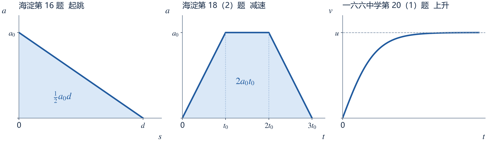
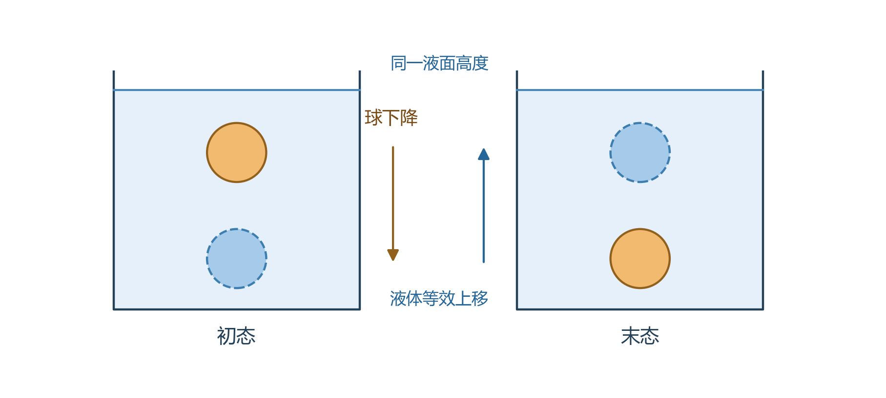

---
tags:
  - 物理
  - 高三
  - 每周作业
---

# 海淀期中补充练习｜答案解析

回到 [[海淀期中补充练习-学生版|学生版]]。

答题报告所示得分为第 3、5、10 题各 2/3，第 4 题 0/3，第 16 题 2/9，第 18 题 0/12。报告显示题目得分，无法据此还原具体选项或计算步骤。讲评时可请学生先说出自己的判断，再对照下方过程。

## 答案速查

- 振动和波 · 1 **ACD**，2 **C**。
- 摩擦临界 · 3 **D**，4 **BD**。
- 非匀变速 · 5 **$mgh$、$\frac12mv^2-mgh$；斜率由大变小并趋零；$\frac{\rho hv}{t}$**。6 **C**，7 **C**，8 **C**，9 **$55\ \mathrm{m/s}$**。第 10 题各问见下方。
- 落球与迁移 · 11 **C**。12 **负电，电荷量大小 $\frac{mgd}{U}(1+\frac{t_1}{t_2})$**。第 13 题各问见下方。
- 本次海淀原卷 · 第 3 题 **BC**，第 4 题 **CD**，第 5 题 **AC**，第 10 题 **BC**。第 16、18 题见下方原卷复盘。

## 一、振动和波

### 1. 上一届海淀期中第 3 题｜ACD

$S$ 到 $A$ 的传播时间是 $1.0\,\mathrm{s}$，所以波速为 $1.0\,\mathrm{m/s}$，A 对。波源振动图像在 $t=0$ 刚开始时向上，B 错。图中 $T=2.0\,\mathrm{s}$，振幅 $6\,\mathrm{cm}$。从 $t=0$ 到 $2.0\,\mathrm{s}$，$A$ 实际振动了 $1.0\,\mathrm{s}=T/2$，经历平衡位置到波峰再回到平衡位置，共走 $12\,\mathrm{cm}$，C 对。$A$ 比波源滞后半周期，两点在 $t=1.0\,\mathrm{s}$ 都经过平衡位置，$S$ 向下、$A$ 刚向上，D 对。

### 2. 昌平二模第 7 题｜C

图上 $0$ 到 $0.2\,\mathrm{s}$ 才完成一周，振幅为 $0.2\,\mathrm{m}$，A、B 错。第一处波峰出现在 $t=0.15\,\mathrm{s}$，此时波刚传到 $x=3.0\,\mathrm m$，故 $v_{\text{波}}=3.0/0.15=20\,\mathrm{m/s}$，C 对。波源从平衡位置向下起振，沿途质点接到的第一个运动也是向下，D 错。

## 二、摩擦临界

### 3. 丰台一模第 7 题｜D

弹簧推力 $400\times0.02=8\,\mathrm{N}$，A 错。弹簧推 $A$ 向左，地面对 $A$ 向右的静摩擦力为 $8\,\mathrm{N}$，上限是 $10\,\mathrm{N}$，B 错。对 $B$，弹力和拉力均向右，静摩擦力向左、大小 $8+2=10\,\mathrm{N}$，小于其上限 $12\,\mathrm{N}$，C 错。地面对两块木块的摩擦力合力向左，大小 $10-8=2\,\mathrm{N}$，D 对。

### 4. 上一届海淀期中第 6 题｜BD

箱和木块一起向右的加速度为 $a=F/(M+m)$。后壁对木块的水平支持力为 $N=ma$，竖直向上的静摩擦力为 $mg$。题给“恰能”意味着 $mg=\mu N$，所以 $\mu=(M+m)g/F$，A 错、B 对。减小 $F$ 后，摩擦上限低于 $mg$，木块开始下滑，摩擦力减小，C 错。箱子突然停下时，木块仍有水平向右的速度，离开后壁后在落到箱底前做平抛运动，D 对。

## 三、非匀变速运动

先看题目给了哪种变量关系，再选做法。

- 给 $a(v)$ 或阻力 $f(v)$，先写牛顿第二定律。用 $a=0$ 找终端速度，再看 $v$ 增大时 $a$ 如何变化。
- 给 $a(t)$，图像的有符号面积是 $\Delta v$。要算位移，还要看 $v(t)$ 的面积。
- 给 $a(s)$，图像的有符号面积是合力做功除以质量，即 $\Delta E_k/m=\tfrac12(v_2^2-v_1^2)$。可用单位确认，$\mathrm{m/s^2}\times\mathrm m=\mathrm{m^2/s^2}$。

### 5. 房山一模第 19 题｜雨滴

1. 重力做功 $W_G=mgh$。由 $W_G+W_f=\tfrac12mv^2$，得 $W_f=\tfrac12mv^2-mgh$。
2. 取向下为正，$ma=mg-kv^2$。$OA$ 段速度小，阻力很小，图线近似斜直线。$AB$ 段阻力逐渐增大，加速度即图线斜率逐渐减小。接近 $kv^2=mg$ 时，加速度趋于零，图线趋于水平，雨滴接近终端速度。
3. 设同一水平受雨面积为 $S$，时间 $t$ 内的雨水质量为 $\rho Sh$。无反弹，雨滴在接触方向上的动量变化量大小约为 $\rho Shv$，估算平均冲力 $F=\rho Shv/t$，故平均压强 $p=F/S=\rho hv/t$。

### 6. 上一届海淀期中第 9 题｜C

取竖直向上为正，用带符号的速度写 $a=-g-kv/m$。上升时 $v>0$、$a<-g$，最高点 $v=0$、$a=-g$，下降时 $v<0$、$a>-g$。因此 $v$ 随时间的图线有弯曲，落回时速率小于初速，A 错。B 把 $a=-g$ 画在落回时刻，B 错。按题定的零势能面，$E_p=mgy$，C 对。同一高度在上升和下降时各经过一次，第二次经过前阻力又消耗了一部分机械能，完整的 $E$–$y$ 图应有两支，D 错。

### 7. 丰台一模第 11 题｜C

刚接触弹簧的 $B$ 点弹力为零，小球继续加速。压缩量达到 $mg/k$ 时合力为零，速率最大，A 错。$mg/k$ 是接触点到平衡位置的距离，经过接触点时小球仍有速度，所以直到低端转折点的振幅大于 $mg/k$，B 错。从 $B$ 到 $C$，系统重力势能下降，在机械能守恒下，动能与弹性势能之和增加，C 对。从 $A$ 到 $C$，初末动能相等，所以横轴下方的面积 2 等于横轴上方的**全部**面积，含 $A$ 至 $B$ 的矩形和阴影 1，D 错。

### 8. 门头沟一模第 9 题｜C

$v(3)=\tfrac12\times2\times5+1\times5=10\,\mathrm{m/s}$，C 对。前 $2\,\mathrm{s}$ 加速度一直增大，A 错。加速度变化率单位为 $\mathrm{m/s^3}$，B 错。后 $1\,\mathrm{s}$ 加速度变化率为零，比前一段更小，按题意更舒适，D 错。

### 9. 东城一模第 20 题第（1）问｜$55\,\mathrm{m/s}$

当 $a=0.4\,\mathrm{m/s^2}$ 时，图中 $t=100\,\mathrm s$。车由静止启动，初速为零。前 $50\,\mathrm s$ 是矩形，后 $50\,\mathrm s$ 是梯形。
$$v=0.6\times50+\frac{0.6+0.4}{2}\times50=55\,\mathrm{m/s}.$$

### 10. 北京市第一六六中学第 20 题｜热气球

悬浮时浮力等于原质量的重力，$F_{\text{浮}}=mg$。题设体积和空气密度不变，因此后续的浮力仍为 $mg$。

**（1）** 设向上为正。减轻到 $0.9m$ 后，气球上升，阻力向下。
$$a=\frac{0.1mg-kv^2}{0.9m},\qquad u=\sqrt{\frac{0.1mg}{k}}.$$
$v$–$t$ 曲线从原点出发，初始斜率为 $g/9$，随后斜率逐渐减小，最后趋近水平线 $v=u$。和海淀第 5 题一样，找到 $a=0$ 就能定位终端速度。这里 $a$ 随速率的关系包含平方项。

**（2）①** 取地面为参考系，设气流水平方向向右。停风前热气球的水平速度始终为 $v_0$，相对气流仅向下运动。到平衡时，向上的浮力与阻力合计 $1.1mg$，所以竖直向下的终端速率也是 $u$。地面系速率为
$$v_1=\sqrt{v_0^2+u^2}=\sqrt{v_0^2+\frac{0.1mg}{k}}.$$
空气的作用包括浮力和阻力。由动能定理，
$$W+1.1mgh=\frac12(1.1m)(v_1^2-v_0^2),\qquad
W=\frac{11m^2g}{200k}-1.1mgh.$$

**（2）②** 气流停止的瞬间，气球的速度仍为 $(v_0,-u)$。再次平衡时，速度为 $(0,-u)$。由动量定理，空气总冲量加重力冲量等于动量变化。空气总冲量的水平分量为 $-1.1mv_0$，竖直分量为 $+1.1mgt$，故
$$I=1.1m\sqrt{v_0^2+g^2t^2}.$$

## 四、落球、浮力与空腔

### 11. 顺义一模第 14 题｜C

球完全浸没并下落时，重力向下，浮力和黏滞力向上。达到终端速度后，
$$(\rho-\rho_L)\frac43\pi r^3g=6\pi\eta rv_0,
\qquad \eta=\frac{2(\rho-\rho_L)gr^2}{9v_0},$$
C 对。用动能定理要算上黏滞阻力的功，A 错。液体的位置和运动也会变化，球减少的机械能有一部分传给液体，B 错。题图从液面处释放，刚释放且尚未浸入时 $a=g$。完全浸没后，用球的质量算加速度，分母为球密度 $\rho$，D 错。

### 等体积液体去哪儿了

把透明水槽里完全浸没的球想成水中的一个“球形缺口”。球从上方位置落到下方位置，上方腾出了球体积的空间，下方有同样体积的空间被球占据。比较初、末两个静态分布，可以把液体的变化看成**下方一球体积的液体换到了上方**。整个液面可以保持原高度，液体重心仍会升高。

设球下降 $h$，排液体积为 $V$。在均匀液体和两端静态位置的模型下，
$$\Delta E_{p,\text{液}}=\rho_{\text{液}}Vgh=F_{\text{浮}}h.$$
在原题的模型里，浮力对球做负功 $-F_{\text{浮}}h$，这一份机械能进入液体的重力势能。黏滞阻力与流动中的耗散有关。达到终端速度时，球的动能不变，重力势能仍在下降，液体也仍被置换。

**三个讲解例子**

- **球上浮，液体等效下移。** 把乒乓球完全按在水下再松手。球向上时，下方腾出的空间由上方液体补上。在完全浸没的这一段，浮力对球做正功，液体重力势能下降。
- **把岩石空腔填回去。** 石景山真题第 13 题里，完整岩体的引力可以算。用它减去被挖掉的那团岩石的引力，就得到有空腔时的引力。计算时也可写成“完整岩体加一团同形的负质量”，这里的负号表示减去贡献。
- **把带电绝缘体的空腔填回去。** 对于电荷均匀固定在体内的绝缘球，先想象把空腔填成同样密度的带电材料，再叠加同形、相反电荷密度的球体抵消填进去的部分。把电子放在空腔里，先用电场叠加求 $\vec E$，再用 $\vec F=-e\vec E$ 判受力。若改成金属导体，电荷会重新分布，需要按静电平衡处理。

### 12. 东城二模第 22 题第（1）问｜密立根油滴

这一题练的是同一个物体在两种终端状态下分别列平衡式。A 板在上且电势较高，板间电场向下。加电场后的油滴匀速向上，重力和阻力都向下，所以电场力向上，油滴带负电。

设相同的测量距离为 $\ell$，阻力大小为 $kv$，油滴电荷量的绝对值为 $|q|$。匀速下降时 $mg=k\ell/t_1$。匀速上升时 $|q|U/d=mg+k\ell/t_2$。消去 $k\ell$ 得
$$|q|=\frac{mgd}{U}\left(1+\frac{t_1}{t_2}\right).$$

### 13. 石景山一模第 22 题｜球形空腔

**（1）①** 被挖掉的小球半径为 $R/2$，质量为 $M/8$。在切点 $A$，完整大球与被挖小球各自产生的引力同向，均指向大球内部。剩余部分引力大小为
$$F_A=\frac{GMm}{R^2}-\frac{G(M/8)m}{(R/2)^2}=\frac{GMm}{2R^2}.$$

**（1）②** $B$ 距大球球心 $R/2$。在完整大球中，同心且半径大于 $R/2$ 的外层球壳对 $B$ 的引力为零。半径 $R/2$ 的同心球质量为 $M/8$，在 $B$ 处按球对自身表面质点的引力计算。被挖掉的小球在自身球心 $B$ 处的贡献为零，因此
$$F_B=\frac{G(M/8)m}{(R/2)^2}=\frac{GMm}{2R^2}.$$

**（2）①** 如果填回质量为 $\rho V$ 的球形岩石，$Q$ 点会增加一项指向球心的引力加速度，大小为 $G\rho V/(L^2+d^2)$。取向下为正，真实岩体缺少这一项，其竖直投影给出反常值
$$\Delta g=-\frac{G\rho Vd}{(L^2+d^2)^{3/2}}.$$
**（2）②** 例如对一片区域多点测量重力反常，利用异常的空间分布辅助定位地下空洞。

## 海淀原卷复盘

### 原卷第 3 题｜BC

波前从 $0$ 走到 $2.0\,\mathrm m$ 用时 $2.0\,\mathrm s$，波速 $1.0\,\mathrm{m/s}$。图上波长 $2.0\,\mathrm m$，周期 $2.0\,\mathrm s$。波前左侧已经向下偏，先动起来的质点都向下起振，A 错。波到 $P$ 的时刻是 $1.0\,\mathrm s$，到 $1.2\,\mathrm s$ 时 $P$ 刚振动 $0.2\,\mathrm s<T/4$，还在向下，B 对。$P$ 与 $S$ 相距半个波长，$t=3.0\,\mathrm s$ 时相位相反，C 对。到 $t=2.0\,\mathrm s$，$P$ 只振动了 $1.0\,\mathrm s$，恰好半周，D 错。

### 原卷第 4 题｜CD

设初始弹簧拉力为 $T$，以向右为正。两物块都静止时弹簧长度固定。对 $P$，地面的摩擦力为 $-T$，大小保持为 $T$，B 错。对 $Q$，静摩擦力为 $T-F$，随 $F$ 增大先向右减到零，再转为向左且大小增加，C 对。初始静止要求 $T\le\mu m_Qg<\mu m_Pg$。在弹簧尚未进一步伸长时，$P$ 的摩擦力达不到上限，因此 $Q$ 先动，A 错。$Q$ 右移拉长弹簧，$P$ 刚动时所受摩擦力为 $\mu m_Pg$，大于 $Q$ 所受滑动摩擦力 $\mu m_Qg$，D 对。

### 原卷第 5 题｜AC

把气球和重物作为整体，取向下为正，记恒定向下的驱动力为 $F_0$。若计入近似恒定的浮力，$F_0$ 是总重力减浮力。初始 $v=0$，阻力为零。
$$a=\frac{F_0-kv}{M},\qquad v_{\text{终}}=\frac{F_0}{k}.$$
随速度增大，$a$ 逐渐减到零，所以 $v$–$t$ 图从原点出发、斜率逐渐减小并趋水平，A 对，B、D 错。$a$–$v$ 图是斜率为 $-k/M$ 的直线，C 对。

### 原卷第 10 题｜BC

用 $V=\pi d^3/6$ 表示球的体积。终端速度处，重力减浮力等于修正后的黏滞阻力。
$$v_{\text{终}}=\frac{(\rho_{\text{球}}-\rho_{\text{液}})gd^2}{18\eta(1+kd/D)}.$$
忽略两项修正时，终端速度与 $d^2$ 成正比，A 错。按题设降温使 $\eta$ 增大，玻璃管变细使 $1+kd/D$ 增大，这两种改变都使终端速度变小，B、C 对。球向下，等体积液体等效向上，液体重力势能增加，D 错。

### 原卷第 16 题｜立定跳远

**（1）** $a$–$s$ 图是从 $(0,a_0)$ 到 $(d,0)$ 的线段。三角形面积为 $\tfrac12a_0d$。乘质量得到全过程的合力功，
$$\frac12mv_0^2=m\cdot\frac12a_0d,\qquad v_0=\sqrt{a_0d}.$$
**（2）** 离地后是斜抛运动。在题设坐标系内，
$$x=\frac{v_0}{\sqrt 2}t,\qquad y=\frac{v_0}{\sqrt 2}t-\frac12gt^2.$$
消去 $t$ 得 $y=x-gx^2/(a_0d)$。

### 原卷第 18 题第（2）问｜火箭减速

取向下为正，题给的 $a$ 是向上加速度的大小。$a$–$t$ 图由左三角形、中间矩形和右三角形组成。从初速减到零，速度减少量为图像的总面积，
$$v_i=\frac12 a_0t_0+a_0t_0+\frac12 a_0t_0=2a_0t_0.$$
加速度图前后对称，前 $t$ 内的速度减少量等于最后 $t$ 内的速度减少量。由于末速为零，故 $v(t)+v(3t_0-t)=v_i$。全程平均速度为 $v_i/2$，下降高度 $H=3a_0t_0^2$。按末态减初态计算机械能变化，
$$\Delta E=-\frac12Mv_i^2-MgH=-Ma_0t_0^2(2a_0+3g).$$

## 选题来源

补充题来自本地题库根目录 **F:\BaiduSyncdisk\上课资料\试卷\高三**，以下标注文件名和用于截图的页码。DOCX 页码按 Word 渲染计。题干、选项和配图直接截取，跨页的同一题拼接在一起。第 9、12 题摘取所标小问。

- 第 1、4、6 题 · 上学期目录《2025~2026学年北京海淀区高三上学期期中物理试卷1.pdf》，PDF 第 2、3、4–5 页，原题号 3、6、9。
- 第 2 题 · 北京市高考二模物理目录《精品解析：2025届北京市昌平区高三下学期二模物理试卷（原卷版）.docx》，第 2–3 页，原题号 7。
- 第 3 题 · 北京市高考一模物理目录《精品解析：2024届北京市丰台区高三下学期综合练习（一模）物理试题（原卷版）.docx》，第 2–3 页，原题号 7。
- 第 5 题 · 北京市高考一模物理目录《精品解析：2023届北京市房山区高三上学期一模物理试题（原卷版）.docx》，第 9 页，试卷卷首为“房山区2023年高三年级第一次模拟考试”，原题号 19。
- 第 7 题 · 北京市高考一模物理目录《精品解析：2025届北京市丰台区高三下学期一模检测物理试题（原卷版）.docx》，第 4–5 页，原题号 11。
- 第 8 题 · 北京市高考一模物理目录《精品解析：2023届北京市门头沟区高三下学期一模物理试题（原卷版）.docx》，第 3–4 页，原题号 9。
- 第 9 题 · 北京市高考一模物理目录《高三物理-东城区2025-2026学年第二学期期中练习（一模）.docx》，第 10 页，卷面原题号 20（1）。
- 第 10 题 · 高三根目录《26秋北京市第一六六中学高三物理试卷带图版.pdf》，第 9 页，原题号 20。这题与第 5 题同考速度相关的阻力。可用“热气球”核对是否就是口述的第 20 题。海淀原卷只到第 18 题。
- 第 11 题 · 北京市高考一模物理目录《精品解析：2026届北京市顺义区高三下学期统一测试物理试卷（原卷版）.docx》，第 4–5 页，原题号 14。
- 第 12 题 · 北京市高考二模物理目录《精品解析：北京市东城区2025-2026学年第二学期高三综合练习（二）物理试卷（原卷版）.docx》，第 9–10 页，原题号 22（1）。
- 第 13 题 · 北京市高考一模物理目录《精品解析：2026届北京市石景山区高三统一练习物理试题（原卷版）.docx》，第 9–10 页，原题号 22。
- 重做题 · 上学期目录《2026~2027学年北京海淀区高三上学期期中物理带图版.pdf》，第 2、2–3、3、5、9–10、11 页，原题号 3、4、5、10、16、18（2）。
