# 2026年北京市日坛中学高二上学期期中物理试卷 #h0

版本：答案解析版。原题与原配图保留；需核对的条件在对应题目解析中说明。

2026～2027学年度第一学期第一次阶段考试  
高二物理试卷　2026.10　考试时间：90 min  

# 一、单项选择题

3分/题×10题＝30分。

###### 1
> [!ti] *2026年北京市日坛中学高二上学期期中物理第1题*
> 有三个完全相同的金属 $A$、$B$、$C$。$A$ 带电量 $7Q$，$B$ 带电量 $-Q$，$C$ 不带电。将 $A$、$B$ 固定，然后让 $C$ 反复与 $A$、$B$ 接触，最后移走 $C$ 球。试问：$A$、$B$ 间的相互作用力变为原来的多少倍？
> > [!opts4]
> > - A. $\frac{4}{7}$
> > - B. $\frac{1}{2}$
> > - C. $\frac{1}{3}$
> > - D. $\frac{3}{4}$

### 答案

A（充分反复接触后）

### 解析

相同金属球接触后平分总电荷。充分反复接触后，三球电荷量趋于相等，由电荷守恒得每球带电 $2Q$。设两固定球相距 $r$，原来相互作用力大小为 $F=7kQ^2/r^2$，后来为 $F'=4kQ^2/r^2$，故 $F'/F=4/7$。原来相互吸引，后来相互排斥。这里按题目通常含义，将“反复接触”理解为达到电荷分配的极限；若只接触有限次且次数未给，不能得到唯一的精确比值。

###### 2
> [!ti] *2026年北京市日坛中学高二上学期期中物理第2题*
> 有两个带有等量异种电荷的小球，用绝缘细线相连后悬起，并置于水平方向匀强电场中。当两小球都处于平衡时其可能位置是图中的哪一个？
> ![[Pasted image 20261101114719.png]]
> > [!opts4]
>

### 答案

A

### 解析

将两球和连接细线看作整体，两球所受水平电场力等大反向，相互间的库仑力也是内力，均抵消。因此，上方悬线必须竖直。再单独分析下方正电小球：电场力向右，连接两球的细线拉力需有向左的分量，所以正球位于负球右下方，只有A图符合。
 

###### 3
> [!ti] *2026年北京市日坛中学高二上学期期中物理第3题*
> 如图所示，原来不带电的金属导体 $MN$，在其两端下面都悬挂有金属验电箔片，若使带负电的金属球 $A$ 靠近导体的 $M$ 端，可能看到的现象：
> %% 图位：原卷第1页，第3题金属导体与验电箔片图。 %%
> 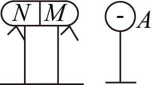
> > [!opts1]
> > - A. 只有 $M$ 端验电箔片张开，且 $M$ 端带正电
> > - B. 只有 $N$ 端验电箔片张开，且 $N$ 端带负电
> > - C. 两端的验电箔片都张开，且左端带负电，右端带正电
> > - D. 两端的验电箔片都张开，且两端都带正电或负电

### 答案

C

### 解析

带负电的球靠近右侧 $M$ 端时，导体中的自由电子被排斥到较远的 $N$ 端。于是右端 $M$ 缺少电子而带正电，左端 $N$ 多余电子而带负电。每端的两片金属箔带同种电荷，都因相互排斥而张开。

###### 4
> [!ti] *2026年北京市日坛中学高二上学期期中物理第4题*
> 如图，电子在电势差为 $U_1$ 的加速电场中由静止开始运动，然后射入电势差为 $U_2$ 的两块平行极板间的电场中，入射方向跟极板平行。整个装置处在真空中，重力可忽略。在满足电子能射出平行板区的条件下，下述四种情况中，一定能使电子的偏转距离变大的是：
> %% 图位：原卷第2页上方，第4题电子加速与偏转图；题干在第1页末。 %%
> 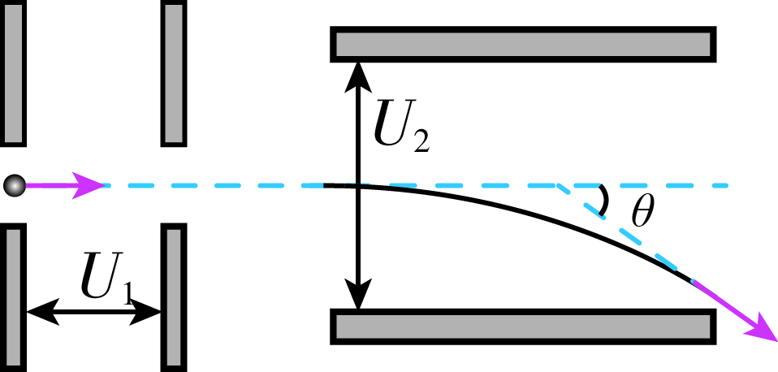
> > [!opts2]
> > - A. $U_1$ 变大、$U_2$ 变大
> > - B. $U_1$ 变小、$U_2$ 变大
> > - C. $U_1$ 变大、$U_2$ 变小
> > - D. $U_1$ 变小、$U_2$ 变小

### 答案

B

### 解析

设偏转板长度为 $l$、板间距为 $d$。加速过程有 $eU_1=\frac12mv_0^2$；偏转过程中 $a=eU_2/(md)$、$t=l/v_0$。因此
$$y=\frac12at^2=\frac{U_2l^2}{4dU_1}.$$
在装置尺寸不变且电子能射出的前提下，只有 $U_1$ 减小、$U_2$ 增大能保证 $y$ 增大。A、D的比值变化不确定，C使偏移减小。

###### 5
> [!ti] *2026年北京市日坛中学高二上学期期中物理第5题*
> 用电场线能很直观、很方便地比较电场中各点场强的强弱。如图甲是等量异种点电荷形成电场的电场线，图乙是场中的一些点，$O$ 是电荷连线的中点，$E$、$F$ 是连线中垂线上相对 $O$ 对称的两点，$B$、$C$ 和 $A$、$D$ 也相对 $O$ 对称。则下列选项中错误的是：
> %% 图位：原卷第2页，第5题甲、乙两图。 %%
> 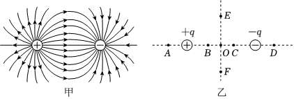
> > [!opts1]
> > - A. $B$、$C$ 两点场强大小和方向都相同
> > - B. $A$、$D$ 两点场强大小相等，方向相反
> > - C. $E$、$O$、$F$ 三点比较，$O$ 点场强最强
> > - D. $B$、$O$、$C$ 三点比较，$O$ 点场强最弱

### 答案

B

### 解析

本题选错误项。等量异种点电荷电场关于连线中点具有对称性：连线上相对 $O$ 对称的两点，合场强大小相等、方向相同。因此外侧 $A$、$D$ 两点的场强并非方向相反。两电荷之间的 $B$、$C$ 两点场强同向；中点 $O$ 在两电荷之间的连线上场强最小，而在中垂线上场强最大，A、C、D均正确。

###### 6
> [!ti] *2026年北京市日坛中学高二上学期期中物理第6题*
> （2005年期末海淀卷）一负电荷从电场中 $A$ 点由静止释放，只受电场力作用，沿电场线运动到 $B$ 点，它运动的速度—时间图象如图甲所示。则 $A$、$B$ 两点所在区域的电场线分布情况可能是图乙中的：
> %% 图位：原卷第2页，第6题图甲v-t图象、图乙A—D四幅选项图。 %%
> ![[Pasted image 20261101114806.png]]
> > [!opts4]
> > - A. 见图乙A
> > - B. 见图乙B
> > - C. 见图乙C
> > - D. 见图乙D

### 答案

C

### 解析

速度—时间图像的斜率表示加速度，图中斜率逐渐增大，说明粒子向 $B$ 运动时加速度增大，场强也逐渐增大。因此电场线沿 $A\to B$ 越来越密。粒子带负电，电场力沿 $A\to B$，电场线方向与之相反，指向 $A$，故选C。

###### 7
> [!ti] *2026年北京市日坛中学高二上学期期中物理第7题*
> 如图中虚线所示为静电场中的等势面1、2、3、4，相邻的等势面之间的电势差相等，其中等势面3的电势为0。一带正电的点电荷在静电力的作用下运动，经过 $a$、$b$ 点时的动能分别为 $26\ \mathrm{eV}$ 和 $5\ \mathrm{eV}$。当这一点电荷运动到某一位置，其电势能变为 $-8\ \mathrm{eV}$ 时，它的动能应为：
> %% 图位：原卷第2页，第7题等势面图。 %%
> 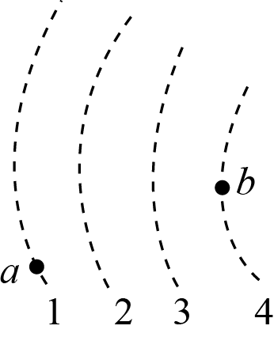
> > [!opts4]
> > - A. $8\ \mathrm{eV}$
> > - B. $13\ \mathrm{eV}$
> > - C. $20\ \mathrm{eV}$
> > - D. $34\ \mathrm{eV}$

### 答案

C，$20\ \mathrm{eV}$

### 解析

只有静电力做功，$E_k+E_p$ 守恒。从等势面1上的 $a$ 到等势面4上的 $b$，电势能增加 $26-5=21\ \mathrm{eV}$。三个相邻间隔均分这一变化，每间隔对应 $7\ \mathrm{eV}$。等势面3上电势能为0，故 $E_{pa}=-14\ \mathrm{eV}$，总能量为 $26-14=12\ \mathrm{eV}$。当 $E_p=-8\ \mathrm{eV}$ 时，$E_k=12-(-8)=20\ \mathrm{eV}$。

###### 8
> [!ti] *2026年北京市日坛中学高二上学期期中物理第8题*
> 如图所示，实线为方向未知的三条电场线，虚线分别为等势线1、2、3，已知 $MN=NQ$，$a$、$b$ 两带电粒子从等势线2上的 $O$ 点以相同的初速度飞出。仅在静电力作用下，两粒子的运动轨迹如图所示，则：
> %% 图位：原卷第3页上方，第8题轨迹图；题干在第2页末。 %%
> 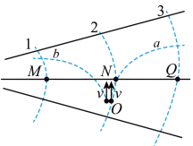
> > [!opts1]
> > - A. $a$ 一定带正电，$b$ 一定带负电
> > - B. $a$ 加速度减小，$b$ 加速度增大
> > - C. $MN$ 两点电势差 $|U_{MN}|$ 等于 $NQ$ 两点电势差 $|U_{NQ}|$
> > - D. $a$ 粒子到达等势线3的动能变化量比 $b$ 粒子到达等势线1的动能变化量小

### 答案

B

### 解析

根据轨迹可知，$a$ 向右进入电场线较疏的区域，$b$ 向左进入电场线较密的区域。对每个粒子都有 $a=|q|E/m$，故前者加速度减小，后者增大。由于未给出电场线箭头，不能确定电荷正负。左侧场强较大，等长的 $MN$、$NQ$ 对应 $|U_{MN}|>|U_{NQ}|$。此外，两粒子的电荷量大小未给，不能仅凭电势差比较它们的动能变化量。

###### 9
> [!ti] *2026年北京市日坛中学高二上学期期中物理第9题*
> （2018高考北京理综卷）研究与平行板电容器电容有关因素的实验装置如图所示。下列说法正确的是：
> %% 图位：原卷第3页，第9题平行板电容器与静电计实验图。 %%
> 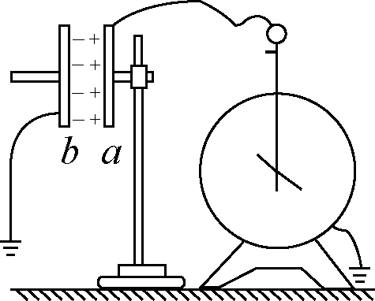
> > [!opts1]
> > - A. 实验前，只用带电玻璃棒与电容器 $a$ 板接触，能使电容器带电
> > - B. 实验中，只将电容器 $b$ 板向上平移，静电计指针的张角变小
> > - C. 实验中，只在极板间插入有机玻璃板，静电计指针的张角变大
> > - D. 实验中，只增加极板带电量，静电计指针的张角变大，表明电容增大

### 答案

A

### 解析

接地的 $b$ 板可与大地交换电荷，带电玻璃棒接触 $a$ 板后，两板形成带电电容器。研究结构因素时，$a$ 板电荷量保持不变，由 $C=\varepsilon S/d$、$U=Q/C$ 可知：将 $b$ 板上移，正对面积减小，$C$ 减小、$U$ 增大，指针张角变大；插入介质则 $C$ 增大、$U$ 减小。增加带电量会增大电压，却不改变电容器本身的电容。

###### 10
> [!ti] *2026年北京市日坛中学高二上学期期中物理第10题*
> 如图（1）所示，是某示波器原理图，在 $YY'$ 上加上恒定电压 $U_0$，$XX'$ 上不加电压时，亮点出现在 $Y$ 轴正向 $P$ 点（如图3），都不加电压时亮点在正中央（零格上）。如果在 $XX'$ 和 $YY'$ 分别加上如图2所示的电压，那么示波器屏幕上看到的：
> %% 图位：原卷第3页，第10题图1示波器原理图、图2电压图象、图3亮点P、图4甲乙丙丁四幅图；选项接第4页。 %%
> 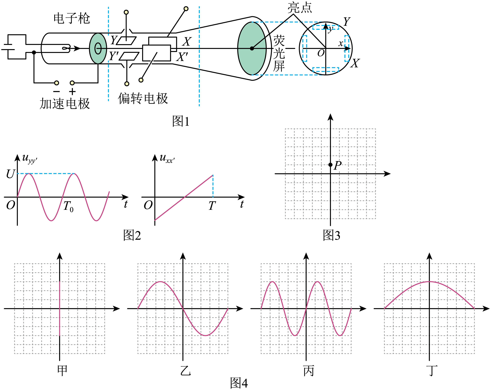
> > [!opts1]
> > - A. 如果 $U=\sqrt{3}U_0$ 时，图4中的甲
> > - B. 如果 $T=T_0$，且 $U=3U_0$ 时，图4中的乙
> > - C. 如果 $T=\frac{1}{2}T_0$，且 $U=3U_0$ 时，图4中的丙
> > - D. 如果 $T=2T_0$，且 $U=3U_0$ 时，图4中的丁

### 答案

B

### 解析

示波器的水平位移与 $XX'$ 间电压成正比，竖直位移与 $YY'$ 间电压成正比。线性扫描将时间等比例映射为横坐标。若扫描时间 $T=T_0$，屏幕上正好显示一个完整周期的正弦曲线；$U=3U_0$ 时，竖直振幅是 $OP$ 的3倍，对应图乙。$T=T_0/2$ 应显示半个周期，$T=2T_0$ 应显示两个周期，分别不符合C、D给出的图形。

# 二、多项选择题

3分/题×4题＝12分。

###### 11
> [!ti] *2026年北京市日坛中学高二上学期期中物理第11题*
> （多选）如图所示的静电实验（虚线框为金属网）能使左边验电器的金属箔张开的是（　　）
> ![[Pasted image 20261101114951.png|500]]
> > [!opts4]
>

### 答案

AC

### 解析

A中，用试电小球接触带电导体外表面，可取到电荷，再使左边验电器带电，箔片张开。B中，静电平衡时空腔内部没有电荷，接触内壁不能按该操作取到电荷。C中导线连通两验电器，发生电荷转移，左边箔片张开。D中金属网起静电屏蔽作用，外部带电球不能使网内验电器按图示方式张开。
 

###### 12
> [!ti] *2026年北京市日坛中学高二上学期期中物理第12题*
> （多选）如图所示，将左边的铜导线与右边的铝导线连接起来，已知铝导线的横截面积是铜导线横截面积的两倍，在铜导线上取一个截面 $A$，在铝导线上取一个截面 $B$，若在1秒内垂直地通过它们的电子数相等，那么，通过这两个截面的：
> %% 图位：原卷第4页，第12题铜、铝导线截面图。 %%
> 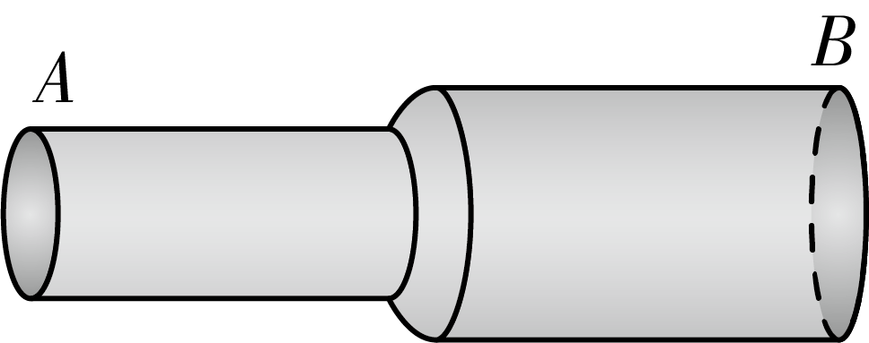
> > [!opts1]
> > - A. 电流相等
> > - B. 电流不相等
> > - C. 自由电子定向移动的速率相等
> > - D. 自由电子定向移动的速率不相等

### 答案

待教师核对（A确定；D需要载流子数密度条件）

### 解析

相同时间通过两截面的电子数相同，所以 $I=Ne/t$ 相等，A正确、B错误。漂移速率必须用 $I=neSv$ 判断，其中 $n$ 是单位体积的自由电子数。由 $S_{\mathrm{Al}}=2S_{\mathrm{Cu}}$ 得
$$\frac{v_{\mathrm{Cu}}}{v_{\mathrm{Al}}}=\frac{2n_{\mathrm{Al}}}{n_{\mathrm{Cu}}}.$$
铜、铝是不同材料，题中没有给出二者的自由电子数密度，不能仅根据截面积不同严格推出速率不同。若补充 $n_{\mathrm{Cu}}\ne2n_{\mathrm{Al}}$，则D成立，答案为AD；若满足等号则C成立。课堂若按常见预设采用AD，应补充所需材料条件，不宜把“不同截面必有不同漂移速率”作为一般规律。

###### 13
> [!ti] *2026年北京市日坛中学高二上学期期中物理第13题*
> （多选）如图，竖直面内固定的均匀带电圆环半径为 $R$，带电量为 $+Q$。在圆环的最高点用绝缘线悬挂一质量为 $m$、带电量为 $q$ 的小球（大小不计），小球在垂直圆环平面的对称轴上处于平衡状态，小球到圆环中心 $O$ 的距离为 $R$，已知静电力常量为 $k$，重力加速度为 $g$，则小球所处位置的电场强度的大小：
> %% 图位：原卷第4页下方，第13题带电圆环与悬挂小球图；选项在第5页上方。 %%
> 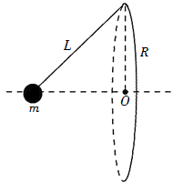
> > [!opts4]
> > - A. $\frac{mg}{q}$
> > - B. $\frac{\sqrt{2}mg}{2q}$
> > - C. $k\frac{Q}{R^2}$
> > - D. $\frac{\sqrt{2}kQ}{4R^2}$

### 答案

AD

### 解析

由几何关系，细线与竖直方向成 $45^\circ$。圆环在轴线上的场强水平指向远离圆环的一侧，小球受力平衡要求电场力也向外，因而小球带正电。平衡条件给出 $qE=mg$，即 $E=mg/q$。

再把圆环分成许多电荷元，各元到小球的距离均为 $\sqrt2R$，垂直于轴线的分量相互抵消，轴向分量相加：
$$E=\frac{kQ}{(\sqrt2R)^2}\cos45^\circ=\frac{\sqrt2kQ}{4R^2}.$$
故A、D是同一场强的两种表达式。

###### 14
> [!ti] *2026年北京市日坛中学高二上学期期中物理第14题*
> （多选）如图所示，两块水平放置的平行金属板 $M$、$N$，下极板 $N$ 接地。现将其与理想二极管串联，与静电计并联，初始电容器所带电量为零。$R_0$ 为定值电阻，$R_1$ 和 $R_2$ 为电阻箱，闭合开关 $S$ 稳定后，一带电油滴恰好静止于两板间的 $P$ 点，则下列说法正确的是：
> %% 图位：原卷第5页，第14题平行板、电阻箱、二极管与静电计电路图。 %%
> 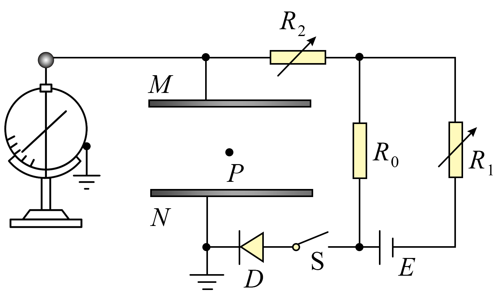
> > [!opts1]
> > - A. 断开开关 $S$，$M$ 板稍微上移，静电计指针偏角变大
> > - B. 断开开关 $S$，$N$ 板稍微下移，带电油滴的电势能增大
> > - C. 保持开关 $S$ 闭合，增大 $R_1$ 阻值，带电油滴仍然静止不动
> > - D. 保持开关 $S$ 闭合，增大 $R_2$ 阻值，平行板电容器的带电荷量减小

### 答案

AC

### 解析

由电源极性及二极管方向，充电后上板 $M$ 带负电，场强竖直向上；静止油滴带正电。

断开 $S$ 后，电荷量不变。上移 $M$ 使间距增大，$C$ 减小，$|U|=Q/C$ 增大，静电计偏角增大，A正确。下移接地的 $N$ 板时，场强 $E=Q/(\varepsilon S)$ 不变，油滴距零电势板的高度增加，$\varphi_P=-Eh$ 更低，正油滴电势能减小，B错误。

闭合 $S$，增大 $R_1$ 会使外电路要求的电容电压大小减小，但二极管阻止电容器反向放电，因此原有电荷量及场强保持不变，油滴仍静止，C正确。稳定后 $R_2$ 支路无电流，仅改变 $R_2$ 不改变稳定电容电压，D错误。

# 三、实验题

共18分。

###### 15
> [!ti] *2026年北京市日坛中学高二上学期期中物理第15题*
> （6分）处于强电场中的空气分子会被电离为电子和正离子，利用此原理可以进行静电除尘。如图所示是一个用来研究静电除尘的实验装置，铝板与手摇起电机的正极相连，缝被针与手摇起电机的负极相连，在铝板和缝被针中间放置点燃的蚊香。转动手摇起电机，蚊香放出的烟雾会被电极吸附，停止转动手摇起电机，蚊香的烟雾又会袅袅上升。关于这个现象，
>
> %% 图位：原卷第5页，第15题静电除尘实验图。 %%
>
> （1）烟尘因为带________（选填：正电或负电）而被吸附到缝被针上。
>
> （2）同一烟尘颗粒在被吸附过程中离铝板越近速度________（选填：越小或越大）。
>
> （3）同一烟尘颗粒在被吸附过程中如果带电荷量不变，离铝板越近则加速度________（选填：越小或越大）。
>
> %% 待核：第（1）问印刷文字为“缝被针上”，原照片手写改为“铝板上”。此处保留印刷原文；与后两问的“离铝板越近”表述存在疑点，使用前请核对。 %%
> 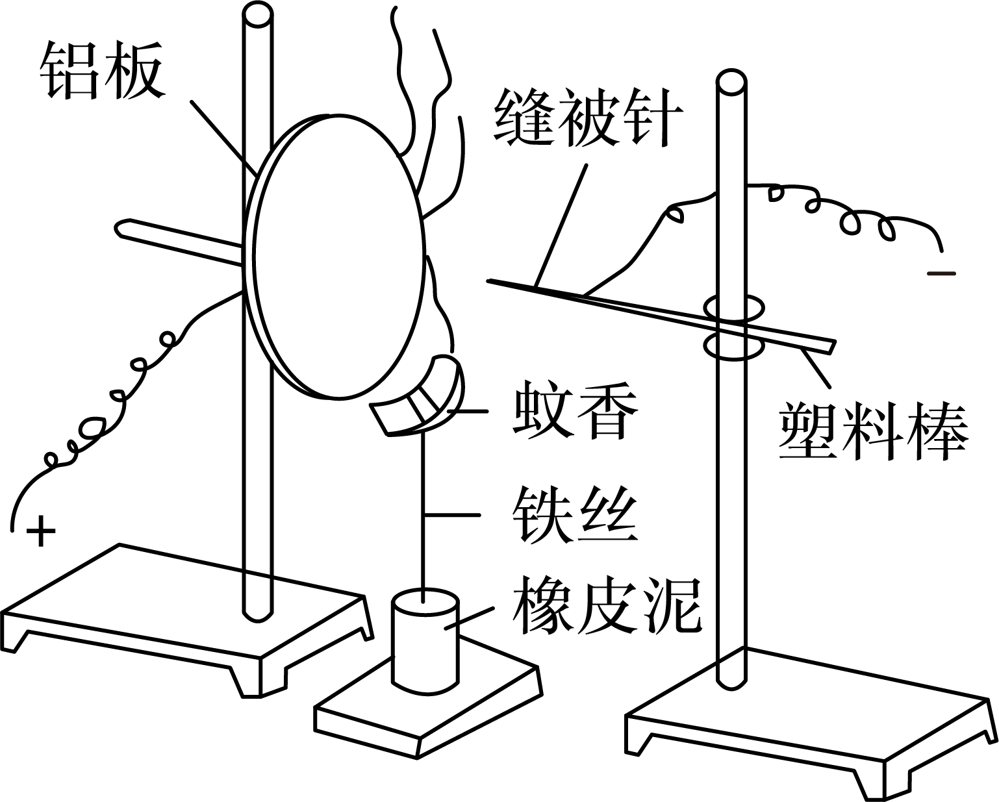

### 答案

待教师核对（吸附电极表述冲突）

### 解析

第（1）问印刷为吸附到接负极的“缝被针上”，按此文字，应填“正电”。原照片手写将其改成“铝板上”，若采用这一修订，则应填“负电”。原题保持不改，两种表述不能混作同一答案。

第（2）、（3）问通常意在研究负烟尘向正铝板运动：电场力做正功，速度越来越大，故（2）填“越大”；尖针附近场线密、铝板附近场线疏，越接近铝板场强越小，在电荷量不变时 $a=|q|E/m$ 越小，故（3）填“越小”。这两个结论采用忽略烟尘阻力等影响的题设简化模型。建议先统一第（1）问的目标电极，再用于学生练习。

###### 16
> [!ti] *2026年北京市日坛中学高二上学期期中物理第16题*
> （12分）如图甲所示是观察电容器的充、放电现象的实验装置。电源输出电压恒为 $8\ \mathrm{V}$。$S$ 是单刀双掷开关，$G$ 为灵敏电流计，$C$ 为平行板电容器。
>
> （1）当开关 $S$ 接________时（选填“1”或“2”），平行板电容器充电。电容器放电，流经 $G$ 表的电流方向与充电时________（选填“相同”或“相反”）。
>
> （2）将 $G$ 表换成电流传感器，电容器充电完毕后再放电，其放电电流随时间变化图象如图乙所示，已知如图所围的面积约为49个方格，可算出电容器的电容为________。
>
> （3）在电容器放电实验中，接不同的电阻放电，图丙中放电电流的 $I-t$ 图线的 $a$、$b$、$c$ 三条曲线中对应电阻最大的一条是________（选填“a”、“b”或“c”）。
>
> %% 图位：原卷第6页，第16题甲电路图、乙放电I-t方格图、丙三条放电曲线图。 %%
> ![[Pasted image 20261101115131.png|450]]

### 答案

（1）1；相反。（2）$4.9\times10^{-4}\ \mathrm{F}$。（3）a。

### 解析

开关接1时，电源给电容器充电；接2时电容器通过电阻放电，同一支路电流方向反转。

$I-t$ 图像与时间轴围成的面积表示电荷量。每小格为 $0.4\ \mathrm{s}\times0.2\ \mathrm{mA}$，所以
$$Q=49\times0.4\times0.2\times10^{-3}=3.92\times10^{-3}\ \mathrm{C},\qquad C=\frac{Q}{8}=4.9\times10^{-4}\ \mathrm{F}.$$
各次初始电压相同，$I_0=U_0/R$；初始电流最小的a曲线对应最大电阻。不能仅凭某一较晚时刻的电流大小比较电阻。

# 四、计算题

共40分。

###### 17
> [!ti] *2026年北京市日坛中学高二上学期期中物理第17题*
> （8分）如图所示，光滑绝缘细杆竖直放置，它与以正电荷 $Q$ 为圆心的某圆交于 $B$、$C$ 两点，质量为 $m$、带电荷量为 $-q$ 的有孔小球从杆上 $A$ 点无初速度下滑，已知 $q\ll Q$，$AB=h$，小球滑到 $B$ 点时的速度大小为 $\sqrt{3gh}$，求：
>
> （1）小球由 $A$ 到 $B$ 的过程中静电力做的功；
>
> （2）$A$、$C$ 两点间的电势差。
>
> %% 图位：原卷第6页，第17题点电荷、圆与竖直细杆图。 %%
> 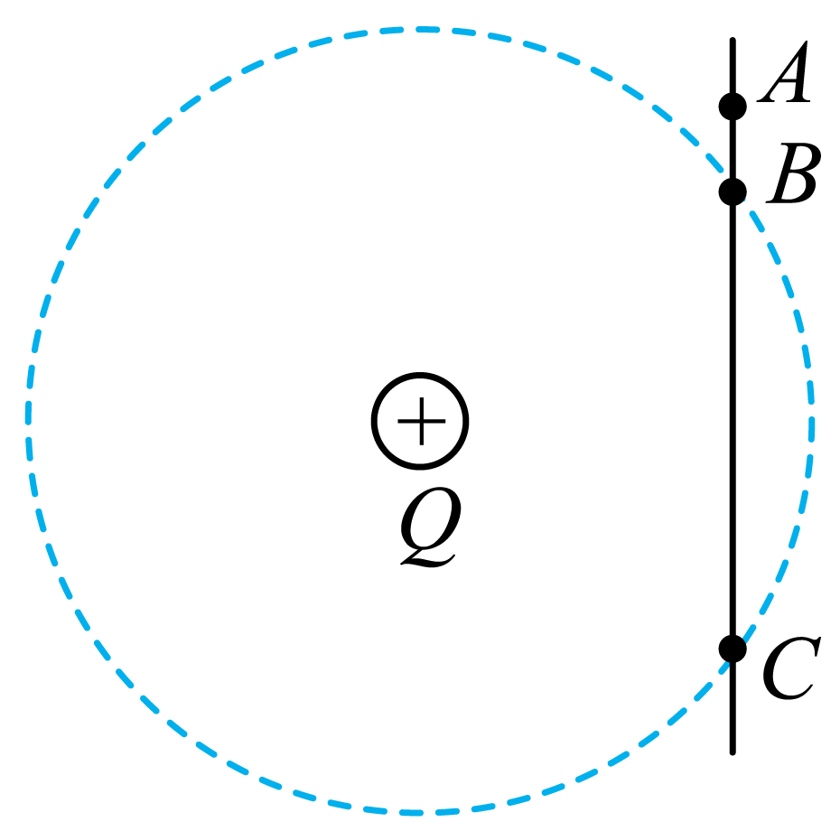

### 答案

（1）$\frac12mgh$。（2）$U_{AC}=-\frac{mgh}{2q}$。

### 解析

小球从 $A$ 到 $B$，支持力不做功，由动能定理
$$mgh+W_{AB}=\frac12m(3gh),\qquad W_{AB}=\frac12mgh.$$
$B$、$C$ 到点电荷 $Q$ 的距离相同，故二者等势。注意小球电荷量为 $-q$，因此
$$W_{AB}=(-q)U_{AB},\qquad U_{AC}=U_{AB}=-\frac{mgh}{2q}.$$
电场力做正功不意味着电势降低：对负电荷，本题恰是沿电势升高的方向运动。

###### 18
> [!ti] *2026年北京市日坛中学高二上学期期中物理第18题*
> （9分）如图所示，用两根不可伸长的绝缘细线将 $A$、$B$ 两带电小球悬挂于 $O$ 点，电荷量分别为 $+9q$、$+q$，质量分别记为 $m_1$ 和 $m_2$，静止时 $A$、$B$ 两球处于同一水平线上，其中 $O$ 点到 $B$ 球的距离 $OB=L$，$\angle AOB=90^\circ$，$\angle OAB=30^\circ$，带电小球均可视为点电荷，静电力常量为 $k$，重力加速度为 $g$。求：
>
> （1）$A$、$B$ 间的库仑力大小；
>
> （2）$A$、$B$ 两球的质量 $m_1$ 和 $m_2$ 之比；
>
> （3）$A$、$B$ 连线上且在 $O$ 点的正下方 $C$ 点的电场强度大小。
>
> %% 图位：原卷第7页上方，第18题双球悬挂图。 %%
> 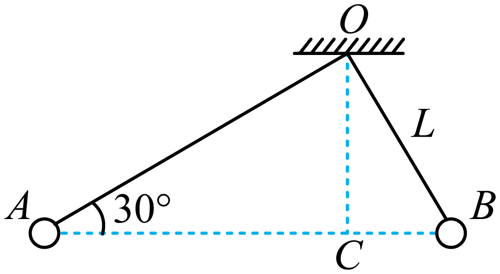

### 答案

（1）$\frac{9kq^2}{4L^2}$。（2）$m_1:m_2=1:3$。（3）0。

### 解析

直角三角形 $AOB$ 中，$AB=OB/\sin30^\circ=2L$，故库仑力为 $F=9kq^2/(4L^2)$。

分别对两球列平衡方程。细线与水平方向的夹角分别为 $30^\circ$、$60^\circ$，所以 $m_1g=F\tan30^\circ$，$m_2g=F\tan60^\circ$，得 $m_1/m_2=1/3$。

由直角三角形的投影关系，$AC=3L/2$、$BC=L/2$。在 $C$ 点，两正电荷的场强方向相反，大小分别为
$$E_A=\frac{9kq}{(3L/2)^2}=\frac{4kq}{L^2},\qquad E_B=\frac{kq}{(L/2)^2}=\frac{4kq}{L^2}.$$
二者相互抵消，合场强为0。

###### 19
> [!ti] *2026年北京市日坛中学高二上学期期中物理第19题*
> （11分）如图所示，在高 $H=2.5\ \mathrm{m}$ 的光滑、绝缘水平高台边缘，静置一个小物块 $B$，另一带电小物块 $A$ 以初速度 $v_0=10.0\ \mathrm{m/s}$ 向 $B$ 运动，$A$、$B$ 的质量均为 $m=1.0\times10^{-3}\ \mathrm{kg}$。$A$ 与 $B$ 相碰撞后，两物块立即粘在一起，并从台上飞出后落在水平地面上，落地点距高台边缘的水平距离 $L=5.0\ \mathrm{m}$。已知此空间中存在方向竖直向上的匀强电场，场强大小 $E=1.0\times10^3\ \mathrm{N/C}$（图中未画出）。假设 $A$ 在滑行过程和碰撞过程中电量保持不变，不计空气阻力，$g=10\ \mathrm{m/s^2}$。求：
>
> （1）$A$、$B$ 碰撞过程中损失的机械能。
>
> （2）试说明 $A$ 带电的电性，并求出其所带电荷 $q$ 的大小。
>
> （3）在 $A$、$B$ 的飞行过程中，电场力对它做的功。
>
> %% 图位：原卷第7页下方，第19题高台上A、B两物块示意图。 %%
> 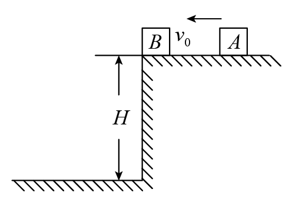

### 答案

（1）$2.5\times10^{-2}\ \mathrm{J}$。（2）正电；$1.0\times10^{-5}\ \mathrm{C}$。（3）$-2.5\times10^{-2}\ \mathrm{J}$。

### 解析

碰撞时水平方向动量守恒，$mv_0=2mv$，解得 $v=5.0\ \mathrm{m/s}$。损失的机械能为
$$\Delta E_{\text{损}}=\frac12mv_0^2-\frac12(2m)v^2=2.5\times10^{-2}\ \mathrm{J}.$$
飞行时间 $t=L/v=1.0\ \mathrm{s}$，由 $H=at^2/2$ 得向下加速度 $a=5.0\ \mathrm{m/s^2}<g$，所以电场力向上，$A$ 带正电。
$$2mg-qE=2ma\quad\Rightarrow\quad q=\frac{2m(g-a)}{E}=1.0\times10^{-5}\ \mathrm{C}.$$
下落时电场力与位移相反，$W_E=-qEH=-2.5\times10^{-2}\ \mathrm{J}$。

###### 20
> [!ti] *2026年北京市日坛中学高二上学期期中物理第20题*
> （12分）宏观与微观相结合是科学研究的重要方法。
>
> （1）微观世界与宏观世界往往存在奇妙的相似性。根据卢瑟福氢原子模型，因为原子核的质量远大于电子质量，可以忽略原子核的运动，形成类似天文学中的恒星—行星系统，核外电子与原子核依靠库仑力作用使电子绕原子核做匀速圆周运动。已知核外电子的质量为 $m$，氢原子核的质量为 $M$，相距为 $r$，静电力常量为 $k$，电子和氢原子核的电荷量大小均为 $e$，求核外电子的动能 $E_k$。
>
> （2）对于同一物理问题，常常可以从宏观与微观两个不同角度进行研究，找出其内在联系，从而更加深刻地理解其物理本质。
>
> a. 如图所示的一段柱状金属导体，横截面积为 $S$，单位体积内的自由电子数为 $n$，电子电荷量大小为 $e$，导体两端加电压后，自由电子定向移动的平均速率为 $v$。请推导：导体中的电流 $I$ 与 $v$ 之间的关系式。
>
> %% 图位：原卷第8页，第20题（2）a柱状导体、电流与自由电子运动方向图。 %%
>
> b. 在金属导体中，除了有大量的自由电子外，还有失去部分核外电子的剩余部分（原子实）。自由电子在电场力作用下做定向运动的过程中，不断地与原子实碰撞，形成对电子定向运动的阻碍作用，这是电阻产生的根本原因。假设电子与原子实每次碰撞后速度都变为0，在两次碰撞的时间间隔内做初速为0的匀加速直线运动。不计电子与原子实除碰撞外的其它作用力，忽略电子之间的相互作用。已知导体的长度为 $L$，横截面积为 $S$，单位体积内的自由电子数为 $n$，电子的质量为 $m$，电荷量大小为 $e$，电子与原子实两次碰撞的时间间隔为 $\Delta t$。请推导导体电阻的表达式；
>
> c. （选做，+5分）请解释为什么金属导体的电阻率随温度的升高而增大？
> 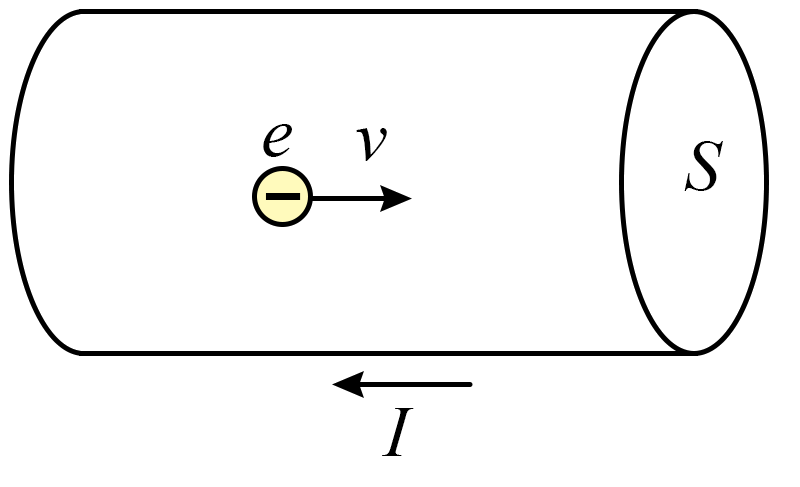

### 答案

（1）$E_k=\frac{ke^2}{2r}$。（2）a. $I=neSv$；b. $R=\frac{2mL}{ne^2S\Delta t}$；c. 温度升高，碰撞更频繁，平均定向运动受阻更强，电阻率增大。

### 解析

（1）由库仑力提供向心力，$ke^2/r^2=mv^2/r$，所以 $E_k=mv^2/2=ke^2/(2r)$。忽略原子核运动后，结果不含核质量 $M$。

（2）a. 时间 $t$ 内通过截面的自由电子来自体积 $Svt$，其电荷量大小为 $Q=neSvt$，故 $I=Q/t=neSv$；电子运动方向与电流方向相反。

b. 设两端电压为 $U$，电子加速度大小 $a=eU/(mL)$。每次碰撞后定向速度清零，在固定间隔 $\Delta t$ 内从0匀加速，平均定向速率为
$$\bar v=\frac12a\Delta t=\frac{eU\Delta t}{2mL}.$$
代入电流表达式：$I=ne^2SU\Delta t/(2mL)$，故 $R=U/I=2mL/(ne^2S\Delta t)$。注意这里必须使用平均速率，不能使用碰撞前的最大速率。

c. 在这个模型下，$\rho=RS/L=2m/(ne^2\Delta t)$。温度升高时原子实的热振动加剧，使电子碰撞更频繁，$\Delta t$ 减小，因而电阻率增大。

