# 北京市第一七一中学教育集团2026—2027学年度第一学期高二物理期中调研试卷 #h0

版本：答案解析版。原题与原配图保留；需核对的条件在对应题目解析中说明。

本试卷共9页，100分。考试时长90分钟。考生务必将答案答在答题卡上，在试卷上作答无效。考试结束后，将本试卷和答题卡一并交回。

# 第一部分

本部分共14题，每题3分，共42分。在每题列出的四个选项中，选出最符合题目要求的一项。

###### 1
> [!ti] *2026年北京市第一七一中学高二上学期期中物理第1题*
> 下列说法正确的是
> > [!opts1]
> > - A. 公式 $E=\frac{F}{q}$ 适用于匀强电场
> > - B. 物体所带的电荷量的数值可以为任意实数
> > - C. 电场中某点的电场强度方向即试探电荷在该点的受力方向
> > - D. 单位时间通过导体某一截面的自由电荷的数量叫做电流

### 答案

A

### 解析

$E=F/q$ 是电场强度的定义式，对匀强、非匀强电场都适用，所以“适用于匀强电场”正确。物体电荷量是元电荷的整数倍，不能任意取实数。场强方向规定为正试探电荷的受力方向，C未限定电性。电流是单位时间通过截面的电荷量，而非自由电荷的个数，D错误。

###### 2
> [!ti] *2026年北京市第一七一中学高二上学期期中物理第2题*
> 用控制变量法，可以研究影响平行板电容器电容的因素（如下图）。设两极板正对面积为 $S$，极板间的距离为 $d$，静电计指针偏角为 $\theta$。实验中，极板所带电荷量不变，若
> %% 图位：原卷第1页，第2题平行板电容器与静电计图。 %%
> 
> > [!opts1]
> > - A. 只增大 $d$，则 $\theta$ 不变
> > - B. 只增大 $d$，则 $\theta$ 变小
> > - C. 只插入介质，则 $\theta$ 变小
> > - D. 只减小 $S$，则 $\theta$ 变小

### 答案

C

### 解析

极板电荷量保持不变，$U=Q/C$，静电计张角反映电压大小。平行板电容器有 $C=\varepsilon S/d$。增大 $d$ 或减小 $S$ 均使 $C$ 减小、$U$ 增大，张角增大；插入电介质使 $C$ 增大、$U$ 减小，张角变小，故选C。

###### 3
> [!ti] *2026年北京市第一七一中学高二上学期期中物理第3题*
> 如图所示为某静电除尘装置的电场线分布示意图。图中虚线是某一带电的烟尘微粒（不计重力）在静电力作用下向集尘板迁移的轨迹。$a$、$b$ 是轨迹上的两点，对该烟尘微粒，下列说法正确的是
> %% 图位：原卷第1页，第3题静电除尘电场线及微粒轨迹图。 %%
> 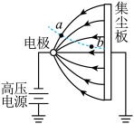
> > [!opts1]
> > - A. 烟尘微粒带正电
> > - B. $a$ 点的场强小于 $b$ 点场强
> > - C. 烟尘微粒在 $a$ 点的电势能小于在 $b$ 点的电势能
> > - D. 烟尘微粒在 $a$ 点的加速度大于在 $b$ 点的加速度

### 答案

D

### 解析

图中针状负电极附近电场线密，集尘板附近电场线疏，故 $E_a>E_b$。烟尘向集尘板迁移，所受力与电场方向相反，烟尘带负电。由 $a=|q|E/m$ 得 $a_a>a_b$，D正确。迁移过程中电场力做正功，电势能减小，故 $E_{pa}>E_{pb}$，C错误。

###### 4
> [!ti] *2026年北京市第一七一中学高二上学期期中物理第4题*
> 如图，$a$、$b$、$c$、$d$、$e$、$f$ 是以 $O$ 为球心的球面上的点，平面 $aecf$ 与平面 $bedf$ 垂直，分别在 $b$、$d$ 两点放上等量异种点电荷，下列说法正确的是
> %% 图位：原卷第1页，第4题球面、两垂直平面及正负点电荷图。 %%
> 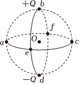
> > [!opts1]
> > - A. $a$、$c$、$e$、$f$ 四点电势不同
> > - B. $a$、$c$、$e$、$f$ 四点电场强度相同
> > - C. 若电子沿直线 $a\to O\to c$ 运动，该过程中电子受到的电场力大小不变
> > - D. 若电子沿圆弧 $a\to e\to c$ 运动，该过程中电子的电势能增大

### 答案

B

### 解析

$a$、$c$、$e$、$f$ 均位于两电荷连线的中垂面上，且到两电荷的距离相同。两电荷产生的电势互相抵消，这四点电势相同；场强的横向分量抵消，沿 $b\to d$ 的分量相加，四点场强大小、方向均相同。

沿 $a\to O\to c$，到两电荷的距离先减小后增大，合场强先增大后减小，力并非恒定。沿圆弧 $a\to e\to c$ 电势始终不变，电子电势能也不变。

###### 5
> [!ti] *2026年北京市第一七一中学高二上学期期中物理第5题*
> 将直流电源 $E$、电阻 $R$、平行板电容器 $C$ 和开关 $S$ 连接成如图所示的电路。闭合开关 $S$，电路达到稳定状态。下列说法正确的是
> %% 图位：原卷第2页，第5题电容器充电电路。 %%
> 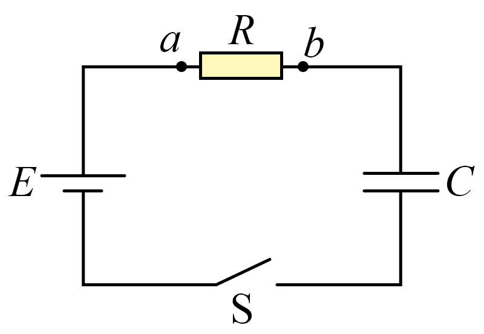
> > [!opts1]
> > - A. 此过程中电源输出的能量等于电容器存储的电场能
> > - B. 若增大电容器两极板间距离，有从 $b$ 到 $a$ 的电流流过电阻
> > - C. 若断开开关，减小电容器两极板间距离，极板间电场强度增大
> > - D. 若断开开关，在电容器两极板间插入电介质后，两极板间电势差增大

### 答案

B

### 解析

闭合开关并稳定后，两板电压等于电源电压。增大板距使 $C$ 减小，$Q=CU$ 减小，电容器向外放电，图中电阻内电流从 $b$ 到 $a$。

若从不带电状态充电，电源输出能量为 $CU^2$，电容储能为 $CU^2/2$，还有一半转化为电阻内能，A错误。断开后 $Q$ 不变，$E=Q/(\varepsilon S)$ 与板距无关，C错误；插入介质使 $C$ 增大，$U=Q/C$ 减小，D错误。

###### 6
> [!ti] *2026年北京市第一七一中学高二上学期期中物理第6题*
> 人体中的脂肪因缺乏自由电子或离子，不容易导电，某脂肪测量仪的工作原理是根据人体等效电阻阻值的大小来判断脂肪所占比例的高低（简化电路如图所示，其中定值电阻 $R_1$ 与人体等效电阻 $R_2$ 的阻值相差不大）。下列说法正确的是
> %% 图位：原卷第2页，第6题脂肪测量仪简化电路。 %%
> 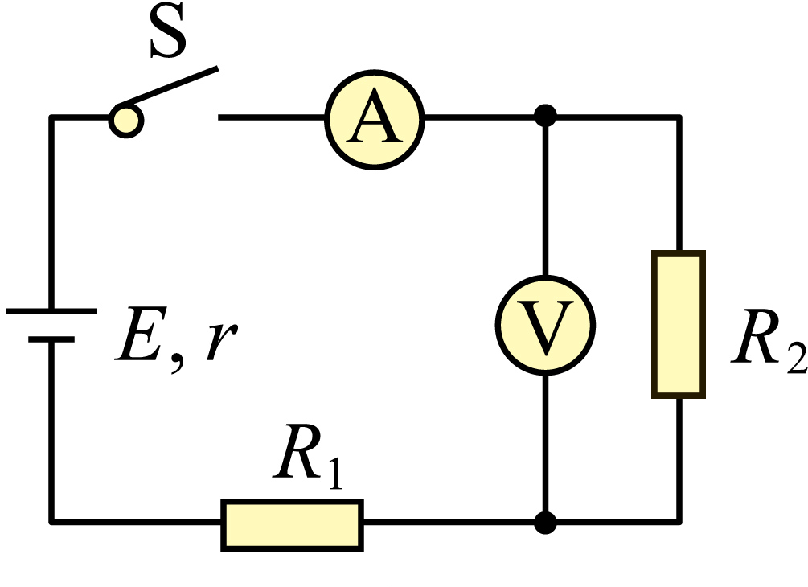
> > [!opts1]
> > - A. 脂肪所占比例高者对应的电流表的示数较小
> > - B. 脂肪所占比例低者对应的电压表的示数较大
> > - C. 脂肪所占比例低者对应的电源内阻消耗的功率较小
> > - D. 脂肪所占比例高者对应的电源消耗的总功率较大

### 答案

A

### 解析

将电表视为理想电表，人体等效电阻 $R_2$ 与 $R_1$、电源内阻 $r$ 串联：
$$I=\frac{E}{R_1+R_2+r},\qquad U_2=\frac{ER_2}{R_1+R_2+r}.$$
脂肪比例高，$R_2$ 较大，电流较小，A正确；脂肪比例低，$R_2$ 较小，电压表示数也较小，B错误。低脂肪时电流较大，内阻发热功率 $I^2r$ 较大，C错误；高脂肪时总功率 $EI$ 较小，D错误。

###### 7
> [!ti] *2026年北京市第一七一中学高二上学期期中物理第7题*
> 某学习小组利用如图所示电路研究某手持小风扇的电动机性能。调节滑动变阻器 $R$，测得风扇运转时电压表示数为 $2.0\ \mathrm{V}$，电流表示数为 $0.20\ \mathrm{A}$；扇叶被卡住停止转动时，电压表示数为 $1.25\ \mathrm{V}$，电流表的示数为 $0.50\ \mathrm{A}$。下列说法正确的是
> %% 图位：原卷第2页，第7题电动机性能实验电路。 %%
> 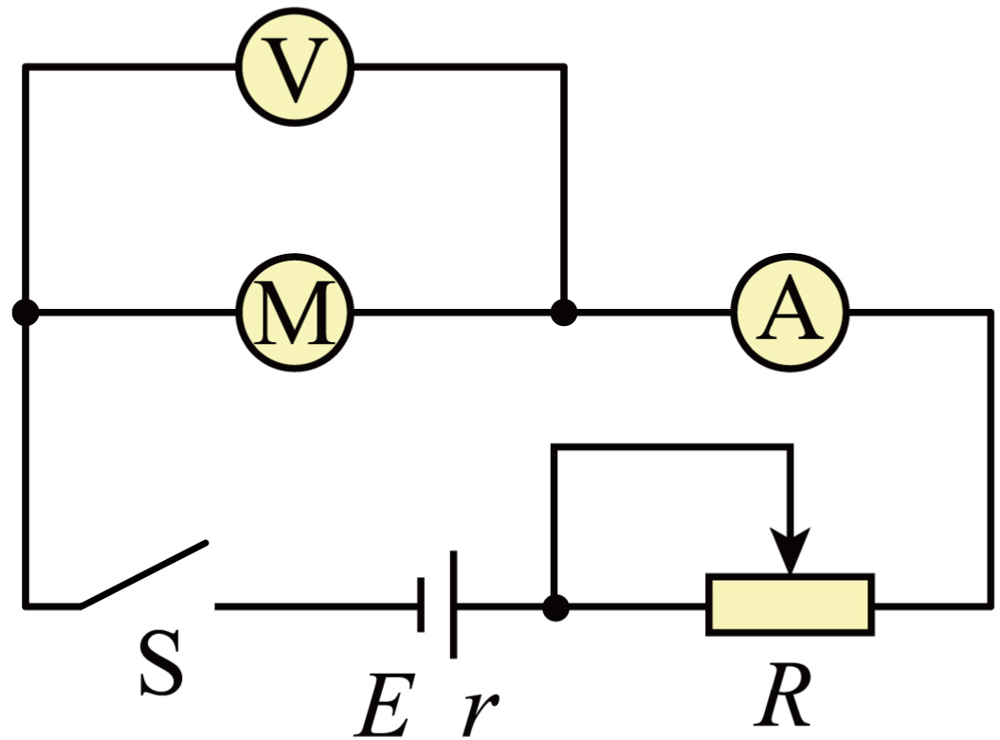
> > [!opts1]
> > - A. 电动机线圈的电阻为 $10\ \Omega$
> > - B. 风扇运转时输出的机械功率为 $0.3\ \mathrm{W}$
> > - C. 风扇运转时线圈的发热功率为 $0.4\ \mathrm{W}$
> > - D. 与扇叶被卡住时相比，风扇运转时电源的总功率保持恒定

### 答案

B

### 解析

扇叶被卡住时，电动机不输出机械功率，可视为纯电阻，线圈电阻
$$r_M=\frac{1.25}{0.50}=2.5\ \Omega.$$
正常运转时输入功率 $P_{\text{入}}=UI=2.0\times0.20=0.40\ \mathrm{W}$，线圈发热功率 $P_{\text{热}}=I^2r_M=0.10\ \mathrm{W}$，故机械输出功率为 $0.30\ \mathrm{W}$。电源总功率为 $EI$，电流变化后不会保持不变。

###### 8
> [!ti] *2026年北京市第一七一中学高二上学期期中物理第8题*
> 如图所示为一种双量程电流表的电路图。定值电阻 $R_1$ 的阻值与表头 $G$ 的内阻相等，$R_2$ 的阻值为表头内阻的4倍，若表头的表盘刻度表示流过接线柱1的电流值。将接线柱1、2接入电路时，电流表的量程为 $I$。下列说法正确的是
> %% 图位：原卷第2页，第8题双量程电流表电路。 %%
> 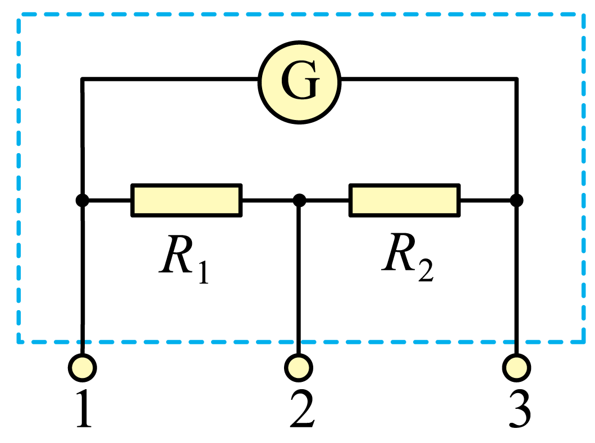
> > [!opts1]
> > - A. 将接线柱1、2接入电路时，通过 $R_2$ 的电流为 $\frac{I}{5}$
> > - B. 将接线柱1、3接入电路时，电流表的量程为 $\frac{1}{4}I_0$
> > - C. 将接线柱1、2接入电路时，若仅使 $R_2$ 阻值变小，电流表的量程会变大
> > - D. 将接线柱1、3接入电路时，若仅使 $R_2$ 阻值变小，电流表的量程会变大

### 答案

D

### 解析

设表头内阻为 $r$、满偏电流为 $I_g$，则 $R_1=r$、$R_2=4r$。接1、2时，表头与 $R_2$ 串联后再与 $R_1$ 并联；通过 $R_2$ 的电流为 $I_g$，通过 $R_1$ 的电流为 $5I_g$，所以量程 $I=6I_g$，A中的 $I/5$ 应为 $I/6$。

接1、3时，表头与 $R_1+R_2$ 并联，量程为 $I'=I_g(1+r/(R_1+R_2))=6I_g/5=I/5$。原文B使用未定义的 $I_0$；若其本意指原量程，系数仍应为 $1/5$，不是 $1/4$。

一般地，两种接法的量程分别为
$$I_{12}=I_g\left(1+\frac{r+R_2}{R_1}\right),\qquad I_{13}=I_g\left(1+\frac{r}{R_1+R_2}\right).$$
仅减小 $R_2$，前者减小、后者增大，故选D。

###### 9
> [!ti] *2026年北京市第一七一中学高二上学期期中物理第9题*
> 如图甲所示，正电荷仅在静电力作用下沿 $x$ 轴正方向运动，经过 $A$、$B$、$C$ 三点，已知 $x_C-x_B=x_B-x_A$。该正电荷的电势能 $E_p$ 随坐标 $x$ 变化的关系如图乙所示，下列说法正确的是
> %% 图位：原卷第3页，第9题甲坐标图、乙电势能随x变化图。 %%
> 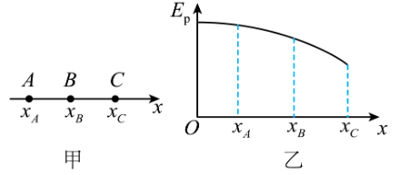
> > [!opts1]
> > - A. $A$ 点的电势低于 $B$ 点的电势
> > - B. $A$ 点的电场强度大于 $B$ 点的电场强度
> > - C. 正电荷在 $A$ 点的速度大于在 $B$ 点的速度
> > - D. 正电荷从 $A$ 到 $B$ 的过程中静电力做的功小于从 $B$ 到 $C$ 的过程中静电力做的功

### 答案

D

### 解析

正电荷有 $E_p=q\varphi$。图中电势能随 $x$ 减小，故 $\varphi_A>\varphi_B$。图像斜率绝对值随 $x$ 增大，由 $F_x=-\mathrm{d}E_p/\mathrm{d}x$ 可知 $E_A<E_B$。电势能减少转化为动能，故 $v_A<v_B$。

相同位移内，后半段电势能减少得更多，因此 $W_{AB}=E_{pA}-E_{pB}<E_{pB}-E_{pC}=W_{BC}$，D正确。

###### 10
> [!ti] *2026年北京市第一七一中学高二上学期期中物理第10题*
> 真空中存在沿 $y$ 轴正方向的匀强电场，带电粒子 $a$ 和 $b$ 先后从坐标原点 $O$ 沿 $x$ 轴正方向射入该电场，其轨迹如图所示。忽略粒子所受重力，下列条件中可以判定粒子 $a$ 比荷较大的是
> %% 图位：原卷第3页，第10题两粒子的偏转轨迹。 %%
> 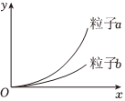
> > [!opts1]
> > - A. 粒子 $a$ 和 $b$ 射入电场时的速度相等
> > - B. 粒子 $a$ 和 $b$ 在电场中的加速度相等
> > - C. 粒子 $a$ 和 $b$ 射入电场时的动能相等
> > - D. 粒子 $a$ 和 $b$ 射入电场时的动量相等

### 答案

A

### 解析

带电粒子做类平抛运动，$x=v_0t$、$y=\frac12(qE/m)t^2$，消去时间得
$$y=\frac{qE}{2mv_0^2}x^2.$$
同一横坐标处，$a$ 的偏移更大。如果初速度相等，则必有 $(q/m)_a>(q/m)_b$。若加速度相等，反而说明比荷相等；初动能或动量相等，都不能在质量未知时直接比较比荷。

###### 11
> [!ti] *2026年北京市第一七一中学高二上学期期中物理第11题*
> 多个点电荷产生的电场中，某点的电势等于各个点电荷单独在该点产生的电势的代数和。已知在电荷量为 $Q$ 的点电荷产生的电场中，将无限远处的电势规定为零时，距离该点电荷 $r$ 处的电势 $\varphi=k\frac{Q}{r}$，其中 $k$ 为静电力常量。若真空中有两个点电荷 $Q_1$ 和 $Q_2$，分别固定在 $x$ 轴的坐标为 $-4\ \mathrm{cm}$ 和 $1\ \mathrm{cm}$ 的位置上。两个点电荷产生的电场的等势线如图中曲线所示。下列说法正确的是
> %% 图位：原卷第3页，第11题点电荷等势线图，含M、N及电势数值。 %%
> 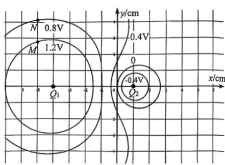
> > [!opts1]
> > - A. $Q_1$ 为正电荷，$Q_2$ 为负电荷，且 $Q_2=-4Q_1$
> > - B. $x$ 轴上 $x=6\ \mathrm{cm}$ 处的电场强度为0
> > - C. 若仅将 $Q_2$ 的电荷量变为原来的2倍，$x$ 轴上 $x=-1.5\ \mathrm{cm}$ 处的电势将变为0
> > - D. 若两点电荷的电荷量均变为原来的2倍，$M$、$N$ 两点间的电势差仍为 $0.4\ \mathrm{V}$

### 答案

待教师核对（等势线图的定量位置需核清）

### 解析

可以确定 $Q_1>0$、$Q_2<0$，且 $M$、$N$ 的电势分别为 $1.2\ \mathrm{V}$、$0.8\ \mathrm{V}$。两电荷同时加倍，各点电势和电势差均加倍，$U_{MN}$ 应变为 $0.8\ \mathrm{V}$，D错误。

但所附图中零电势闭合曲线与坐标刻度的对应关系不够一致，不能用示意图的近似位置直接认定电荷量之比。令 $Q_1=Q>0$、$Q_2=-q$，有以下可核验的判据：

- B成立的条件：在 $x=6\ \mathrm{cm}$，两电荷距该点分别为10 cm和5 cm，$kQ/10^2=kq/5^2$，即 $Q=4q$。
- C成立的条件：$x=-1.5\ \mathrm{cm}$ 恰为两电荷的中点，两侧距离都为2.5 cm；$Q_2$ 加倍后该点电势为0要求 $Q=2q$。
- 零电势线与两电荷之间的 $x$ 轴交点 $x_0$ 应满足 $Q/q=(x_0+4)/(1-x_0)$。若 $x_0=0$，应选B；若 $x_0=-2/3\ \mathrm{cm}$，应选C。

请以清楚且坐标准确的原图确认上述交点或直接补充电荷量之比。照片中的手写C不能代替题设证据；这里不把它作为标准答案。

###### 12
> [!ti] *2026年北京市第一七一中学高二上学期期中物理第12题*
> 某种静电分析器的原理简图如图所示，在两半圆形圆弧板组成的管道中加有径向电场。一动能为 $E_k$ 的电子 $a$ 自 $A$ 点垂直电场入射，恰好做圆周运动，轨迹为 $ABC$，半径为 $r$。另一个电子 $b$ 自 $A$ 点垂直电场入射，轨迹为 $APQ$，其中 $P$、$B$、$O$ 三点共线，已知 $B$、$P$ 两点间的电势差为 $U$，$CQ=2BP$，电子的电荷量为 $e$。则
> %% 图位：原卷第4页，第12题静电分析器、径向电场及电子轨迹。 %%
> 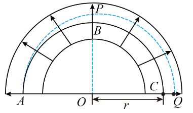
> > [!opts1]
> > - A. $P$ 点的电场强度大于 $C$ 点的电场强度
> > - B. $B$ 点的电场强度大小为 $\frac{E_k}{er}$
> > - C. 电子 $b$ 从 $A$ 点到 $Q$ 点电势能的增加量小于 $2eU$
> > - D. 电子 $b$ 在 $P$ 点的动能小于在 $Q$ 点的动能

### 答案

C

### 解析

圆弧电极间的辐向电场向外，场强随半径增大而减小。电子所受力向内。电子 $a$ 做圆周运动，有 $eE_B=mv^2/r=2E_k/r$，所以 $E_B=2E_k/(er)$，B少了系数2。$P$ 的半径比 $C$ 大，故 $E_P<E_C$，A错误。

设 $BP=h$，则 $CQ=2h$。$A$、$B$、$C$ 等势，从半径 $r$ 到 $r+h$ 的电势下降为 $U$；外侧再增加相同的径向距离 $h$ 时，因场强较小，电势下降小于 $U$。因此从 $A$ 到 $Q$，电势下降小于 $2U$，负电子的电势能增加小于 $2eU$，C正确。$Q$ 半径大于 $P$，负电子在 $Q$ 的电势能更大、动能更小，D错误。

###### 13
> [!ti] *2026年北京市第一七一中学高二上学期期中物理第13题*
> 如图所示，在水平方向的匀强电场中，一带电小球仅受重力和静电力的作用，在竖直面（纸面）内运动。若小球的初速度方向与虚线平行，则其运动轨迹为直线。现小球从 $M$ 点以初速度 $v_0$ 竖直向上运动，经过最高点 $P$ 点，到达与 $M$ 点等高的 $N$ 点（$P$ 点、$N$ 点、$M$ 点均未画出）。小球从 $M$ 点到 $N$ 点的过程中。下列说法正确的是
> %% 图位：原卷第4页，第13题匀强电场方向与虚线图。 %%
> 
> > [!opts1]
> > - A. 经过 $P$ 点时动能最小
> > - B. 动能先减小后增大，电势能先增大后减小
> > - C. 从 $M$ 点到 $P$ 点与从 $P$ 点到 $N$ 点的时间相等
> > - D. 从 $M$ 点到 $P$ 点与从 $P$ 点到 $N$ 点的水平位移相等

### 答案

C

### 解析

题干明确电场沿水平方向，故竖直方向仅受重力，始终有 $y=v_0t-gt^2/2$。最高点对应 $t_P=v_0/g$，回到同一高度对应 $t_N=2v_0/g$，上升和下降时间相等，C正确。

设水平加速度大小为 $a_x$，则 $v^2=a_x^2t^2+(v_0-gt)^2$，速率最小的时刻为 $t=gv_0/(a_x^2+g^2)<t_P$，不是最高点。水平电场力与水平位移同向，持续做正功，电势能持续减小，B错误。两段相等时间内的水平位移之比为 $1:3$，D错误。

###### 14
> [!ti] *2026年北京市第一七一中学高二上学期期中物理第14题*
> 闪电的可见部分之前有一个不可见阶段，在该阶段，由于雷雨云和地面间强大的电场，云底首先出现大气被强烈电离形成的一段暗淡的气柱，这种气柱逐级从云底向下延伸到地面，称梯级先导。梯级先导长约 $50\ \mathrm{m}$，直径约 $6\ \mathrm{m}$，电流约 $100\ \mathrm{A}$，可视为电子柱，它以平均约 $1.5\times10^5\ \mathrm{m/s}$ 的速度一级一级地伸向地面，一旦接近地面，柱内的电子迅速地倾泻到地面，在倾泄期间，运动电子与柱内空气的碰撞导致明亮的闪光。一般情况下雷雨云距离地面 $1000\ \mathrm{m}$ 左右，用高速摄像机研究发现梯级先导电流主要集中在直径为几厘米的核心通道内流动。已知若电荷均匀分布在一条长直线上，与长直线距离为 $r$ 处的电场强度大小的表达式为 $E=2k\frac{\lambda}{r}$（$\lambda$ 为单位长度上的电荷量，$k=9\times10^9\ \mathrm{N\cdot m^2/C^2}$，$e=1.6\times10^{-19}\ \mathrm{C}$）。不考虑电荷运动引起的其他效应，下列估算正确的是
> > [!opts1]
> > - A. 梯级先导到达地面的时间约为 $7\times10^{-6}\ \mathrm{s}$
> > - B. 电子柱内的平均电子数密度约为 $1\times10^{12}\ \mathrm{个/m^3}$
> > - C. 核心通道每米长度上的电荷量约为 $6\times10^{-6}\ \mathrm{C}$
> > - D. 电子柱边缘处的电场强度大小约为 $4\times10^6\ \mathrm{N/C}$

### 答案

D

### 解析

按题目给出的平均推进速度作估算，
$$t\approx\frac{1000}{1.5\times10^5}=6.7\times10^{-3}\ \mathrm{s},\qquad \lambda=\frac{I}{v}\approx6.7\times10^{-4}\ \mathrm{C/m}.$$
故A、C均不符合数量级。电子柱半径约3 m，由 $I=nev\pi r^2$ 得平均电子数密度 $n\approx1.5\times10^{14}\ \mathrm{m^{-3}}$，B错误。

电子柱边缘的场强
$$E=\frac{2k\lambda}{r}\approx\frac{2\times9\times10^9\times6.7\times10^{-4}}{3}=4.0\times10^6\ \mathrm{N/C},$$
故选D。核心通道较细，不改变由总电流和速度确定的单位长度电荷量。

# 第二部分

本部分共6题，共58分。

###### 15
> [!ti] *2026年北京市第一七一中学高二上学期期中物理第15题*
> （8分）某兴趣小组利用如图1所示装置观察电容器的放电过程。先使开关 $S$ 与1端相连，电源向电容器充电，这个过程可在短时间完成。然后把开关 $S$ 掷向2端，电容器通过电阻 $R$ 放电，传感器将电流信息传入计算机，电流随时间变化图像如图2所示。
>
> %% 图位：原卷第5页，第15题图1电路、图2放电I-t方格图、图3虚线放电图；图3实线为手写作答，不录入。 %%
>
> （1）根据图2中的 $I-t$ 图像估算图像与坐标轴围成的面积共约60个小格，则此电容器充满电时所带的电荷量 $q=$________$\mathrm{C}$（保留2位有效数字）。
>
> （2）实验中，所用电阻的阻值为 $100\ \Omega$，则电容器的电容约为________$\mathrm{\mu F}$，$1\ \mathrm{s}$ 时电容器两端电压约为________$\mathrm{V}$（第二空保留2位有效数字）。
>
> （3）若只更换电阻 $R$ 重复上述实验。当电阻为 $R_1$ 时，电容器放电的 $I-t$ 图像如图3中的虚线所示。若将电阻更换为 $R_2$（$R_2<R_1$），请在图3中用实线定性画出电容器放电的 $I-t$ 图像。
> 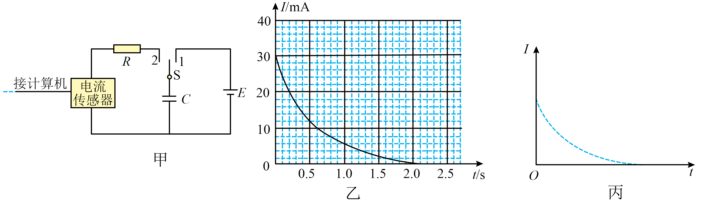

### 答案

（1）$1.2\times10^{-2}\ \mathrm{C}$。（2）$4.0\times10^3\ \mathrm{\mu F}$；1秒电压待教师核对。（3）见解析图。

### 解析

（1）每个小格表示 $0.1\ \mathrm{s}\times2\ \mathrm{mA}=2.0\times10^{-4}\ \mathrm{C}$。根据题给60格，$q=60\times2.0\times10^{-4}=1.2\times10^{-2}\ \mathrm{C}$。

（2）初始电流约 $30\ \mathrm{mA}$，由欧姆定律 $U_0=I_0R=3.0\ \mathrm{V}$，所以 $C=q/U_0=4.0\times10^{-3}\ \mathrm{F}=4.0\times10^3\ \mathrm{\mu F}$。

待核之处：原拍照卷在 $t=1\ \mathrm{s}$ 处电流约为 $3\ \mathrm{mA}$，应得到 $U=IR\approx0.30\ \mathrm{V}$；当前带图版补入的曲线在该时刻约为 $6\ \mathrm{mA}$，对应约 $0.60\ \mathrm{V}$。两图读数不一致，故该空不能混用。以上 $q$ 仍按题干给定60格计算，使用前请统一图2。

（3）相同电容、相同初始电压下，$I_0=U_0/R$，电阻越小，初始电流越大、衰减越快，两条曲线与时间轴围成的面积相等，均为初始电荷量。实线应从虚线上方出发，与虚线相交后位于其下方，最终趋近于0。

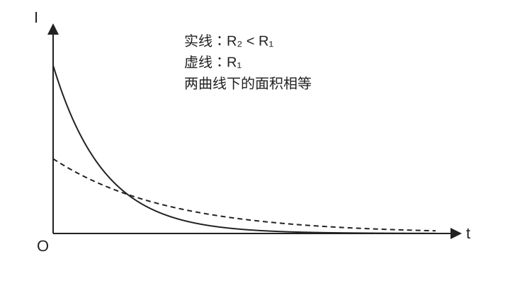

###### 16
> [!ti] *2026年北京市第一七一中学高二上学期期中物理第16题*
> （10分）某实验小组利用下列器材测量某种金属丝的电阻率，金属丝的阻值大约为 $9\ \Omega$。除了导线和开关外，还有以下器材可供选择：
>
> > [!opts1]
> > - A. 电源电动势为 $E=3.0\ \mathrm{V}$，内阻不计
> > - B. 电压表（$0\sim3\ \mathrm{V}$，内阻约 $3\ \mathrm{k\Omega}$）；（$0\sim15\ \mathrm{V}$，内阻约 $15\ \mathrm{k\Omega}$）
> > - C. 电流表（$0\sim0.6\ \mathrm{A}$，内阻约 $0.125\ \Omega$）；（$0\sim3\ \mathrm{A}$，内阻约 $0.0255\ \Omega$）
> > - D. 滑动变阻器 $R_1$（最大阻值 $5\ \Omega$，额定电流 $3\ \mathrm{A}$）
> > - E. 滑动变阻器 $R_2$（最大阻值 $200\ \Omega$，额定电流 $1.25\ \mathrm{A}$）
>
> （1）为了调节方便，滑动变阻器应选用________。（选填选项前的字母）
>
> （2）根据实验电路图，在图中用连线代替导线完成实验器材的连接。
>
> %% 图位：原卷第6页，第16题实物连线图。 %%
>
> （3）实验小组对测量电路进行了创新，如图所示，在电阻丝上夹有一个可沿电阻丝滑动的金属触头 $P$，触头的位置可从刻度尺上读出。实验时改变触头 $P$ 与电阻丝接触的位置，多次改变电阻丝接入电路的长度 $l$，调节滑动变阻器滑动头的位置，使电流表的读数达到某一相同值 $I$ 时，记录电压表的示数 $U$，得到多个 $\frac{U}{I}$ 的值，作出 $\frac{U}{I}-l$ 的图像，如图所示。
>
> %% 图位：原卷第6页，第16题改进电路图及U/I-l图像（标有a、b、c）。 %%
> 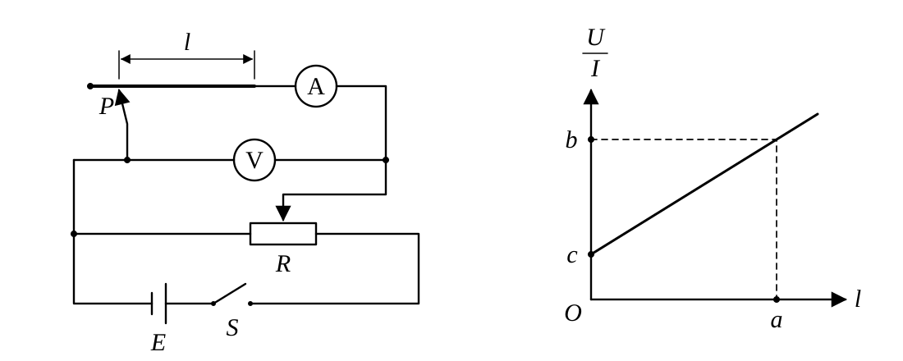
>
> ①如果已经测得电阻丝的直径为 $d$，根据图中所给数据，可得金属丝的电阻率 $\rho=$________（用 $a$、$b$、$c$ 和 $d$ 表示）。
>
> ②请从理论上分析并说明，①问求得的电阻丝电阻率________（选填“存在”或“不存在”）因电表内阻带来的误差。

### 答案

（1）D。（2）见解析，原MD连线图缺失，需对照原照片。（3）①$\rho=\frac{\pi d^2(b-c)}{4a}$；②不存在。

### 解析

（1）为方便分压调节，选最大阻值较小的5 Ω滑动变阻器，选D。电源3 V，应使用电压表0～3 V挡；电流最大约 $3/9=0.33\ \mathrm{A}$，使用0～0.6 A挡。

（2）第（3）问的改进电路及关系图已按原照片重绘并补在上方题干。第（2）问实物连线图仍需对照原照片。改进电路的连接关系为：滑动变阻器采用分压接法，两固定端跨接电源，滑片与一固定端提供测量电压；电阻丝与电流表串联，电压表跨接电阻丝和电流表整体，即电流表内接。电源、开关、变阻器构成供电回路，接线时电表正接线柱朝电源高电势一侧。下图表示该改进电路的节点关系，可作为接线依据；原实物接线柱位置仍请对照原照片。

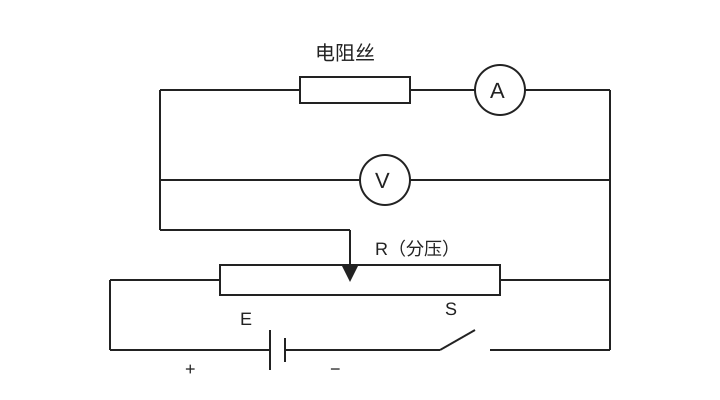

若单独设计传统伏安法测9 Ω电阻，外接法的相对误差更小；本题后问利用内接法的截距抵消电流表内阻，两种任务不要混淆。

（3）设电阻丝横截面积 $S_x=\pi d^2/4$，电流表内阻为 $R_A$。改进电路中，电流表测电阻丝电流，电压表测两者串联电压，因此
$$\frac UI=\frac{\rho l}{S_x}+R_A.$$
图线纵截距为 $c=R_A$，斜率为 $(b-c)/a=\rho/S_x$，所以 $\rho=\pi d^2(b-c)/(4a)$。电流表内阻只影响截距，电压表分流不流过电流表；通过斜率求出的电阻率不存在由这两项电表内阻导致的系统误差。

###### 17
> [!ti] *2026年北京市第一七一中学高二上学期期中物理第17题*
> （9分）如图所示，在水平向右的匀强电场中，长为 $L$ 的绝缘细线一端悬于 $O$ 点，另一端系一质量为 $m$、电荷量为 $+q$ 的小球（可视为点电荷）。将小球拉至与 $O$ 点等高的 $A$ 点，保持细线绷紧并静止释放，小球运动到与竖直方向夹角 $\theta=37^\circ$ 的 $P$ 点时速度变为零。已知 $\cos37^\circ=0.80$，$\sin37^\circ=0.60$，空气阻力可忽略，重力加速度为 $g$。求：
>
> （1）电场强度的大小 $E$；
>
> （2）小球从 $A$ 运动到 $B$ 的过程中，电场力做的功 $W$；
>
> （3）小球通过最低点 $B$ 时，细线对小球的拉力大小 $F$。
>
> ![[Pasted image 20261106185253.png|200]]

### 答案

（1）$E=\frac{mg}{2q}$。（2）$W=-\frac12mgL$。（3）$F=2mg$。

### 解析

取 $O$ 为坐标原点，向右、向上为正。$A$ 坐标为 $(L,0)$，$P$ 坐标为 $(-L\sin\theta,-L\cos\theta)$。从 $A$ 到 $P$，初末速度均为0，由动能定理
$$mgL\cos\theta-qEL(1+\sin\theta)=0.$$
故 $E=mg\cos\theta/[q(1+\sin\theta)]=mg/(2q)$。

从 $A$ 到最低点 $B$，水平位移为 $-L$，电场力做功 $W=-qEL=-mgL/2$。再次用动能定理，$mgL-qEL=mv_B^2/2$，得 $v_B^2=gL$。

在 $B$ 点，电场力水平，没有竖直径向分量，$F-mg=mv_B^2/L$，故 $F=2mg$。

###### 18
> [!ti] *2026年北京市第一七一中学高二上学期期中物理第18题*
> （9分）（1）电荷之间的作用力是通过电场产生的，地球对物体的万有引力也可以认为是通过“引力场”来实现的。试类比电场强度的定义方法，写出地球“引力场强度 $E'$”的定义式，并结合万有引力定律，推导距离地心为 $r$（$r>R$）处的引力场强度的表达式，已知万有引力常量为 $G$。（请对其中涉及的物理量做出必要说明）
>
> （2）经典电磁理论认为：当金属导体两端电压稳定后，导体中产生分布不随时间变化的恒定电场。恒定电场中，任何位置的电荷分布和电场强度都不随时间变化，它的基本性质与静电场相同。在恒定电场的作用下，金属中的自由电子做定向加速运动，在运动过程中与导体内不动的粒子不断碰撞，每次碰撞后定向移动的速度减为0。碰撞阻碍了自由电子的定向运动，结果是大量自由电子定向移动的平均速度不随时间变化。某种金属中单位体积内的自由电子数量为 $n$，自由电子的质量为 $m$，所带电荷量为 $e$，如图所示，该种金属制成的长为 $L$、横截面积为 $S$ 的圆柱形金属导体，将其两端加上恒定电压 $U$，为简化问题，假设自由电子连续两次与不动的粒子碰撞的时间间隔平均值为 $t_0$。
>
> a. 自由电子从静止开始加速时间为 $t_0$ 时的速度 $v$；
>
> b. 求金属导体中的电流 $I$。
>
> %% 图位：原卷第7页，第18题圆柱形金属导体（L、S、U）。 %%
> ![[Pasted image 20261106185316.png]]

### 答案

（1）$\boldsymbol E'=\boldsymbol F_g/m_0$，大小 $GM/r^2$，方向指向地心。（2）a. $v=\frac{eUt_0}{mL}$；b. $I=\frac{ne^2SUt_0}{2mL}$。

### 解析

（1）用质量为 $m_0$、对地球引力场影响可忽略的小物体作试探物体，将其所受引力与质量之比定义为引力场强度。设地球质量为 $M$、半径为 $R$，地心距离为 $r>R$，由 $F_g=GMm_0/r^2$ 得 $E'=GM/r^2$，方向沿半径指向地心，单位为 N/kg。

（2）a. 导体内场强大小 $E=U/L$，自由电子定向加速度大小 $a=eE/m=eU/(mL)$，从静止加速 $t_0$ 后的速度大小 $v=at_0=eUt_0/(mL)$，方向与电场相反。

b. 按题目的简化碰撞周期模型，电子在一个周期内的平均定向速率为 $\bar v=v/2$。时间 $t$ 内通过截面的电荷量大小为 $neS\bar vt$，故
$$I=neS\bar v=\frac{ne^2SUt_0}{2mL}.$$
不能把周期末的最大定向速率直接代入微观电流公式。本式按碰撞间隔统一取 $t_0$ 的高中简化模型计算。

###### 19
> [!ti] *2026年北京市第一七一中学高二上学期期中物理第19题*
> （10分）电子束光刻技术原理简化如图甲所示，电子源发射的电子束经过多级直线加速器后，进入静电转向器，再通过偏移器后对晶圆上的光刻胶进行曝光。多级直线加速器由 $n$ 个横截面积相同且共轴的金属圆筒依次水平排列，各金属圆筒依序接在交变电源的两极 $A$、$B$ 上，交变电源两极间电势差的变化规律如图乙所示。序号为0的金属圆板中央有一个点状电子源，电子逸出的速度不计，转向器中有辐向电场，电子从 $M$ 点水平射入，沿着半径为 $R$ 的圆弧虚线（等势线）运动，并从 $N$ 点竖直射出，沿着偏移器的中轴线进入，轴线垂直晶圆上表面并过中心 $O$ 点，已知偏移器为长、间距均为 $L$ 的平行金属板（两极板可加电压），电子质量为 $m$，电荷量大小为 $e$，交变电压的绝对值为 $U$，周期为 $T$。电子通过圆筒间隙的时间不计，不计电子重力及电子间的相互作用力，忽略相对论效应、极板边缘效应等其他因素的影响，电子在偏移器中运动时，可认为场强不变。
>
> %% 图位：原卷第8页，第19题甲电子束光刻原理图、乙交变电压图。 %%
>
> （1）若 $t=0$ 时刻进入圆筒间隙的电子能够被加速，判断此时 $A$、$B$ 的电势高低。
>
> （2）经过8个圆筒后被导出的电子恰能沿圆弧虚线运动，求第8个圆筒的长度和转向器虚线处电场强度的大小；
>
> （3）第（2）问中的电子能经过偏移器，求偏移器间所加电压的范围；
>
> （4）若电子均匀进入偏移器，要求电子均匀对称打在光刻胶的 $x$ 轴上 $O$ 点两侧，试定性画出加在偏移器上扫描电压随时间变化的规律。
> 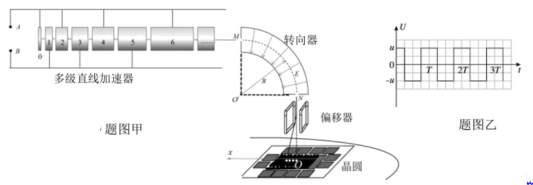

### 答案

（1）$\varphi_B>\varphi_A$。（2）$l_8=2T\sqrt{eU/m}$；$E=16U/R$。（3）$|U_{\text{偏}}|<16U$。（4）对称正、负幅值间的线性扫描，见图。

### 解析

（1）0号板接A，1号筒接B。负电子从0号板向1号筒运动且被加速，需要进入较高电势处，所以B的电势高于A。

（2）每经过一个加速间隙，动能增加 $eU$。进入第8个筒时，$mv_8^2/2=8eU$，故 $v_8=4\sqrt{eU/m}$。按通常的基频同步设计，在筒内匀速运动半个交变周期，故 $l_8=v_8T/2=2T\sqrt{eU/m}$。若允许在一个筒内停留更久，奇数个半周期也可同步；这里采用常规最短同步筒长。

转向器中电子沿等势圆弧运动，速率不变，$eE=mv_8^2/R$，得 $E=16U/R$。

（3）偏移器内飞行时间 $t=L/v_8$，横向加速度大小 $a=e|U_{\text{偏}}|/(mL)$。出口偏移
$$|y|=\frac12at^2=\frac{e|U_{\text{偏}}|L}{2mv_8^2}=\frac{|U_{\text{偏}}|L}{32U}.$$
要求不碰板，$|y|<L/2$，故 $-16U<U_{\text{偏}}<16U$。等号表示恰好擦到出口边缘，通常不计为无碰撞通过。

（4）电子的落点横坐标与扫描电压成正比，均匀入射时，要获得均匀位置分布，就应使电压以恒定速率改变，并覆盖关于0对称的电压范围。可用下面的周期性三角波往返扫描，也可用理想锯齿波单向扫描后快速回扫。幅值应满足第（3）问的通过条件，且单个电子通过偏移器期间电压变化可忽略。

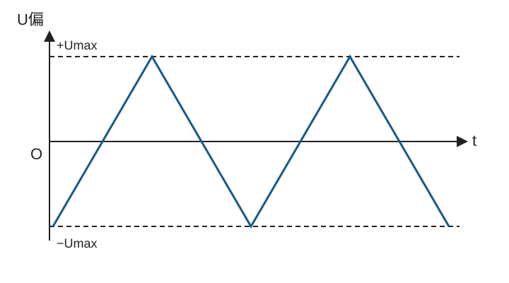

###### 20
> [!ti] *2026年北京市第一七一中学高二上学期期中物理第20题*
> （12分）如图所示，真空中，质子源产生的初速度为零的质子经电压为 $U$ 的电场加速后，形成横截面半径为 $b$ 的均匀圆柱形质子束，此加速过程时间极短，已知单位体积内质子数为 $n$，质子质量为 $m$，电荷量为 $q$，忽略重力影响。
>
> （1）求质子离开加速场时的速度大小 $v$；
>
> （2）质子束沿水平方向进入长为 $L$、内径为 $b$ 的圆柱形金属通道，由于库仑斥力的作用，质子会产生垂直于圆柱形通道中轴线的速度，水平速度不变，当质子与圆柱形通道内表面接触时会被吸收。为简化研究，可将质子在库仑斥力作用下的运动等效为：质子仅在外加电场 $E=kr$ 作用下的运动，其中 $k$ 为常量，$r$ 为质子到中轴线的距离，该场强方向垂直于中轴线沿通道半径指向通道内表面，等效后忽略质子间的相互作用。求：
>
> a. 从距中轴线 $r_0$ 处进入通道的质子，运动到距中轴线 $r$（$r<b$）处时，垂直于中轴线的速度大小 $v_r$ 与 $r$ 的关系式；
>
> b. 若从通道右侧边缘射出的质子速度方向与中轴线夹角为 $\theta$，求通道内表面吸收的质子数占总质子数的比例 $\eta$，以及单位时间内被通道内表面吸收的质子数 $\Delta N$。
>
> %% 图位：原卷第9页，第20题质子源、加速电场及圆柱形通道（2b、b、L）。 %%
>
> %% 待核：第（2）问印刷为“内径为b”，但题首质子束半径为b、图中b标在通道半径上，且后文使用r<b，疑应为“内半径为b”；此处保留原文，不擅自改题。 %%
> 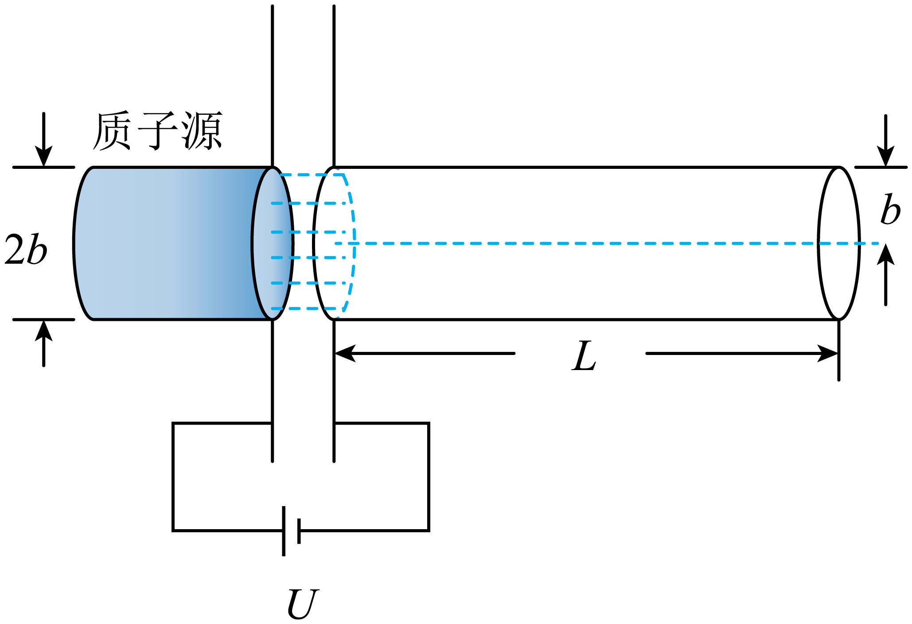

### 答案

待教师核对（通道“内径”与图示半径冲突；条件化结果见解析）

### 解析

原文写“内径为 $b$”，但题首束流半径为 $b$，图中 $b$ 也标作通道半径，并给出 $r<b$。以下按“通道内半径为 $b$”推导；未改动原题。若坚持内径为 $b$，入口束流还涉及截断，不能直接套用以下比例。

（1）由加速电场做功，$qU=mv^2/2$，故 $v=\sqrt{2qU/m}$。

（2）a. 径向电场力 $F_r=qkr$ 随 $r$ 线性变化，从 $r_0$ 到 $r$ 做的功等于力—位移图像下梯形面积：
$$W=\frac{qkr_0+qkr}{2}(r-r_0)=\frac12qk(r^2-r_0^2).$$
初始径向速度为0，故
$$v_r=\sqrt{\frac{qk}{m}(r^2-r_0^2)}.$$

b. 设恰好从通道出口边缘射出的临界质子初始半径为 $r_c$。它到出口时 $r=b$、$v_r=v\tan\theta$，由上式
$$r_c^2=b^2-\frac{mv^2\tan^2\theta}{qk}=b^2-\frac{2U\tan^2\theta}{k}.$$
同一飞行时间内，初始半径越大，径向位移越大；入口位于外侧环带 $r_c<r_0<b$ 的质子先撞上内壁被吸收。均匀束流的粒子数比等于截面积比，因此
$$\eta=\frac{b^2-r_c^2}{b^2}=\frac{2U\tan^2\theta}{kb^2}.$$
单位时间入射数为 $n\pi b^2v$，所以
$$\Delta N=\eta n\pi b^2v=\frac{2\pi nU}{k}\sqrt{\frac{2qU}{m}}\tan^2\theta.$$
这里 $\Delta N$ 按题意表示每秒吸收数；结果要求 $0\le\eta\le1$。给出的角度 $\theta$ 已编码飞行长度 $L$ 的影响，因此最终表达式可以不显含 $L$。

