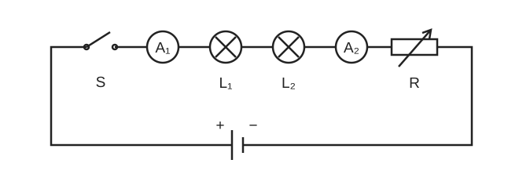

# 2026年八十中学管庄分校初三上学期期中物理（答案解析版） #h0

原卷标题：初三年级物理期中调研试卷。全卷8页，满分70分，考试时间70分钟。

# 一、单项选择题

共24分，每题2分。下列每题均有四个选项，其中只有一个选项符合题意。

###### 1
> [!ti] *2026年八十中学管庄分校初三上学期期中物理第1题*
> 下列物品通常情况下属于导体的是
>
> > [!opts1]
> > - A. 纸杯
> > - B. 瓷碗
> > - C. 铁锅
> > - D. 木铲

### 答案

C

### 解析

铁锅是金属制品，通常容易导电。纸杯、瓷碗、木铲在通常干燥条件下是绝缘体。

###### 2
> [!ti] *2026年八十中学管庄分校初三上学期期中物理第2题*
> 如图是感应发光“冰块”，它是由食品级 PS 材料外壳、液体感应器、纽扣电池和 LED 灯等元件组成，当液体感应器接触水后，“冰块”内的 LED 灯就会发光，其中液体感应器相当于电路中的
>
> %% 图位：原卷第1页，第2题图。 %%
>
> > [!opts1]
> > - A. 开关
> > - B. 电源
> > - C. 导线
> > - D. 用电器

### 答案

A

### 解析

液体感应器接触水后使电路接通，控制 LED 灯发光，相当于开关。

###### 3
> [!ti] *2026年八十中学管庄分校初三上学期期中物理第3题*
> 如图所示，易拉罐中装有适量的水，用酒精灯加热，当有蒸汽喷出时，风车的扇叶就转动起来。下列说法正确的是
>
> %% 图位：原卷第1页，第3题图。 %%
>
> > [!opts1]
> > - A. 易拉罐中水的内能增加是通过做功的方式实现的
> > - B. 蒸汽喷出推动扇叶转动过程中的能量转化与汽油机的压缩冲程一致
> > - C. 推动扇叶转动的水蒸气的内能一部分转化为扇叶的机械能
> > - D. 酒精灯内的酒精减少会导致酒精的热值变小

### 答案

C

### 解析

酒精灯通过热传递使水的内能增大。蒸汽推动扇叶做功，内能转化为机械能，对应汽油机做功冲程。酒精的热值由燃料种类决定。

###### 4
> [!ti] *2026年八十中学管庄分校初三上学期期中物理第4题*
> 如图所示，闭合开关 $S$ 后，两个小灯泡同时发光的是
>
> %% 图位：原卷第1页，第4题图。 %%
>
> > [!opts1]
> > - A. 见图 A
> > - B. 见图 B
> > - C. 见图 C
> > - D. 见图 D

### 答案

C

### 解析

图C中两灯并联，开关在干路上。图A的 L₂、图B的 L₁ 被导线短接。图D中两灯所在支路被导线短接，闭合开关还会造成电源短路。

###### 5
> [!ti] *2026年八十中学管庄分校初三上学期期中物理第5题*
> 小北进行了如下操作：①用丝绸摩擦过的玻璃棒去接触不带电的验电器 A，A 的金属箔片张角变大；②再用带绝缘手柄的 C 棒去同时接触 A、B 验电器的金属球，发现 A 的金属箔片张角变小，B 的金属箔片张角变大。③换用毛皮摩擦过的橡胶棒接触不带电的验电器 A，重复上述操作。下列说法正确的是
>
> %% 图位：原卷第1页，第5题图。 %%
>
> > [!opts1]
> > - A. 在步骤①中，A 下方金属箔片带负电
> > - B. 在步骤②中，电流方向为 A 到 B
> > - C. 在步骤③中，金属箔片不会张开
> > - D. 在步骤③中，橡胶棒失去电子而带正电

### 答案

B

### 解析

丝绸摩擦过的玻璃棒带正电，接触后A带正电。接通A、B时，自由电子从B移向A，电流方向从A到B。毛皮摩擦过的橡胶棒得到电子而带负电，也能使验电器箔片张开。

###### 6
> [!ti] *2026年八十中学管庄分校初三上学期期中物理第6题*
> 为了保护人们在骑行电动自行车时的人身安全，小北利用物理课上所学的电路知识，设计了一款智能头盔，只有当骑行的人戴上头盔扣上卡扣后，头盔上的信号发射器才能发出信号。当电动自行车上的信号接收器 $S_1$ 接收到信号，再转动电动自行车的钥匙 $S_2$，车才能正常启动。如图所示的电路符合要求的是
>
> %% 图位：原卷第2页，第6题图。 %%
>
> > [!opts1]
> > - A. 见图 A
> > - B. 见图 B
> > - C. 见图 C
> > - D. 见图 D

### 答案

A

### 解析

两个开关必须同时闭合，电动机才工作，因此两个开关与电动机串联。

###### 7
> [!ti] *2026年八十中学管庄分校初三上学期期中物理第7题*
> 小北自制简易警示灯，设计的电路图如图所示。闭合总开关后，照明灯始终可以工作；再闭合支路开关，红色 LED 警示灯才发光。下列实物电路中，与该电路图对应的是
>
> %% 图位：原卷第2页，第7题图。 %%
>
> > [!opts1]
> > - A. 见图 A
> > - B. 见图 B
> > - C. 见图 C
> > - D. 见图 D

### 答案

选项字母待核图

### 解析

原理图中照明灯和 LED 支路并联，总开关在干路，支路开关只控制 LED。电源正极应连到 LED 正极所在一侧，电流从 LED 正极流入。四个实物图要逐项追踪导线，并核对灯脚极性。原照片中导线在灯座处靠得很近，LED 灯脚细节不足以可靠判定选项字母。

###### 8
> [!ti] *2026年八十中学管庄分校初三上学期期中物理第8题*
> 如图，是小北测电压的电路。闭合开关后，发现小灯泡 $L_1$ 不发光，但小灯泡 $L_2$ 发光，且电压表有示数。下列说法正确的是
>
> %% 图位：原卷第2页，第8题图。 %%
>
> > [!opts1]
> > - A. 小灯泡 $L_1$ 不发光，故障可能是小灯泡 $L_1$ 断路
> > - B. 将导线②的左端改接到 $a$ 接线柱，闭合开关后电压表能测出 $L_1$ 两端的电压
> > - C. 将导线①的左端改接到 $a$ 接线柱，闭合开关后电压表会被短路
> > - D. 将导线①的左端改接到 $a$ 接线柱，电压表示数可能变大

### 答案

D

### 解析

L₂能发光说明主回路导通，L₁断路不能解释这一现象。原图中电压表测 L₂ 两端电压。将导线①左端从 b 移到 a，电压表改测两灯两端总电压。若 L₁ 只是实际功率太小而未明显发光，它仍有电压，此时示数会变大。若 L₁ 被短路，示数可不变。

###### 9
> [!ti] *2026年八十中学管庄分校初三上学期期中物理第9题*
> 如图所示，是科创小组设计制作的一款发电球，设计灵感源自我国古代蹴鞠。球在被踢、滚动的过程中内部装置能够发电，可为蓄电池充电；储存的电能可点亮 LED 灯照明。下列说法正确的是
>
> %% 图位：原卷第2页，第9题图。 %%
>
> > [!opts1]
> > - A. 足球被踢动发电时，内部装置将机械能转化为化学能
> > - B. 给蓄电池充电的过程中，将电能转化为化学能
> > - C. 使用蓄电池供电点亮 LED 灯时，蓄电池将电能转化为化学能
> > - D. LED 灯照明时，LED 灯将机械能转化为光能

### 答案

B

### 解析

发电装置把机械能转化为电能。蓄电池充电时把电能转化为化学能，供电时把化学能转化为电能。LED 灯工作时把电能转化为光能和内能。

###### 10
> [!ti] *2026年八十中学管庄分校初三上学期期中物理第10题*
> 如图甲是家用风扇的调速开关，图乙是调速开关的电位器结构图，$a$、$b$、$c$ 是它的三个接线柱，$a$、$c$ 分别与弧形电阻丝的两端相连，$b$ 与金属滑片相连。在电源电压不变时，接入电路的电阻越大，电路电流越小，风扇转速越慢；电阻越小，电路电流越大，风扇转速越快。当转动风扇旋钮时，滑片会在弧形电阻丝上同向滑动，即可调节风扇转速。下列分析正确的是
>
> %% 图位：原卷第2页，第10题图。 %%
>
> > [!opts1]
> > - A. 若只将 $a$、$c$ 接入电路，顺时针转动旋钮时风扇转速变快
> > - B. 若只将 $b$、$c$ 接入电路，逆时针转动旋钮时，风扇转速变快
> > - C. 电位器与风扇并联
> > - D. 若将 $a$、$b$ 接入电路同一点，$c$ 接入电路的另一点时，旋动旋钮时不能改变风扇转速

### 答案

B

### 解析

电位器与风扇串联。接 b、c 时，有效电阻丝是滑片 P 到 c 之间的一段。按图逆时针旋转，P 靠近 c，有效电阻减小，电流增大，转速变快。只接 a、c 时接入整段电阻丝。a、b 接同一点时，a 到滑片之间被短接，仍可用滑片到 c 之间的一段调速。

###### 11
> [!ti] *2026年八十中学管庄分校初三上学期期中物理第11题*
> 根据下表所提供的几种物质的比热容，得出以下四个结论，其中正确的是
>
> | 物质 | 比热容 $c/[\mathrm{J\cdot(kg\cdot{}^\circ C)^{-1}}]$ | 物质 | 比热容 $c/[\mathrm{J\cdot(kg\cdot{}^\circ C)^{-1}}]$ |
> | --- | ---: | --- | ---: |
> | 水 | $4.2\times10^3$ | 冰 | $2.1\times10^3$ |
> | 酒精 | $2.4\times10^3$ | 沙石 | $0.92\times10^3$ |
> | 煤油 | $1.2\times10^3$ | 铝 | $0.88\times10^3$ |
> | 水银 | $0.14\times10^3$ | 铜 | $0.39\times10^3$ |
>
>
> > [!opts1]
> > - A. 同种物质在不同状态下比热容一定相等
> > - B. $1\,\mathrm{kg}$ 的水银温度升高 $1\,{}^\circ\mathrm C$，需要吸收的热量是 $140\,\mathrm{J/(kg\cdot{}^\circ C)}$
> > - C. 水和酒精降低相同的温度，水放出的热量一定多
> > - D. 初温相等的水和沙石，吸收相等的热量后，水的末温可能比沙石的末温高

### 答案

D

### 解析

由 $Q=cm\Delta T$，相同初温、吸收相同热量时，温升由 $cm$ 决定。若水的质量足够小，水的末温可以更高。水和冰的比热容不同。B 中热量应以 J 为单位，C 没有给定质量。

###### 12
> [!ti] *2026年八十中学管庄分校初三上学期期中物理第12题*
> 在其他条件相同的情况下，电阻较小的导体，其材料的导电性能较强。如图所示的电路中，$R_1$ 是甲种材料制成的电阻丝，$R_2$ 是乙种材料制成的电阻丝，它们的长度相等，$R_1$、$R_2$ 的横截面积分别为 $S_1$、$S_2$，且 $S_1<S_2$。闭合开关 $S$ 后，观察到电流表 $A_1$ 的示数 $I_1$ 大于电流表 $A_2$ 的示数 $I_2$。则下列说法中正确的是
>
> %% 图位：原卷第3页，第12题图。 %%
>
> > [!opts1]
> > - A. $R_1$ 两端的电压大于 $R_2$ 两端的电压
> > - B. $R_1$ 的阻值大于 $R_2$ 的阻值
> > - C. 甲材料的导电性能较好
> > - D. 乙材料的导电性能较好

### 答案

C

### 解析

两电阻并联，电压相等。$I_1>I_2$ 表明 $R_1<R_2$。在长度相同且 $S_1<S_2$ 时，甲电阻丝截面更小却仍有更小的电阻，所以甲材料导电性能较好。

# 二、多项选择题

共6分，每题2分。每题选项全选对的得2分，选对但不全的得1分，有错选的不得分。

###### 13
> [!ti] *2026年八十中学管庄分校初三上学期期中物理第13题*
> 下列说法正确的是
>
> %% 图位：原卷第3页，第13题图。 %%
>
> > [!opts1]
> > - A. 甲图中，压紧的两铅块，下面悬挂很重的重物而不分开，这是由于分子之间存在斥力
> > - B. 乙图中，将一定量的水与酒精混合后总体积变小，说明分子间存在空隙
> > - C. 丙图中，用弹簧测力计稍稍用力向上拉水平接触水面的玻璃板时示数变大，说明了分子间存在引力
> > - D. 丁图中，迅速向下压活塞时，通过活塞对硝化棉做功，使管内硝化棉燃烧

### 答案

BC

### 解析

压紧铅块能悬挂重物体现分子引力。水和酒精混合体积变小表明分子间有空隙。玻璃板离开水面前需要克服分子引力。活塞直接对管内空气做功，空气内能增加、温度升高，使硝化棉燃烧。

###### 14
> [!ti] *2026年八十中学管庄分校初三上学期期中物理第14题*
> 关于电流、电压和电阻，下列说法错误的是
>
> > [!opts1]
> > - A. 电路两端有电压，电路中一定有电流
> > - B. 导体两端的电压为零时，导体的电阻也为零
> > - C. 电压是形成电流的原因
> > - D. 导体容易导电，是因为导体中有大量可以自由移动的电子

### 答案

ABD

### 解析

本题选错误项。断开的电路两端可以有电压，导体两端电压为零时仍有电阻。电压是形成电流的原因。导体容易导电是因为有较多可自由移动的电荷，电解质溶液中自由移动的是离子，故D将所有导体都归为自由电子导电不严谨。

###### 15
> [!ti] *2026年八十中学管庄分校初三上学期期中物理第15题*
> 在相距 $10\,\mathrm{km}$ 的甲、乙两地之间沿直线架设了两条输电线，已知输电线每 $1\,\mathrm m$ 的电阻为 $0.01\,\Omega$。现输电线在某处发生了短路，为确定短路位置，检修员利用如图所示的电路进行检修，测得电压表的示数为 $1.5\,\mathrm V$，电流表的示数为 $0.03\,\mathrm A$，下列说法正确的是
>
> %% 图位：原卷第4页，第15题图。 %%
>
> > [!opts1]
> > - A. 甲地到短路处之间的输电线电阻共为 $50\,\Omega$
> > - B. 短路位置离甲地的距离为 $5\,\mathrm{km}$
> > - C. 短路位置离乙地的距离为 $7.5\,\mathrm{km}$
> > - D. 输电线越粗，在相同长度下，输电线的电阻一定越大

### 答案

AC

### 解析

短路回路包含从甲地到短路点的两段输电线。总电阻 $R=1.5/0.03=50\,\Omega$，两段合计长 $50/0.01=5000\,\mathrm m$，故短路点距甲地2.5 km、距乙地7.5 km。相同材料和长度时，输电线越粗，电阻越小。

# 三、实验探究题

共28分。16和17题各2分，20和23题各3分，19和21题各4分，18和22题各5分。

###### 16
> [!ti] *2026年八十中学管庄分校初三上学期期中物理第16题*
> 如图电阻箱的阻值为 ______ $\Omega$。
>
> %% 图位：原卷第4页，第16题图。 %%

### 答案

待核读数

### 解析

按四个旋钮箭头指向的数字，依次乘 $1000$、$100$、$10$、$1$ 后相加。原照片旋钮的数字模糊，无法可靠确认各位数字。

###### 17
> [!ti] *2026年八十中学管庄分校初三上学期期中物理第17题*
> 如图所示，某同学用滴管向一个装有水的烧杯中滴入一滴红墨水，一段时间后，可以看到：______，这属于扩散现象，该现象说明 ______。
>
> %% 图位：原卷第4页，第17题图。 %%

### 答案

红墨水逐渐散开，水逐渐变红。分子在不停地做无规则运动。

### 解析

没有搅拌时，红墨水也能逐渐进入周围的水中，这是扩散现象。

###### 18
> [!ti] *2026年八十中学管庄分校初三上学期期中物理第18题*
> 小北利用电压不变的电源，和如图所示的装置做了如下实验，他在 $M$、$N$ 两点之间分别接入不同的电阻丝，其规格如下表所示：
>
> %% 图位：原卷第4页，第18题图。 %%
>
> | 编号 | 材料 | 长度/m | 横截面积/$\mathrm{mm^2}$ |
> | --- | --- | ---: | ---: |
> | A | 镍铬合金 | 0.5 | 0.5 |
> | B | 镍铬合金 | 1.0 | 0.5 |
> | C | 镍铬合金 | 0.5 | 1.0 |
> | D | 锰铜合金 | 0.5 | 0.5 |
>
> （1）为了比较 A、B、C、D 四根导体电阻的大小，可通过观察 ______ 来判断。
> （2）选用编号为 A、B 的两根电阻丝进行实验，可以探究导体电阻大小与 ______ 的关系。
> （3）为了探究导体电阻大小与导体材料的关系，应选用编号为 ______ 的两根电阻丝进行实验。
> （4）小北想探究导体电阻是否与导体横截面积有关，主要实验步骤如下：
>
> 步骤一：把一根合金丝 $R$ 按如图所示接入电路，闭合开关，记录电流表的示数 $I_1$。
>
> 步骤二：把这根合金丝对折后，将两端再接入原电路，闭合开关，记录电流表的示数 $I_2$。
>
> 步骤三：比较数据，发现 $I_1<I_2$，于是他得出结论：导体的电阻与导体的横截面积有关。
>
> ①小北的探究过程中存在的问题是：______。
>
> ②针对小北探究过程中存在的问题，应选用编号为 ______ 的两根电阻丝进行实验。

### 答案

（1）电流表示数。（2）长度。（3）A、D。（4）①对折同时改变了导体的有效长度和横截面积。②A、C。

### 解析

同一电路中，接入电阻越大，电流越小。A、B 只在长度上不同，A、D 只在材料上不同，A、C 只在横截面积上不同。对折会同时改变两个量，无法据此单独判断横截面积的影响。

###### 19
> [!ti] *2026年八十中学管庄分校初三上学期期中物理第19题*
> 利用两端电压不变的电源、两个电流表、两个不同规格的小灯泡、滑动变阻器、开关和导线若干，探究在串联电路中，流出第二个灯泡的电流 $I_2$ 与流入第一个灯泡的电流 $I_1$ 是否相等。
>
> （1）画出实验电路图。
> （2）画出实验数据记录表格。

### 答案

（1）电源正极 → 开关 → A₁ → L₁ → L₂ → A₂ → 滑动变阻器 → 电源负极，所有元件串联。（2）记录实验次数、$I_1/\mathrm A$ 和 $I_2/\mathrm A$。

### 解析

电流表 A₁ 放在 L₁ 的前面测流入电流，A₂ 放在 L₂ 的后面测流出电流。两表均应正接线柱进、负接线柱出。改变变阻器的接入阻值，记录多组 $I_1$ 和 $I_2$，比较同一次的两个读数。

| 实验次数 | $I_1/\mathrm A$ | $I_2/\mathrm A$ |
| --- | --- | --- |
| 1 | | |
| 2 | | |
| 3 | | |

###### 20
> [!ti] *2026年八十中学管庄分校初三上学期期中物理第20题*
> 为了探究“电流与电压的关系”，小北设计了如图所示的电路，选用了电压恒定不变的电源、定值电阻 $R$、滑动变阻器，电压表、电流表均已调零且各仪器均完好。
>
> %% 图位：原卷第5页，第20题图。 %%
>
> （1）请将下列小北的实验步骤补充完整：
>
> ①断开开关 $S$，按电路图连接电路，并将滑动变阻器的滑片 $P$ 滑至阻值最大的位置；
>
> ②闭合开关 $S$ 后，调节滑动变阻器的滑片 $P$ 至某一合适位置，读出电流表的示数 $I$ 及电压表的示数 $U$，并把 $U$、$I$ 的数值记录在表格中；
>
> ③______，读出电流表的示数 $I$ 及电压表的示数 $U$，并把 $U$、$I$ 的数值记录在表格中；
>
> ④仿照步骤③再做 4 次实验。
>
> （2）实验过程中，小北将记录的数据绘制成图像，根据图中数据能得出的结论是：______。

### 答案

（1）③保持定值电阻 R 不变，调节滑片 P 至另一合适位置。（2）电阻一定时，通过导体的电流与导体两端的电压成正比。

### 解析

保持电阻不变，用滑动变阻器改变定值电阻两端的电压。$I-U$ 图像是一条经过原点的直线，表明 $I/U$ 为定值。

###### 21
> [!ti] *2026年八十中学管庄分校初三上学期期中物理第21题*
> 某同学利用如图所示的电路，探究在串联电路中，$R_1$、$R_2$ 两端的总电压 $U$ 与 $R_1$ 两端电压 $U_1$、$R_2$ 两端电压 $U_2$ 之和的关系。实验数据如下表所示。
>
> %% 图位：原卷第5页，第21题图。 %%
>
> | 物理量 | 1 | 2 | 3 | 4 | 5 | 6 |
> | --- | ---: | ---: | ---: | ---: | ---: | ---: |
> | $U_1/\mathrm V$ | 0.8 | 0.9 | 1.0 | 1.2 | 1.4 | 1.6 |
> | $U_2/\mathrm V$ | 0.4 | 0.4 | 0.5 | 0.6 | 0.7 | 0.8 |
> | $(U_1+U_2)/\mathrm V$ | 1.2 | 1.3 | 1.5 | 1.8 | 2.1 | 2.4 |
> | $U/\mathrm V$ | 1.2 | 1.3 | 1.5 | 1.8 | 2.1 | 2.4 |
>
> （1）该实验中的自变量是 ______，改变自变量的方法是 ______。
> （2）分析表中数据 $U$ 与 $U_1$、$U_2$ 之和的关系，得到的实验结论是 ______。

### 答案

（1）$R_1、R_2$ 两端的总电压 $U$。调节滑动变阻器滑片 P。（2）串联电路各部分两端的电压之和等于该串联部分的总电压。

### 解析

滑动变阻器与 $R_1、R_2$ 串联，改变滑片位置可改变 $R_1、R_2$ 这一段的总电压。比较表格每一列，均有 $U=U_1+U_2$。

###### 22
> [!ti] *2026年八十中学管庄分校初三上学期期中物理第22题*
> 实验桌上有如下器材：学生电源、滑动变阻器、已调零的电压表和电流表，阻值分别为 $5\,\Omega$、$10\,\Omega$、$15\,\Omega$、$20\,\Omega$、$25\,\Omega$、$40\,\Omega$ 的定值电阻各一个，开关和导线。为了探究“电流与电阻的关系”，小北选用上述器材连接了如图所示的电路，并将学生电源调到 $4.5\,\mathrm V$ 恒压挡。
>
> %% 图位：原卷第5页，第22题图。 %%
>
> （1）断开开关连接电路，请添加一根导线使滑动变阻器阻值最大。
> （2）连接好电路，小北先将定值电阻的阻值为 $5\,\Omega$ 接入电路，闭合开关，调节滑动变阻器的滑片，使电压表的示数为某一合适值，此时电流表的示数为 $0.4\,\mathrm A$，记录数据，断开开关。
> （3）他再将电路中的定值电阻更换为 $10\,\Omega$ 后，闭合开关，小北观察到电压表的示数增大了，他意识到应该将滑动变阻器滑片 $P$ ______，直至 ______ 时，记录数据。
> （4）更换不同的定值电阻依照上步再做 4 次实验，得到下表中的实验数据，发现 ______，由此可得实验结论：______。
>
> | 电阻 $R/\Omega$ | 5 | 10 | 15 | 20 | 25 | 40 |
> | --- | ---: | ---: | ---: | ---: | ---: | ---: |
> | 电流 $I/\mathrm A$ | 0.40 | 0.20 | 0.14 | 0.10 | 0.08 | 0.05 |

### 答案

（1）将开关的空接线柱与滑动变阻器 B 接线柱相连。（2）控制电压为2.0 V。（3）向左移动，直至电压表示数恢复到2.0 V。（4）$IR$ 近似不变。电压一定时，通过导体的电流与导体的电阻成反比。

### 解析

图中滑片靠近 A 端，选 B 与滑片配合可使接入电路的电阻最大。第一次 $U=IR=0.4\times5=2.0\,\mathrm V$。换成 $10\,\Omega$ 后，要增大变阻器的接入阻值，使其分担更多电压，因此滑片远离 B。表中 $15\,\Omega$ 一组的乘积为 $2.1\,\mathrm V$，其余为 $2.0\,\mathrm V$，应表述为近似不变。

###### 23
> [!ti] *2026年八十中学管庄分校初三上学期期中物理第23题*
> 在两个相同的烧杯中分别装有两种液体 A、B，其质量 $m_A<m_B$。有甲、乙两个电加热器且甲加热器单位时间产生的热量比乙多，现用甲、乙两个电加热器分别加热液体 A 和 B。液体 A、B 的温度随加热时间变化的关系如图所示。不考虑热量损失，请你推理液体 A 与液体 B 的比热容哪个大？
>
> %% 图位：原卷第6页，第23题图。 %%

### 答案

液体 A 的比热容大。

### 解析

取两液体均处于升温阶段的相同一段加热时间。图中两条升温段重合，故温升相同。甲每秒产生的热量较多，所以 $Q_A>Q_B$。又因 $m_A<m_B$，由 $c=Q/(m\Delta T)$ 得 $c_A>c_B$。应比较升温阶段的斜率，水平段不能用于这一比较。

# 四、科普阅读题（共4分）

###### 24
> [!ti] *2026年八十中学管庄分校初三上学期期中物理第24题*
> 请阅读《热是什么》并回答 24 题。
>
> **热是什么**
>
> 对于热是什么，历史上有两种不同的观点，一种是热质说，另一种是热动说。十七世纪的许多科学家都支持热动说，认为热是粒子运动的表现，但是这种看法由于缺乏精确的实验证据，还不能形成科学的理论。到了十八世纪，热质说由于能够解释某些实验结果，开始获得广泛承认。热质说将热看成一种不生不灭的、没有质量的流质——热质，物体的冷热程度，取决于其中所含热质的多少。
>
> 热质说对摩擦生热的解释是，摩擦并没有改变热质的总量，但物质在摩擦时比热容降低了，因此摩擦可以使物体的温度升高。1798 年，英国物理学家伦福德发现钻孔钻下的铜屑具有极高的温度，甚至可以使水沸腾。伦福德认为，由摩擦所生的热，来源似乎是无穷无尽的，要用热质说解释摩擦生热现象，钻下的铜屑的比热容要改变很大才行。于是他设计并做了一系列实验，发现钻下的铜屑的比热容在摩擦时并没有降低。根据实验结果，伦福德断言热质说不足为信。次年，英国化学家戴维进行了这样的实验：在低于零下 $2\,{}^\circ\mathrm C$ 的环境中，用钟表机件让两块放在真空玻璃罩中的冰块互相摩擦，冰块慢慢融化，最终变为 $2\,{}^\circ\mathrm C$ 的水，显然这和热质说相矛盾。戴维的实验有力地打击了热质说。
>
> 此后，科学家进一步研究了热和做功的关系。特别是英国物理学家焦耳，从 1840 年起花了近 40 年的时间，对热和功的关系进行了定量研究。如图所示的是焦耳进行的一个经典实验，用绝热性能良好的材料制作容器，容器中安装着叶片组成的搅拌器。重物下落时重力做功带动叶片转动，搅拌容器中的水，水由于摩擦而温度上升。焦耳的实验证明了机械功和热量的等效性，为能量守恒定律的建立奠定了基础。
>
> 随着能量守恒定律的建立，热质说被彻底否定了。人们认识到：宏观的热现象是物体内部大量分子的无规则运动的表现。热量不表示物质所含“热质”的多少，而表示在热传递过程中传递的能量的多少。
>
> %% 图位：原卷第7页，焦耳实验装置。 %%
>
> 请根据上述材料，回答下列问题：
>
> （1）随着能量守恒定律的建立，人们认识到热是 ______。
> （2）说明图中所示的实验中，能量是如何转化的？
> （3）结合下表提供的数据，说明化学家戴维的实验为何可以否定热质说。
>
> 一些物质的比热容
>
> | 物质 | 水 | 酒精 | 煤油 | 冰 | 钢、铁 | 铜 |
> | --- | ---: | ---: | ---: | ---: | ---: | ---: |
> | 比热容 $c/[\mathrm{J\cdot(kg\cdot{}^\circ C)^{-1}}]$ | $4.2\times10^3$ | $2.4\times10^3$ | $2.1\times10^3$ | $2.1\times10^3$ | $0.46\times10^3$ | $0.39\times10^3$ |
>
> %% 原卷两处表格的煤油比热容分别印为 $1.2\times10^3$ 和 $2.1\times10^3$，各按所在题原文转录。 %%

### 答案

（1）物体内部大量分子无规则运动的宏观表现。（2）重物的重力势能经搅拌器的机械运动转化为水等物体的内能。（3）水的比热容大于冰，实验排除了外界供热，摩擦仍使冰熔化并升温，与热质说的解释矛盾。

### 解析

（1）宏观热现象与分子的无规则运动有关。热量表示热传递中转移的能量。（2）重物下降带动叶片搅拌水，克服阻力做功，使水的内能增加、温度上升。（3）表中水的比热容为 $4.2\times10^3$，冰为 $2.1\times10^3$，冰变成水时比热容增大，且熔化和水升温都需要能量。低温真空条件下，不能用摩擦使比热容降低或外界供热来解释。摩擦做功提供了这部分能量。

# 五、计算题（共8分，25、26题各4分）

###### 25
> [!ti] *2026年八十中学管庄分校初三上学期期中物理第25题*
> 电源两端电压恒为 $12\,\mathrm V$ 保持不变，将一个定值电阻 $R_1$ 接入电路，通过它的电流是 $300\,\mathrm{mA}$，求：
>
> （1）定值电阻 $R_1$ 的阻值。
> （2）若将这个定值电阻 $R_1$ 接在另一个电压不同的电源两端，通过它的电流比原来减小了 $0.1\,\mathrm A$，求此时定值电阻 $R_1$ 两端的电压。

### 答案

（1）$40\,\Omega$。（2）$8\,\mathrm V$。

### 解析

$300\,\mathrm{mA}=0.300\,\mathrm A$，所以 $R_1=12/0.300=40\,\Omega$。改变电源后电流为 $0.300-0.100=0.200\,\mathrm A$，故 $U'=0.200\times40=8\,\mathrm V$。

###### 26
> [!ti] *2026年八十中学管庄分校初三上学期期中物理第26题*
> 一辆质量为 $2\,\mathrm t$ 的汽车在水平路面上匀速行驶，所受阻力大小为车重的 6%。已知该车消耗的汽油完全燃烧时所产生的热量有 30% 用来克服阻力做功。（$g$ 取 $10\,\mathrm{N/kg}$，汽油的热值 $4.6\times10^7\,\mathrm{J/kg}$。）
>
> 求：
>
> （1）汽车匀速行驶时受到的阻力是多大？
> （2）该车行驶 $100\,\mathrm{km}$ 的过程中，所消耗汽油的质量是多少？（结果保留一位小数）

### 答案

（1）$1200\,\mathrm N$。（2）$8.7\,\mathrm{kg}$。

### 解析

车重为 $2000\times10=2.0\times10^4\,\mathrm N$，阻力为其6%，即1200 N。行驶100 km克服阻力做功 $W=1200\times10^5=1.2\times10^8\,\mathrm J$。由 $W=0.30m_{\text{油}}q$，得 $m_{\text{油}}=1.2\times10^8/(0.30\times4.6\times10^7)\approx8.7\,\mathrm{kg}$。
