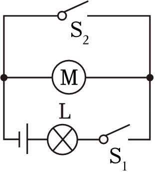
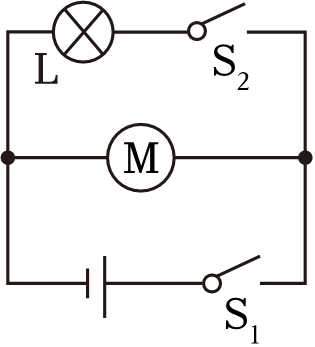
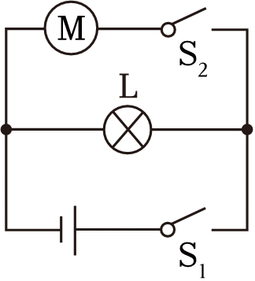
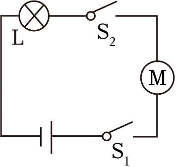
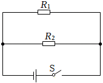
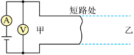
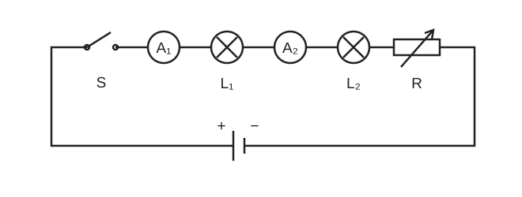
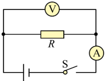
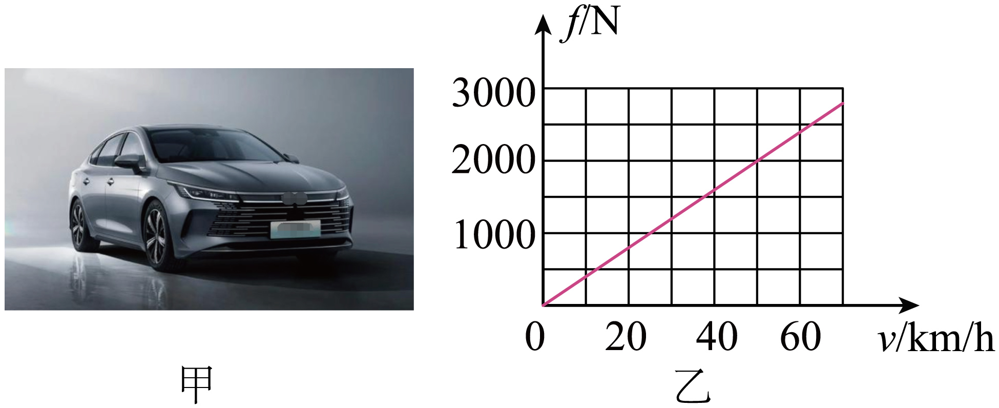

# 管庄分校初三上期中物理错题相似题训练（答案解析版） #h0

题源为指定的北京中考物理分类汇编。每组对应一处错题，题签标注中考或区校模拟出处。

## 对应原卷第7题 · 干路开关与支路开关

###### 1
> [!ti] *2025年海淀区校级三模｜专题13汇编第21题*
> 不戴头盔存在安全隐患，于是张明同学设计以下方案：骑行前，扫码成功后开关 $S_1$ 闭合，指示灯 $L$ 亮，但电机不工作；从车头取出头盔并戴上后，头盔内遥控设备遥控 $S_2$ 闭合，电动机才通电工作；若只戴头盔不扫码则无法骑行。下列电路符合以上设计要求的是（　　）
>
> > [!opts1]
> > - A. 
> > - B. 
> > - C. 
> > - D. 

### 答案

C

### 解析

灯和电动机并联。$S_1$ 控制整个电路，接在干路上。$S_2$ 只控制电动机，接在电动机所在支路上。与错题第7题的开关控制关系相同，原错题还要额外检查 LED 极性。

## 对应原卷第8题 · 灯不亮时判断电路故障

###### 2
> [!ti] *2025年东城区校级模拟｜专题15汇编第14题（2）节选*
> 在“测量小灯泡的额定功率”实验中，小灯泡的额定电压为 $2.5\,\mathrm V$。连接电路后，闭合开关 $S$，发现灯泡不亮，电压表示数为零，电流表有示数，产生这种现象的原因可能是 ______。

### 答案

灯泡短路。

### 解析

电流表有示数说明主回路仍导通。电压表并联在灯泡两端，示数为零说明灯泡两端几乎等势，符合灯泡被导线短接的现象。回到原第8题，先判电路是否导通，再看电压表改接后测的是哪两个节点。

## 对应原卷第11题 · 比热容表与质量条件

###### 3
> [!ti] *2025年西城区二模｜专题12汇编第12题*
> 依据表格中的数据，下列说法正确的是（　　）
>
> | 物质 | 比热容 $c/[\mathrm{J\cdot(kg\cdot{}^\circ C)^{-1}}]$ |
> | --- | ---: |
> | 水 | $4.2\times10^3$ |
> | 煤油 | $2.1\times10^3$ |
> | 砂石 | 约 $0.92\times10^3$ |
>
> > [!opts1]
> > - A. 一桶煤油用掉一半，桶内剩余煤油的比热容变小
> > - B. 水和砂石吸收相等的热量，水的温度升高得较多
> > - C. 水的比热容表示水的温度降低 $1\,{}^\circ\mathrm C$ 放出的热量是 $4.2\times10^3\,\mathrm J$
> > - D. 质量相等的水和煤油，升高相同温度，煤油吸收热量少

### 答案

D

### 解析

由 $Q=cm\Delta T$，质量和温升相同，煤油比热容较小，吸热较少。比热容不随取用质量改变。吸热相同但质量未知时，无法只凭比热容比较温升。解释比热容必须说清“1 kg”。

## 对应原卷第14题 · 电流、电压与电阻的判断

###### 4
> [!ti] *2022年北京中考｜专题14汇编第8题*
> 如图所示的电路中，电阻阻值 $R_1<R_2$。开关 $S$ 闭合后，$R_1$、$R_2$ 两端的电压分别为 $U_1$、$U_2$，通过 $R_1$、$R_2$ 的电流分别为 $I_1$、$I_2$。下列判断正确的是（　　）
>
> 
>
> > [!opts1]
> > - A. $U_1>U_2$
> > - B. $U_1<U_2$
> > - C. $I_1>I_2$
> > - D. $I_1=I_2$

### 答案

C

### 解析

两电阻并联，$U_1=U_2$。闭合后由 $I=U/R$ 得 $I_1>I_2$。本题练电流、电压和电阻的关系。回到原第14题，形成持续电流还需要通路，电阻也不会随两端电压变为零而消失。

## 对应原卷第15题 · 输电线短路定位

###### 5
> [!ti] *2025年西城区二模｜专题14汇编第29题*
> 在相距 $50\,\mathrm{km}$ 的甲、乙两地间沿直线架设两条输电线，已知每条输电线每1千米的电阻为 $0.2\,\Omega$。若输电线在某处发生了短路，为确定短路位置，检修人员在甲地利用电源、电压表和电流表连接成如图所示的电路进行测量。当电压表的示数为 $4\,\mathrm V$ 时，电流表的示数为 $0.5\,\mathrm A$。由此可判断短路位置离甲地的距离为（　　）
>
> 
>
> > [!opts1]
> > - A. $40\,\mathrm{km}$
> > - B. $30\,\mathrm{km}$
> > - C. $20\,\mathrm{km}$
> > - D. $10\,\mathrm{km}$

### 答案

C

### 解析

回路总电阻 $4/0.5=8\,\Omega$，对应往返两条线的总长度 $8/0.2=40\,\mathrm{km}$，短路点距甲地 $20\,\mathrm{km}$。原错题同样要把总线长除以2。

## 对应原卷第19（1）题 · 串联电流实验画图

###### 6
> [!ti] *2024年北京中考｜专题13汇编第1题（1）节选*
> 利用两端电压不变的电源、两个电流表、两个不同规格的小灯泡、滑动变阻器、开关和导线若干，探究在串联电路中，流入第二个灯泡的电流 $I_2$ 与流入第一个灯泡的电流 $I_1$ 是否相等。
>
> （1）画出实验电路图。

### 答案

将电源、开关、滑动变阻器、两个灯泡和两个电流表接成一个串联回路。

### 解析

按电流方向依次接：电源正极 → 开关 → $A_1$ → $L_1$ → $A_2$ → $L_2$ → 滑动变阻器 → 电源负极。$A_2$ 放在两个灯泡之间，直接测流入第二个灯泡的电流。原期中题问的是流出第二个灯泡的电流，画原题时把 $A_2$ 放到 $L_2$ 后面。

## 对应原卷第22（3）题 · 换电阻后恢复原电压

###### 7
> [!ti] *2021年北京中考｜专题14汇编第10题*
> 小圆想探究通过导体的电流与导体的电阻之间的关系，他利用干电池、电流表、电压表、多个阻值不同且已知的定值电阻、开关及导线，设计了如图所示的电路。实验中，他将定值电阻 $R$ 接入电路中，读出相应的电流表的示数并观察电压表的示数，记录实验数据。将 $R$ 换为不同阻值的另一个电阻后，小圆观察到电压表的示数增大了。小圆意识到自己的实验设计不能实现探究目的。
>
> （1）请你写出小圆的实验设计不能实现探究目的的原因：______。
>
> （2）请你画出能够实现探究目的的电路图（可以添加适当的实验器材）。
>
> （3）依据你设计的电路图，针对小圆不能实现探究目的的原因，写出操作的方法。
>
> 

### 答案

（1）未控制定值电阻两端电压相同。（2）在主回路串联滑动变阻器，电压表仍并联在定值电阻两端。（3）更换电阻后调节变阻器，使电压表示数恢复为原来记录的值，再读电流。

### 解析

第一次记下电压 $U$。每次换电阻前断开开关，闭合前把变阻器调至接入阻值最大处，闭合后调至电压表仍为 $U$，再记录电流。若换阻后电压偏大，要增大变阻器接入阻值，让它分担更多电压。

## 对应原卷第26题 · 匀速牵引、克服阻力做功与耗油

###### 8
> [!ti] *2024年北京二中校考一模｜2020—2024版专题25汇编第14题（2）节选＋补练*
> 测试人员驾驶一辆混合动力汽车在平直公路上以 $50\,\mathrm{km/h}$ 的速度匀速行驶 $1\,\mathrm h$。该车行驶时所受阻力 $f$ 和车速 $v$ 的关系如图乙所示。
>
> （1）【原题第（2）问】测试过程中汽车行驶时的牵引力大小为 ______ N。
>
> （2）【依照期中第26题补练】按上述速度行驶 $1\,\mathrm h$，若汽油完全燃烧放出的热量有30%用于克服阻力做功，汽油热值取 $4.6\times10^7\,\mathrm{J/kg}$，求耗油质量，结果保留一位小数。
>
> 

### 答案

（1）$2000\,\mathrm N$。（2）$7.2\,\mathrm{kg}$。

### 解析

由图读出 $50\,\mathrm{km/h}$ 时阻力为 $2000\,\mathrm N$，匀速时牵引力等于阻力。行驶路程 $s=50\,\mathrm{km}=5.0\times10^4\,\mathrm m$，克服阻力做功 $W=fs=1.0\times10^8\,\mathrm J$。由 $W=0.30mq$ 得 $m\approx7.2\,\mathrm{kg}$。
