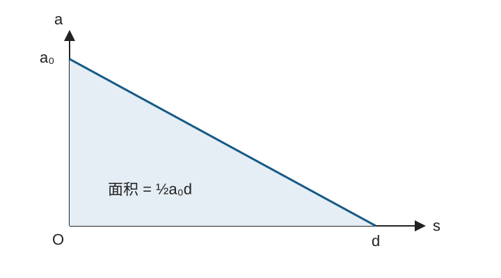

# 海淀区2026—2027学年第一学期期中练习 高三物理 #h0

版本：答案解析版。原题与原配图保留；需核对的条件在对应题目解析中说明。

2026.11　考试时长：90分钟满分：100分原卷共8页

本试卷共8页，100分。考试时长90分钟。

# 第一部分 (不定项)

本部分共10题，每题3分，共30分。在每题给出的四个选项中，有的题只有一个选项是正确的，有的题有多个选项是正确的。全部选对的得3分，选不全的得2分，有选错或不答的得0分。把正确的答案填涂在答题纸上。

###### 1
> [!ti] *2026年11月海淀区高三上学期期中物理第1题*
> 如图1所示，一重物用三根轻质细绳 $OA$、$OB$ 和 $OC$ 悬挂并处于静止状态。初始时 $OA$ 与 $OB$ 垂直，$OA$ 和 $OB$ 的拉力大小分别为 $T_A$ 和 $T_B$。保持 $O$ 点位置不动、$OA$ 方向不变，使 $OB$ 沿顺时针方向缓慢转至水平的过程中，下列判断正确的是
> %% 图位：原卷第1页，图1，三绳悬挂重物。 %%
> ![[Pasted image 20261105153728.png]]
> > [!opts2]
> > - A. $T_A$ 变小
> > - B. $T_A$ 变大
> > - C. $T_B$ 变小
> > - D. $T_B$ 变大

### 答案

BD

### 解析

设 $OA$ 与竖直方向夹角为 $\alpha$，$OB$ 与水平向右方向夹角为 $\beta$。初始两绳垂直，故 $\beta=\alpha$；转动过程中 $\beta$ 逐渐减小到0。对结点 $O$ 列平衡方程：
$$T_B\cos\beta=T_A\sin\alpha,\qquad T_A\cos\alpha+T_B\sin\beta=mg.$$
解得 $T_A=mg\cos\beta/\cos(\alpha-\beta)$，$T_B=mg\sin\alpha/\cos(\alpha-\beta)$。随着 $\beta$ 减小，$\cos\beta$ 增大、$\cos(\alpha-\beta)$ 减小，两拉力均增大。

###### 2
> [!ti] *2026年11月海淀区高三上学期期中物理第2题*
> 一辆被架起的自行车，其大齿轮、小齿轮、后轮的边缘处分别有 $A$、$B$、$C$ 三个点，如图2所示。转动脚踏板，大、小齿轮和后轮一起转动，下列说法正确的是
> %% 图位：原卷第1页，图2，自行车传动示意图。 %%
> ![[Pasted image 20261105153738.png]]
> > [!opts1]
> > - A. $A$ 点的角速度最小
> > - B. $C$ 点的角速度最小
> > - C. $B$ 点的线速度最大
> > - D. $C$ 点的线速度最大

### 答案

AD

### 解析

链条传动不打滑，大、小齿轮边缘的线速度相等，即 $v_A=v_B$。由于大齿轮半径更大，由 $v=\omega r$ 得 $\omega_A<\omega_B$。小齿轮与后轮同轴转动，$\omega_B=\omega_C$；后轮半径大于小齿轮，故 $v_C>v_B=v_A$。因此A点角速度最小，C点线速度最大。

###### 3
> [!ti] *2026年11月海淀区高三上学期期中物理第3题*
> 一列沿 $x$ 轴正方向传播的简谐横波，波源 $S$ 位于坐标原点，$P$ 为 $x=1.0\ \mathrm{m}$ 处的质点。$t=0$ 时，波源开始振动，$t=2.0\ \mathrm{s}$ 时该波恰好传到 $x=2.0\ \mathrm{m}$ 处，如图3所示。下列说法正确的是
> %% 图位：原卷第1页，图3，t=2.0 s时的波形图。 %%
> ![[Pasted image 20261105153748.png]]
> > [!opts1]
> > - A. $t=0$ 时，波源 $S$ 沿 $y$ 轴正方向开始振动
> > - B. $t=1.2\ \mathrm{s}$ 时，质点 $P$ 沿 $y$ 轴负方向振动
> > - C. $t=3.0\ \mathrm{s}$ 时，质点 $P$ 和波源 $S$ 相位相反
> > - D. 从 $t=0$ 到 $t=2.0\ \mathrm{s}$，质点 $P$ 刚好完成一次全振动

### 答案

BC

### 解析

波在2.0 s内传播2.0 m，所以波速 $v=1.0\ \mathrm{m/s}$。图示波长 $\lambda=2.0\ \mathrm{m}$，周期 $T=\lambda/v=2.0\ \mathrm{s}$。波前后方首先出现负位移，说明波源最初沿 $-y$ 方向振动，A错误。

$P$ 点在 $t=1.0\ \mathrm{s}$ 开始振动，到1.2 s只振动了0.2 s，仍沿负方向运动，B正确。$SP=\lambda/2$，两点均已振动后相位差始终为 $\pi$，C正确。到2.0 s时P只振动1.0 s，即半个周期，D错误。

###### 4
> [!ti] *2026年11月海淀区高三上学期期中物理第4题*
> 如图4所示，木块 $\mathrm{P}$、$\mathrm{Q}$ 置于水平地面上，二者之间用一根被拉伸的轻弹簧连接并处于静止状态。已知 $\mathrm{P}$、$\mathrm{Q}$ 与地面间的动摩擦因数相同，且 $\mathrm{P}$ 的质量大于 $\mathrm{Q}$ 的质量。设最大静摩擦力等于滑动摩擦力。现用水平拉力 $F$ 向右拉 $\mathrm{Q}$，在 $F$ 从0开始缓慢增大的过程中，弹簧始终处于弹性限度内。下列说法正确的是
> %% 图位：原卷第2页，图4，木块P、Q与弹簧。 %%
> ![[Pasted image 20261105153757.png]]
> > [!opts1]
> > - A. $\mathrm{P}$、$\mathrm{Q}$ 可能同时开始移动
> > - B. $\mathrm{P}$、$\mathrm{Q}$ 均未移动前，$\mathrm{P}$ 受到的摩擦力一直增大
> > - C. $\mathrm{P}$、$\mathrm{Q}$ 均未移动前，$\mathrm{Q}$ 受到的摩擦力先减小后增大
> > - D. $\mathrm{P}$ 刚开始移动时，$\mathrm{P}$ 受到的摩擦力大于 $\mathrm{Q}$ 受到的摩擦力

### 答案

CD

### 解析

设弹簧初始拉力为 $F_0$。两物块都没动时，弹簧伸长量不变，P所受摩擦力始终为 $F_0$，B错误。Q所受静摩擦力大小为 $|F-F_0|$，随 $F$ 从0增大，先减小到0，再反向增大，C正确。

初始静止要求 $F_0\le\mu m_Qg<\mu m_Pg$。Q开始运动前，P受到的拉力不足以达到自身最大静摩擦力，故Q先动，A错误。P刚开始动时，P所受摩擦力为 $\mu m_Pg$，Q已滑动，其摩擦力为 $\mu m_Qg$，由于 $m_P>m_Q$，D正确。

###### 5
> [!ti] *2026年11月海淀区高三上学期期中物理第5题*
> 如图5所示，将悬吊重物的气球从足够高处由静止释放，不计重物所受空气阻力。已知气球所受空气阻力的大小跟气球运动的速率成正比。图6中可能正确反映下落过程中，气球的速率 $v$、加速度大小 $a$、下落时间 $t$ 之间关系的是
> ![[Pasted image 20261105153821.png]]
> > [!opts4]
>![[Pasted image 20261105153845.png]]

### 答案

AC

### 解析

将气球和重物作为整体，设总质量为 $M$，恒定向下驱动力为 $F_0$（已扣除浮力），空气阻力为 $kv$。向下取正，有
$$Ma=F_0-kv,\qquad a=\frac{F_0}{M}-\frac{k}{M}v.$$
因此 $a-v$ 图像是一条斜率为负的直线，C正确。开始时速度为0，加速度最大；随后速度增大、加速度减小，最终速度趋近 $F_0/k$，加速度趋近0，故 $v-t$ 图像为A。B表示加速度恒定，不符合；D的加速度趋向非零常量，也不符合。

###### 6
> [!ti] *2026年11月海淀区高三上学期期中物理第6题*
> 我国计划发射嫦娥七号探测器，前往月球搜寻水冰证据。探测器先进入半径为 $r_1$ 的圆轨道1绕月运行，速率为 $v_1$、周期为 $T_1$。为开展精细观测，探测器降至半径为 $r_2$ 的圆轨道2绕月运行，速率为 $v_2$、周期为 $T_2$。假定探测器质量不变，下列说法正确的是
> 
> > [!opts1]
> > - A. $T_1:T_2=\sqrt{r_1}:\sqrt{r_2}$
> > - B. $v_1:v_2=\sqrt{r_2}:\sqrt{r_1}$
> > - C. 探测器在轨道2上的机械能与其在轨道1上的机械能相等
> > - D. 相等时间内，探测器与月心连线在轨道1上扫过的面积与其在轨道2上扫过的面积相等

### 答案

B

### 解析

由万有引力提供向心力，$GMm/r^2=mv^2/r$，得到 $v=\sqrt{GM/r}$，所以 $v_1/v_2=\sqrt{r_2/r_1}$，B正确。

周期 $T=2\pi\sqrt{r^3/(GM)}$，应有 $T_1/T_2=(r_1/r_2)^{3/2}$。圆轨道机械能为 $-GMm/(2r)$，半径变小时机械能减小。单位时间扫过面积为 $rv/2=\sqrt{GMr}/2$，不同半径的圆轨道并不相同；面积定律所说的恒定是同一条轨道上的比较。

###### 7
> [!ti] *2026年11月海淀区高三上学期期中物理第7题*
> 一物体由静止开始下落的过程中，除受到重力外，还受到大小为2倍重力的水平恒力。不计空气阻力。下列说法正确的是
> > [!opts1]
> > - A. 下落过程中，物体做匀变速曲线运动
> > - B. 在下落后的任意时刻，物体水平分速度一定是其竖直分速度的2倍
> > - C. 下落过程中的任意时间内，物体动能增加量是其重力势能减少量的 $\sqrt{5}$ 倍
> > - D. 下落过程中的任意时间内，物体机械能增加量是其重力势能减少量的4倍

### 答案

BD

### 解析

取水平受力方向及竖直向下为正，$a_x=2g$、$a_y=g$。由静止出发，$v_x=2gt$、$v_y=gt$，故B正确。合加速度方向固定且初速度为0，物体沿合力方向做匀加速直线运动，A错误。

在任意一段运动中，都有水平位移 $\Delta x=2\Delta y$。重力做功 $W_g=mg\Delta y$，水平恒力做功 $W_F=2mg\Delta x=4mg\Delta y$。因此动能增加量为 $5mg\Delta y$，机械能增加量为 $W_F=4mg\Delta y$，C错误、D正确。

###### 8
> [!ti] *2026年11月海淀区高三上学期期中物理第8题*
> 两个小球 $a$、$b$（均可视为质点）分别置于两个完全相同的固定光滑斜面顶端。某时刻，$a$ 球由静止释放，$b$ 球被水平抛出，且恰能落至斜面底端，如图7所示。不计空气阻力。关于两个小球的运动，下列说法正确的是
>![[Pasted image 20261105153907.png]]
> > [!opts1]
> > - A. 两球同时到达斜面底端
> > - B. 两球到达斜面底端时的速度大小相同
> > - C. 两球均未到达斜面底端前的任意同一时刻，$a$ 球速度小于 $b$ 球速度
> > - D. 从顶端至底端的过程中，两球速度变化量的大小相同

### 答案

CD

### 解析

设斜面高度为 $h$、倾角为 $\alpha$，b球水平初速度为 $u>0$。a球沿斜面加速度为 $g\sin\alpha$，到达底端需时 $t_a=\sqrt{2h/g}/\sin\alpha$；b球平抛需时 $t_b=\sqrt{2h/g}$，故b先到达，A错误。

到达底端时，$v_a=\sqrt{2gh}$，$v_b=\sqrt{u^2+2gh}>v_a$，B错误。在两球都未到达的同一时刻，$v_a=g\sin\alpha\,t<\sqrt{u^2+g^2t^2}=v_b$，C正确。

a球初速度为0，速度变化量大小为 $\sqrt{2gh}$；b球水平速度不变，速度变化量只有竖直分量，其大小 $gt_b=\sqrt{2gh}$，D正确。速度变化量大小相同不等于末速度大小相同。

###### 9
> [!ti] *2026年11月海淀区高三上学期期中物理第9题*
> 一根轻质橡皮筋下端挂一钩码，上端与固定的拉力传感器相连。用手将钩码移至某位置释放，钩码沿竖直方向振动，传感器的示数 $F$ 与时间 $t$ 的关系如图8所示。下列说法正确的是
> %% 图位：原卷第3页，图8，拉力F随时间t变化图象及阴影区域。 %%
>![[Pasted image 20261105153917.png]]
> > [!opts1]
> > - A. $t_2$ 时刻，钩码正在向下运动
> > - B. $t_2$ 时刻，钩码处于失重状态
> > - C. $t_3$ 时刻钩码所受拉力的功率大于 $t_4$ 时刻钩码所受拉力的功率
> > - D. $t_1\sim t_3$ 时间内，图中阴影部分的面积表示该过程中钩码动量变化量的大小

### 答案

C

### 解析

最终静止时传感器示数等于重力，图中水平虚线即 $mg$。$t_2$ 处拉力仍大于 $mg$，而且正在减小：橡皮筋伸长量减小，钩码正在上行，且拉力大于重力，处于超重状态，故A、B错误。

$t_3$、$t_4$ 两时刻，拉力都等于 $mg$，图线都处于向下穿越平衡值的阶段，对应钩码向上通过平衡位置。振动逐渐衰减，所以较早的 $t_3$ 上行速率更大。拉力与速度同向，$P=Fv=mgv$，故 $P_3>P_4$，C正确。

图示阴影从 $t_1$ 画到 $t_2$，并非覆盖整个 $t_1\sim t_3$ 区间。动量变化要计算完整区间内合力的冲量，不能把该局部阴影面积当成全程动量变化，D错误。

###### 10
> [!ti] *2026年11月海淀区高三上学期期中物理第10题*
> 落球黏度计是测量液体黏滞系数 $\eta$ 的常用仪器。测量时，在足够深的竖直玻璃管内充满待测液体，让浸没其中的小球沿轴线由静止释放，小球加速后达到最大速度。已知玻璃管的内径为 $D$，小球的直径为 $d$。黏滞阻力大小 $F$ 与速度大小 $v$ 满足 $F=3\pi\eta dv$。
>
> 在实际测量中，需要考虑以下影响：
>
> ①由于管壁对小球运动的影响，小球受到液体的黏滞阻力可近似为 $F=3\pi\eta dv\left(1+k\frac{d}{D}\right)$，其中 $k$ 为常数（$k>0$）。
>
> ②当液体温度发生微小变化 $\Delta t$ 时，黏滞系数可近似为 $\eta=\frac{\eta_0}{1+\gamma\Delta t}$，其中 $\eta_0$ 为初始温度下的黏滞系数、$\gamma$ 为系数（$\gamma>0$）。
>
> 根据上述信息，下列说法正确的是
>
> > [!opts1]
> > - A. 忽略①和②的影响，小球下落的最大速度与 $d$ 成正比
> > - B. 仅使液体温度降低，小球下落的最大速度将变小
> > - C. 仅换用 $D$ 更小的玻璃管，小球下落的最大速度将变小
> > - D. 下落过程中，小球损失的机械能全部转化为内能

### 答案

BC

### 解析

设球、液体密度分别为 $\rho_s$、$\rho_l$。达到最大速度时受力平衡：
$$(\rho_s-\rho_l)\frac{\pi d^3}{6}g=3\pi\eta d\left(1+k\frac dD\right)v_{\max}.$$
所以
$$v_{\max}=\frac{(\rho_s-\rho_l)gd^2}{18\eta(1+kd/D)}.$$
忽略两种修正时，最大速度与 $d^2$ 成正比，A错误。降温时 $\Delta t<0$，黏滞系数增大，最大速度减小，B正确。$D$ 减小时管壁修正项增大，最大速度减小，C正确。

小球下落时除受到黏滞阻力外，还受到浮力。小球损失的机械能有一部分用于抬高被置换液体、增加液体的重力势能，并非全部转化为内能，D错误。

# 第二部分

本部分共8题，共70分。

###### 11
> [!ti] *2026年11月海淀区高三上学期期中物理第11题*
> （7分）用如图9所示装置探究加速度与力、质量的关系。
>
> %% 图位：原卷第4页，图9，小车、打点计时器、槽码实验装置。 %%
>
> （1）除了图9中所给器材以及交流电源、导线和刻度尺外，在下列器材中，还必须使用的器材是________。（填选项前的字母）
> ![[Pasted image 20261105153939.png]]
> > [!opts2]
> > - A. 秒表
> > - B. 天平（含砝码）
>
> （2）实验前，需要思考如何测“力”。为了简化“力”的测量，需要先平衡摩擦力。关于平衡摩擦力，下列操作的正确顺序是________。（填写序号）
>
> ①将打点计时器上的纸带与小车相连，小车另一端不悬挂槽码
>
> ②调节木板的倾斜度，使小车能拖动纸带沿倾角合适的木板匀速运动
>
> ③把木板的一端垫高，用手给小车一个初速度，让小车在木板上运动
>
> （3）实验中保持小车所受拉力不变，通过增减小车中的重物改变小车的总质量 $M$。某同学在满足实验要求，并进行正确操作后，得到多组不同的 $M$ 对应的加速度 $a$，并绘出 $a-M$ 图像，如图10所示。请根据 $a-M$ 图像，写出 $a$ 与 $M$ 成反比的判断依据。
>![[Pasted image 20261105153950.png]]
> %% 图位：原卷第4页，图10，a-M方格图；蓝色辅助线与数字为手写，不属于原图。 %%

### 答案

（1）B。（2）①③②。（3）图线上多组对应的 $a$、$M$ 满足 $aM$ 近似相同。

### 解析

（1）纸带的时间间隔由打点计时器提供，不需要秒表；探究质量因素必须测量小车及重物的总质量，需用天平。

（2）先不悬挂槽码并连接纸带，再垫高木板、给小车初速度，最后调节倾角使小车拖动纸带匀速运动。此时重力沿斜面分力恰好平衡阻力，操作顺序为①③②。

（3）从图像上取多个点，读出横、纵坐标，并比较乘积。若在实验误差范围内有 $a_1M_1\approx a_2M_2\approx a_3M_3$，即由各点与坐标轴围成的矩形面积近似相等，就支持 $a\propto1/M$。只说“图像下降”不足以证明反比例关系。

###### 12
> [!ti] *2026年11月海淀区高三上学期期中物理第12题*
> （8分）甲、乙两组同学研究气垫导轨上滑块碰撞时的动量守恒。
>
> %% 图位：原卷第5页，图11，滑块、遮光条与光电门装置。 %%
>
> （1）甲组同学用如图11所示装置进行研究。实验前，他们先选取两个质量不同的滑块，滑块上均安装有遮光条和弹性碰撞架。
>
> ①用如图12所示20分度的游标卡尺测量遮光条的宽度 $d$，测得 $d=$________$\mathrm{mm}$。
>
> %% 图位：原卷第5页，图12，20分度游标卡尺读数图。 %%
>
> ②实验前，用一个滑块进行如下操作，其中正确的是________。（填选项前的字母）
>![[Pasted image 20261105154008.png]]
> ![[Pasted image 20261105154017.png]]
> > [!opts1]
> > - A. 导轨未通气时，使导轨一端略高于另一端，以平衡摩擦阻力
> > - B. 导轨未通气时，滑块可以静止在导轨上任意位置，说明导轨已调水平
> > - C. 导轨通气时，滑块的遮光条先后通过两个光电门的时间相等，说明导轨已调水平
>
> ③测得左、右两个滑块（含遮光条和弹性碰撞架）的质量分别为 $m_1$、$m_2$，遮光条的宽度均为 $d$。调节气垫导轨水平后开始实验，轻推左侧滑块，使其与静止的右侧滑块发生碰撞后，左侧滑块立即反弹。配套的数字计时器记录了左侧滑块的遮光条连续两次通过光电门的时间分别为 $t_1$、$t_1'$，右侧滑块的遮光条通过光电门的时间为 $t_2'$。
>
> 在误差允许范围内，满足表达式________表明两滑块碰撞前后系统的动量守恒。
>
> （2）乙组同学换用另一套装置进行实验，如图13所示。该组同学的操作步骤如下：
>
> ①先将气垫导轨通气；
>
> ②在两个滑块间放置轻质弹簧，挤压两个滑块使弹簧压缩，并用一根细线将两个滑块连接，置于气垫导轨上。
>
> ③放开两个滑块同时烧断细线，弹簧在极短时间内落下，两个滑块由静止向相反方向运动。
>![[Pasted image 20261105154030.png]]
> 已知左、右两个滑块（含遮光条）质量分别为 $m_1'$、$m_2'$，两个滑块被弹开后经过光电门测得的速率分别为 $v_1$、$v_2$。重复多次实验，他们都发现 $m_1'v_1>m_2'v_2$，分析说明产生该结果的可能原因。
>
> %% 图位：原卷第5页，图13，另一套气垫导轨装置与两滑块间弹簧。 %%

### 答案

（1）①$5.20\ \mathrm{mm}$；②C；③$\frac{m_1}{t_1}=-\frac{m_1}{t_1'}+\frac{m_2}{t_2'}$。（2）例如导轨左低右高，未调水平。

### 解析

（1）①20分度游标卡尺精度为0.05 mm，主尺读数为5 mm，游标第4条刻线与主尺对齐，故 $d=5+4\times0.05=5.20\ \mathrm{mm}$。

②导轨通气后摩擦很小，同一遮光条两次遮光时间相等，说明两处速率相等，可判断导轨水平。未通气时静摩擦可能使滑块停在倾斜导轨上，不能用“能静止”判断水平，也不应靠倾斜来平衡气垫实验中的摩擦。

③选向右为正，遮光时间很短，速度大小近似为 $d/t$。碰前总动量 $m_1d/t_1$；碰后左滑块反弹，其动量为 $-m_1d/t_1'$，右滑块为 $m_2d/t_2'$。动量守恒式两边约去 $d$ 即得答案，反弹项负号不可漏。

（2）如果导轨左低右高，弹开后左滑块沿斜面向低处加速、右滑块向高处减速，到光电门时便可能测得 $m_1'v_1>m_2'v_2$。这属于测量前的运动受到外力影响，不表示弹簧释放瞬间的内力违背动量守恒。实验步骤中缺少先调水平的操作。

###### 13
> [!ti] *2026年11月海淀区高三上学期期中物理第13题*
> （8分）如图14所示，倾角为 $\theta$ 的光滑斜面固定在水平面上。一质量为 $m$ 的小物块（可视为质点）从斜面顶端由静止下滑。已知斜面长为 $L$，重力加速度为 $g$。求：
>
> （1）物块加速度的大小 $a$。
>
> （2）物块到达斜面底端时速度的大小 $v$。
>
> （3）物块到达斜面底端时重力的瞬时功率 $P$。
>
> %% 图位：原卷第6页，图14，光滑斜面与物块。 %%
> ![[Pasted image 20261105154041.png]]

### 答案

（1）$a=g\sin\theta$。（2）$v=\sqrt{2gL\sin\theta}$。（3）$P=mg\sin\theta\sqrt{2gL\sin\theta}$。

### 解析

沿斜面方向列牛顿第二定律，$mg\sin\theta=ma$，得 $a=g\sin\theta$。由 $v^2=2aL$，得底端速度 $v=\sqrt{2gL\sin\theta}$。

重力瞬时功率等于重力在速度方向的分量与速率的乘积，因此 $P=(mg\sin\theta)v$，代入上式得到答案。这里不能直接写 $mgv$，因为速度沿斜面，重力竖直向下。

###### 14
> [!ti] *2026年11月海淀区高三上学期期中物理第14题*
> （8分）一质量 $m=60\ \mathrm{kg}$ 的蹦床运动员，从离水平网面高度 $h_1=3.2\ \mathrm{m}$ 处自由下落，着网后沿竖直方向蹦回到离水平网面高度 $h_2=5.0\ \mathrm{m}$ 处。已知运动员与网接触的时间 $t=0.8\ \mathrm{s}$，取重力加速度 $g=10\ \mathrm{m/s^2}$，不计空气阻力。求：
>
> （1）运动员与网接触的过程中，其动量变化量的大小 $\Delta p$。
>
> （2）运动员与网接触的过程中，网对运动员平均作用力的大小 $F$。
>
> （3）从自由下落至回到离水平网面高度 $h_2$ 处的过程中，运动员所受重力冲量的大小 $I_G$。

### 答案

（1）$1080\ \mathrm{kg\cdot m/s}$。（2）$1950\ \mathrm{N}$。（3）$1560\ \mathrm{N\cdot s}$。

### 解析

接触网前的速率 $v_1=\sqrt{2gh_1}=8.0\ \mathrm{m/s}$，离网后的速率 $v_2=\sqrt{2gh_2}=10\ \mathrm{m/s}$。取向上为正，接触过程动量变化为
$$\Delta p=mv_2-(-mv_1)=60(10+8)=1080\ \mathrm{kg\cdot m/s}.$$
用动量定理 $(F-mg)t=\Delta p$，解得 $F=600+1080/0.8=1950\ \mathrm{N}$。

全过程包括下落、接触网、上升三段，所需时间分别为0.8 s、0.8 s、1.0 s。重力始终向下，冲量大小为 $I_G=mg(0.8+0.8+1.0)=1560\ \mathrm{N\cdot s}$，不能漏掉接触网的时间。

###### 15
> [!ti] *2026年11月海淀区高三上学期期中物理第15题*
> （8分）如图15所示为半径 $R=50\ \mathrm{m}$ 的圆弧形拱桥，$A$、$B$ 两处位于桥面上，其中 $B$ 处为桥顶。有一质量 $m=800\ \mathrm{kg}$ 的小汽车行驶上桥，先后经过桥面上 $A$、$B$ 两处。取重力加速度 $g=10\ \mathrm{m/s^2}$，不计空气阻力。
>
> %% 图位：原卷第6页，图15，圆弧拱桥与A、B、O、h。 %%
>
> （1）若汽车到达桥顶 $B$ 处时的速度 $v=10\ \mathrm{m/s}$，求桥对汽车支持力的大小 $F$。
>
> （2）汽车在过桥过程中，其对桥面的压力过小是不安全的。图中 $A$ 处与 $B$ 处间竖直距离 $h=10\ \mathrm{m}$。
>
> a. 汽车通过 $B$ 处时，对于同样的车速，分析说明拱桥圆弧的半径应该设计得大些比较安全，还是小些比较安全？
>
> b. 为保证行车安全，汽车经过 $A$ 处不能脱离桥面，求汽车经过 $A$ 处时的最大速度 $v_{\mathrm{m}}$。
> ![[Pasted image 20261105154052.png]]

### 答案

（1）$6400\ \mathrm{N}$。（2）a. 半径设计得大些；b. $v_{\mathrm m}=20\ \mathrm{m/s}$。

### 解析

（1）桥顶向心方向向下，$mg-F=mv^2/R$，故 $F=8000-800\times10^2/50=6400\ \mathrm{N}$。

（2）a. 同样车速下，$F=mg-mv^2/R$，增大 $R$ 可以增大支持力，避免压力过小或脱离桥面，因此较大半径更安全。

b. 设 $OA$ 与竖直向上方向夹角为 $\alpha$，则 $\cos\alpha=(R-h)/R=0.8$。沿指向圆心的方向列式，$mg\cos\alpha-F_A=mv_A^2/R$。不脱离桥面要求 $F_A\ge0$，最大速度对应 $F_A=0$，所以
$$v_{\mathrm m}=\sqrt{gR\cos\alpha}=\sqrt{g(R-h)}=20\ \mathrm{m/s}.$$

###### 16
> [!ti] *2026年11月海淀区高三上学期期中物理第16题*
> （9分）运动员立定跳远时要经历起跳、腾空和落地三个过程。
>
> 为研究起跳过程，某同学作如下简化：
>
> 在起跳过程中，运动员重心从静止开始做与水平方向夹角为 $\theta$ 的直线运动，速度达到最大时双脚离地。该过程中，运动员重心的加速度 $a$ 与其位移 $s$ 的关系为 $a=a_0\left(1-\frac{s}{d}\right)$，已知 $a_0$ 为初始加速度、$d$ 为最大位移，重力加速度为 $g$。不计空气阻力。
>
> （1）研究起跳过程，
>
> a. 在图16中画出 $a$ 与 $s$ 的关系图线。
>
> b. 求离地瞬间运动员重心速度的大小 $v_0$。
>
> %% 图位：原卷第6页，图16，待作图的a-s空白坐标轴；蓝色图线和标注为手写答案。 %%
>
> （2）研究腾空过程，以离地瞬间运动员重心位置为坐标原点，水平向前为 $x$ 轴正方向，竖直向上为 $y$ 轴正方向，建立平面直角坐标系。推导 $\theta=45^\circ$ 时腾空阶段运动员重心的轨迹方程。
> ![[Pasted image 20261105154102.png]]

### 答案

（1）a. 从 $(0,a_0)$ 到 $(d,0)$ 的直线段；b. $v_0=\sqrt{a_0d}$。（2）$y=x-\frac{gx^2}{a_0d}$。

### 解析

（1）a. $a=a_0-(a_0/d)s$，截距为 $a_0$，斜率为 $-a_0/d$，图线如下。

b. 对起跳过程用动能定理。合力为 $ma$，合力—位移图像面积为 $m$ 倍的 $a-s$ 图像面积，因此
$$\frac12mv_0^2=m\times\frac12a_0d,\qquad v_0=\sqrt{a_0d}.$$
这里不能把变化的加速度当成恒定的 $a_0$ 使用。

（2）腾空后仅受重力，初速度与水平成 $45^\circ$：
$$x=\frac{v_0}{\sqrt2}t,\qquad y=\frac{v_0}{\sqrt2}t-\frac12gt^2.$$
消去 $t$ 并代入 $v_0^2=a_0d$，得 $y=x-gx^2/(a_0d)$。

###### 17
> [!ti] *2026年11月海淀区高三上学期期中物理第17题*
> （10分）在天文学中，天体运动的周期性现象，往往是新发现的入口。假定太阳系中的天体都在同一平面上运动。
>
> （1）a. 在地球、月球系统中，已知地球质量为 $M$，月心到地心间的距离为 $r$，引力常量为 $G$，求月球绕地球做匀速圆周运动的周期 $T_{\text{月}}$。
>
> b. 当月球、地球、太阳位于同一直线上，且地球位于月球和太阳之间时，月相为满月，也称为望月。已知（1）a中 $T_{\text{月}}=27.3\ \mathrm{d}$，地球绕太阳公转的周期 $T_{\text{地}}=365\ \mathrm{d}$。实际观测发现相邻望月的时间间隔大于 $T_{\text{月}}$。求出现相邻望月的时间间隔 $T_0$。
>
> （2）在对天王星研究的过程中，科学家发现天王星运动的实际数据与理论数据存在差异。因此天文学家猜想天王星轨道外侧还有一颗未知天体也绕太阳做匀速圆周运动。当未知天体靠近天王星时会对天王星的运动产生微小扰动。已知天王星的公转周期为 $T$，每经过 $kT$（$k$ 为已知常数）的时间，理论计算出的天王星的位置与其实际位置会出现微小偏差。已知天王星的轨道半径为 $R$，求未知天体的轨道半径 $R'$。
>

### 答案

（1）a. $T_{\text{月}}=2\pi\sqrt{r^3/(GM)}$；b. $T_0\approx29.5\ \mathrm{d}$。（2）$R'=R\left(\frac{k}{k-1}\right)^{2/3}$（同向公转，$k>1$）。

### 解析

（1）a. 设月球质量为 $m$，由万有引力提供向心力，$GMm/r^2=m(2\pi/T_{\text{月}})^2r$，解得 $T_{\text{月}}=2\pi\sqrt{r^3/(GM)}$。

b. 按日、地、月系统的同向公转，出现下一次满月时，月球相对于地日连线多转一周，故
$$\left(\frac{2\pi}{T_{\text{月}}}-\frac{2\pi}{T_{\text{地}}}\right)T_0=2\pi.$$
所以 $T_0=T_{\text{月}}T_{\text{地}}/(T_{\text{地}}-T_{\text{月}})=27.3\times365/(365-27.3)\approx29.5\ \mathrm{d}$。

（2）按两天体同向公转，外侧天体周期 $T'>T$。相邻靠近间隔为 $kT$，于是 $(1/T-1/T')kT=1$，得 $T'=kT/(k-1)$。两者绕同一中心天体运动，$R'^3/T'^2=R^3/T^2$，故 $R'=R[k/(k-1)]^{2/3}$。

这里采用太阳系行星同向公转的通常模型；仅“共面”在数学上并不排除逆向运动，若另设逆向天体，相遇条件应改用角速度之和。

###### 18
> [!ti] *2026年11月海淀区高三上学期期中物理第18题*
> （12分）长征十号乙运载火箭完成全球首次海上网系回收，标志着我国在重复使用运载火箭技术领域取得重大突破。网系回收系统由绳索、滑轮组、液压缓冲装置等组成。图17为火箭网系回收系统示意图。图18为液压缓冲装置内部水平放置的阻尼器的简化图。利用上述回收系统回收火箭的过程如下：火箭先垂直喷气减速下降进入捕获网，精准卡入“井”字形网中，停止喷气。通过绳索拉动阻尼器，使火箭最终安全停稳。
>
> ![[Pasted image 20261105154122.png]]
>
> （1）运动的活塞可推动液压油从阻尼器一端经过一小段细管进入其他装置。已知液压油的密度为 $\rho$，细管的横截面积为 $S$，活塞的横截面积为细管的横截面积的 $N$ 倍，液压油不可压缩，且不计其黏滞阻力及其与管壁的摩擦力。当活塞以速度 $v$ 运动时，
>
> %% 图位：原卷第8页，图18，液压油、活塞与细管截面C。 %%
>![[Pasted image 20261105154130.png]]
> a. 求液压油在细管中的速度大小 $u$。
>
> b. 已知细管截面 $C$ 处的压强为 $p_C$，求活塞受到的液压阻力 $f$。
>
> （2）火箭接触捕获网后会同时受到阻尼器和绳索、滑轮组的作用使火箭减速。火箭从某一速度持续减速至0的过程可简化为三个阶段，其加速度大小 $a$ 随时间 $t$ 的变化，分别为
>
> $$
> a=\begin{cases}
> \dfrac{a_0}{t_0}t, & 0\leq t\leq t_0,\\
> a_0, & t_0<t\leq 2t_0,\\
> a_0-\dfrac{a_0}{t_0}(t-2t_0), & 2t_0<t\leq 3t_0.
> \end{cases}
> $$
>
> 其中 $a_0$、$t_0$ 均为已知量。已知火箭总质量为 $M$，重力加速度为 $g$。求该过程中火箭机械能的变化量 $\Delta E$。

### 答案

（1）a. $u=Nv$；b. $f=NS\left[p_C+\frac12\rho(N^2-1)v^2\right]$。（2）$\Delta E=-Ma_0t_0^2(2a_0+3g)$。

### 解析

（1）a. 液压油不可压缩，同一小段时间内被活塞推动的体积等于细管流出体积：$NSv\Delta t=Su\Delta t$，故 $u=Nv$。

b. 按题设无黏滞、无摩擦的准稳定理想流动处理。设活塞处油压为 $p_1$，取一小段等体积 $\Delta V$ 的油，从宽管进入细管，两处高度相同。压强做的净功转化为油的动能增加：
$$(p_1-p_C)\Delta V=\frac12\rho\Delta V(u^2-v^2).$$
所以 $p_1=p_C+\rho(u^2-v^2)/2$。油对活塞的液压力大小 $f=p_1NS$，代入 $u=Nv$ 即得
$$f=NS\left[p_C+\frac12\rho(N^2-1)v^2\right].$$
该式指油侧作用力，$p_C$ 与 $p_1$ 应采用同一压强基准；若求扣除活塞另一侧环境压力后的净阻力，应相应采用表压。不能只对细管流量写动量变化而遗漏收缩段管壁的压力作用。

（2）火箭始终向下运动、加速度向上。由题给加速度大小画出的图像，面积为
$$\Delta v=\frac12a_0t_0+a_0t_0+\frac12a_0t_0=2a_0t_0.$$
末速度为0，故初速 $v_i=2a_0t_0$。图像关于 $t=3t_0/2$ 对称，因此互补时刻满足 $v(t)+v(3t_0-t)=v_i$，全程平均速率为 $v_i/2=a_0t_0$。下降高度为 $H=3a_0t_0^2$。

机械能变化量取末态减初态，动能、重力势能均减少：
$$\Delta E=-\frac12Mv_i^2-MgH=-2Ma_0^2t_0^2-3Mga_0t_0^2=-Ma_0t_0^2(2a_0+3g).$$
注意第三段加速度大小从 $a_0$ 线性减到0，不能画成继续增大的折线。

