# 高三年级物理学科三校联考 #h0

考试时长90分钟。原卷10页。

考查知识：运动的描述、匀变速直线运动、相互作用、牛顿运动定律、曲线运动、万有引力与宇宙航行、机械能、动量、静电场。

考查能力：理解能力、推理能力、实验探究能力、模型建构能力。

# 一、单项选择题

下列各小题均有四个选项，其中只有一个选项符合题意。

###### 1
> [!ti] *高三物理三校联考第1题*
> 一辆汽车在水平公路上转弯，沿曲线由 $M$ 向 $N$ 行驶且速度大小逐渐增大。下图中画出了汽车转弯时所受合力 $F$ 的四种方向，可能正确的是（　　）
>
> %% 图位：原卷第1页，四幅选项图。 %%
>
> > [!opts1]
> > - A. 见图A
> > - B. 见图B
> > - C. 见图C
> > - D. 见图D

###### 2
> [!ti] *高三物理三校联考第2题*
> 如图所示，悬吊重物的轻质细绳 $OA$ 被一水平轻质细绳 $OB$ 牵引，$O$ 为结点，绳 $OA$ 与竖直方向夹角为 $\theta$。悬吊物所受重力的大小为 $G$，绳 $OA$ 和绳 $OB$ 所受拉力的大小分别为 $T_A$ 和 $T_B$。保持 $O$ 点位置不变，若 $B$ 点向上移，则 $T_A$ 和 $T_B$ 的变化，下列判断正确的是
>
> %% 图位：原卷第1页，细绳与重物。 %%
>
> 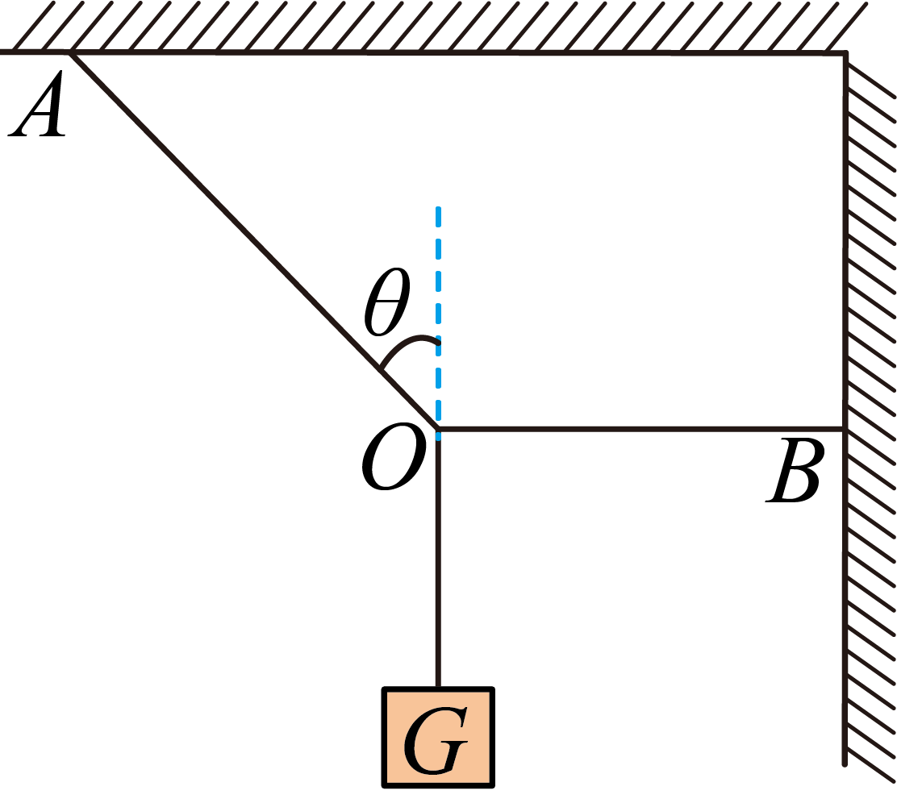
> > [!opts1]
> > - A. $T_A$ 一直增大
> > - B. $T_A$ 一直减小
> > - C. $T_B$ 一直增大
> > - D. $T_B$ 一直减小

###### 3
> [!ti] *高三物理三校联考第3题*
> 关于教材中的插图，下列理解不正确的是（　　）
>
> %% 图位：原卷第2页，四幅教材插图。 %%
>
> 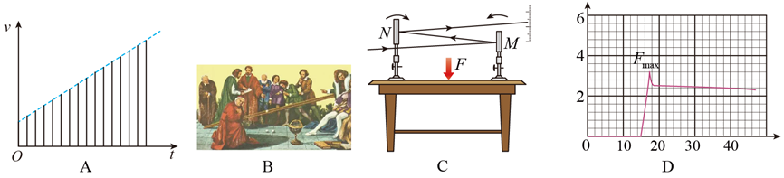
> > [!opts1]
> > - A. A图是用微元法探究匀变速直线运动的位移，所有小矩形面积之和近似等于物体的位移大小，分得越少则越接近
> > - B. B图是伽利略在做铜球沿斜面运动的实验，其中斜面的作用是“冲淡”重力，方便测时间，随着斜面倾角的增大，伽利略观察到铜球的运动规律相同，合理外推得到自由落体运动规律
> > - C. C图桌面上的装置可以放大桌面的微小形变，所运用的主要研究方法与卡文迪许测量引力常量的主要研究方法相同
> > - D. D图是物体由静止状态被拉动，直到物体匀速运动起来，用力的传感器测得拉力的变化过程，说明物体所受的最大静摩擦力大于滑动摩擦力

###### 4
> [!ti] *高三物理三校联考第4题*
> 人站在力传感器上完成“下蹲”和“起立”动作，下图中呈现的是力传感器的示数随时间变化的情况，由此可以判断（　　）
>
> %% 图位：原卷第2页，力传感器图像（部分图线缺损）。 %%
>
> 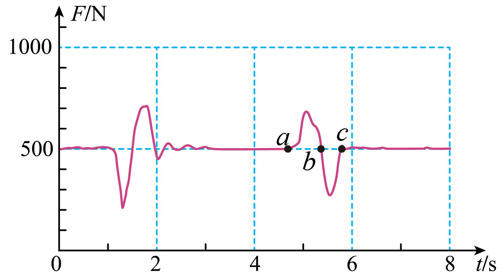
> > [!opts1]
> > - A. 此人先起立后下蹲
> > - B. 起立时先失重后超重
> > - C. $a\to b$ 为“起立”过程，$b\to c$ 为“下蹲”过程
> > - D. $a\to b$ 为“起立”的超重过程，$b\to c$ 为“起立”的失重过程

###### 5
> [!ti] *高三物理三校联考第5题*
> 如图所示，两个相同的光滑弧形槽，一个为 $A_1B_1C_1$ 凸形，一个为 $A_2B_2C_2$ 凹形，两个相同小球分别进入两弧形槽的速度都为 $v$，运动到槽的末端速度也都为 $v$，小球通过凸形槽的时间为 $t_1$，通过凹形槽的时间为 $t_2$，则 $t_1$、$t_2$ 的关系为（　　）
>
> %% 图位：原卷第2—3页，凸槽与凹槽。 %%
>
> 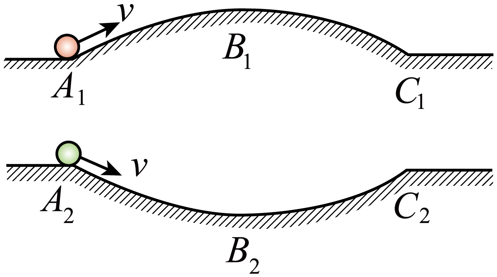
> > [!opts1]
> > - A. $t_1>t_2$
> > - B. $t_1=t_2$
> > - C. $t_1<t_2$
> > - D. 无法确定

###### 6
> [!ti] *高三物理三校联考第6题*
> 图甲为一列简谐横波在 $t=1.0\,\mathrm s$ 时的波形图，$P$ 是平衡位置为 $x=2\,\mathrm m$ 处的质点，$Q$ 是平衡位置为 $x=4\,\mathrm m$ 处的质点，图乙为质点 $Q$ 的振动图像。下列判断正确的是（　　）
>
> %% 图位：原卷第3页，波形图和振动图（振动曲线后半段缺损）。 %%
>
> 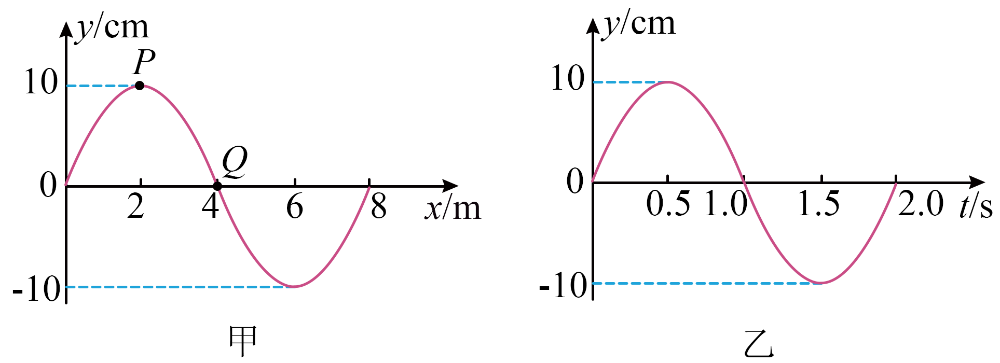
> > [!opts1]
> > - A. 该波沿 $x$ 轴负方向传播
> > - B. $t=1.5\,\mathrm s$ 时，质点 $P$ 的位移达到负向最大
> > - C. $t=1.5\,\mathrm s$ 时，质点 $Q$ 的回复力方向沿 $y$ 轴负方向
> > - D. 这列简谐波的波速为 $8\,\mathrm{m/s}$

###### 7
> [!ti] *高三物理三校联考第7题*
> 如图，在电场强度 $E=kQ/r^2$ 的匀强电场中，取 $O$ 点为圆心，$r$ 为半径，作一圆周，$a$、$b$、$c$、$d$ 为圆周上四点。在 $O$ 点固定一带电荷量为 $+Q$ 的点电荷，则 $a$、$b$、$c$、$d$ 各点电场强度的大小为（　　）
>
> %% 图位：原卷第3页，场强叠加示意图（点名缺损）。 %%
>
> 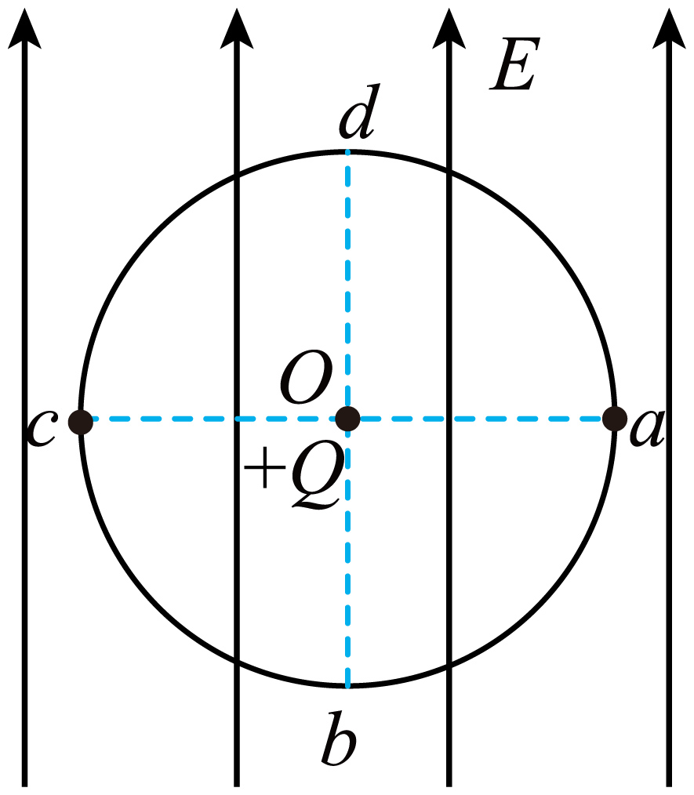
> > [!opts1]
> > - A. $E_a=E$
> > - B. $E_a=E_b=\sqrt2 E$
> > - C. $E_c=0$
> > - D. $E_d=2E$

###### 8
> [!ti] *高三物理三校联考第8题*
> 如图所示，京张高铁将北京到张家口的通行时间缩短在1小时内，成为2022年北京冬奥会重要的交通保障设施。假设此高铁动车启动后沿平直轨道行驶，发动机的功率恒为 $P$，且行驶过程中受到的阻力大小恒定。已知动车的质量为 $m$，最高行驶速度 $v_m$。则下列说法正确的是（　　）
>
> %% 图位：原卷第3页，京张高铁。 %%
>
> 
> > [!opts1]
> > - A. 行驶过程中动车受到的阻力大小为 $Pv_m$
> > - B. 当动车的速度为 $v_m/4$ 时，动车的加速度大小为 $3P/(mv_m)$
> > - C. 从启动到速度为 $v_m$ 的过程中，动车牵引力所做的功为 $mv_m^2/2$
> > - D. 从启动到速度为 $v_m$ 的过程中，动车所用时间为 $mv_m^2/(2P)$

###### 9
> [!ti] *高三物理三校联考第9题*
> 榫卯结构是中国传统建筑、家具和其他木制器具的主要结构方式。如图甲所示为榫眼的凿削操作，图乙为截面图，凿子尖端夹角为 $\theta$，在凿子顶部施加竖直向下的力 $F$ 时，其竖直面和侧面对两侧木头的压力分别为 $F_1$ 和 $F_2$。不计凿子的重力及摩擦力，下列说法正确的是（　　）
>
> %% 图位：原卷第4页，榫眼凿削及截面。 %%
>
> 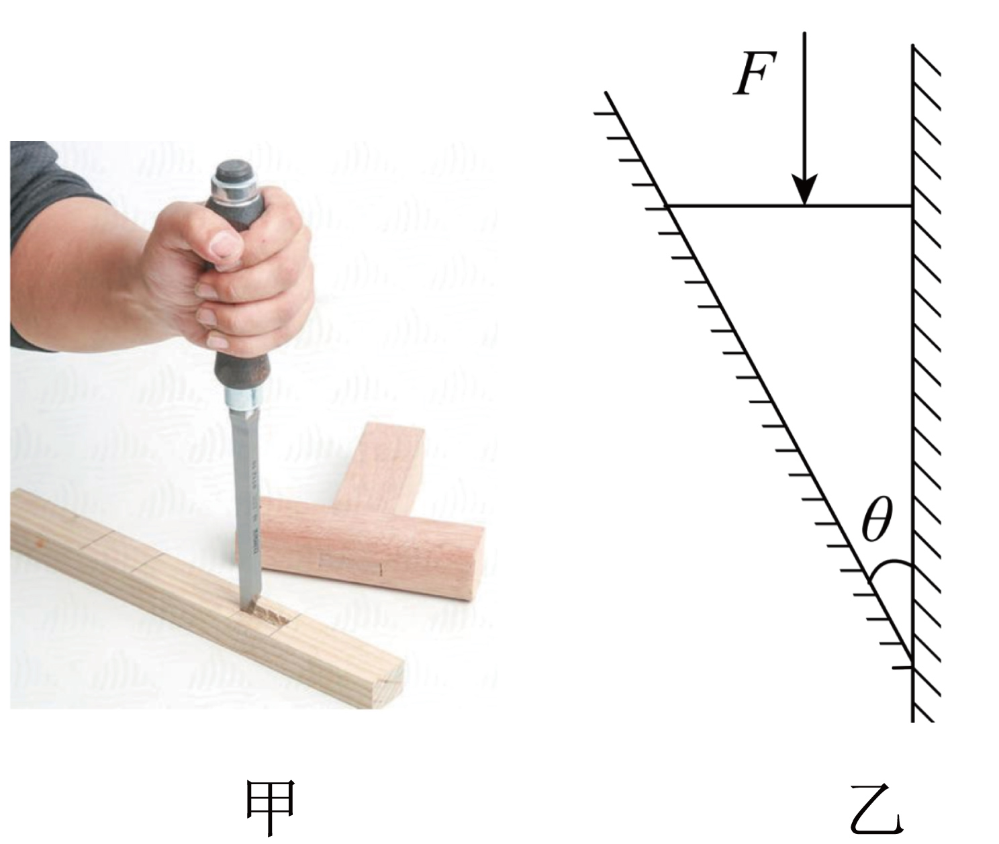
> > [!opts1]
> > - A. $F_1=F_2$
> > - B. 夹角 $\theta$ 越小，$F_1$ 越大
> > - C. $F_2=F\sin\theta$
> > - D. 夹角 $\theta$ 越大，凿子越容易凿入木头

###### 10
> [!ti] *高三物理三校联考第10题*
> 如图所示，长为 $L$ 的细绳吊起一个质量为 $m$ 的摆球，细绳上端固定，使摆球在水平面内做匀速圆周运动。已知重力加速度为 $g$，细绳与竖直方向的夹角为 $\theta$。下列说法正确的是（　　）
>
> %% 图位：原卷第4页，圆锥摆。 %%
>
> 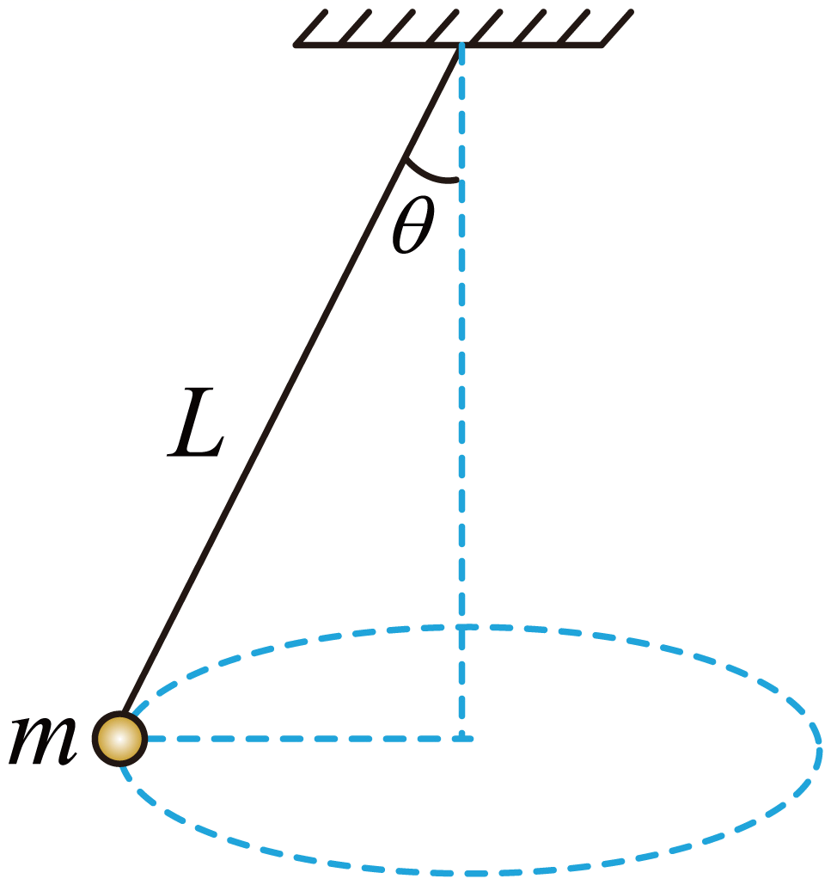
> > [!opts1]
> > - A. 摆球运动过程中，任一时刻重力的功率为 $mg\sqrt{gL\sin\theta\cos\theta}$
> > - B. 摆球运动半周的过程，合力的平均功率为 $2mgL\sin\theta\tan\theta$
> > - C. 摆球运动一周，拉力的冲量大小为 $2\pi m\sqrt{gL\cos\theta}$
> > - D. 摆球运动半周，动量变化量为0

###### 11
> [!ti] *高三物理三校联考第11题*
> 如图所示，“羲和号”探日卫星绕太阳做圆周运动，轨道1半径为 $r$。调整轨道以后，卫星的轨道变为图中虚线椭圆轨道2，远日点仍为 $P$，近日点为 $Q$，$Q$ 到太阳的距离为 $r_1$。下列说法正确的是（　　）
>
> %% 图位：原卷第4页，圆轨道和椭圆轨道。 %%
>
> 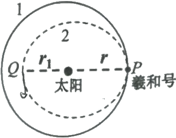
> > [!opts1]
> > - A. 变轨后卫星绕太阳运行的周期可能不变
> > - B. 变轨前卫星与太阳连线相同时间内扫过的面积与变轨后的相等
> > - C. 变轨前和变轨后卫星在 $P$ 点加速度相同
> > - D. 变轨后卫星经过 $Q$ 点的速度比变轨前的运行速度小

###### 12
> [!ti] *高三物理三校联考第12题*
> 将质量为 $m$ 的小球在距地面高度为 $h$ 处抛出，抛出时的速度大小为 $v_0$，小球落到地面时的速度大小为 $2v_0$。若小球受到的空气阻力不能忽略，则对于小球下落的整个过程，下面说法中正确的是
> > [!opts1]
> > - A. 小球重力势能增加了 $mgh$
> > - B. 合外力对小球做的功小于 $3mv_0^2/2$
> > - C. 物体的机械能减少了 $3mv_0^2/2$
> > - D. 克服空气阻力做的功等于 $mgh-3mv_0^2/2$

###### 13
> [!ti] *高三物理三校联考第13题*
> 如图甲，一质量为 $m$ 的物块A与轻质弹簧连接，静止在光滑水平面上。物块B以某一速度向A运动，$t=0$ 时刻物块B与弹簧接触，$t=2t_0$ 时刻与弹簧分离。物块A、B运动的 $v-t$ 图像如图乙所示。已知从 $t=0$ 到 $t=t_0$ 时间内，物块A运动的距离为 $0.32v_0t_0$，弹簧始终处于弹性限度内。下列说法正确的是（　　）
>
> %% 图位：原卷第5页，物块弹簧和速度图像。 %%
>
> 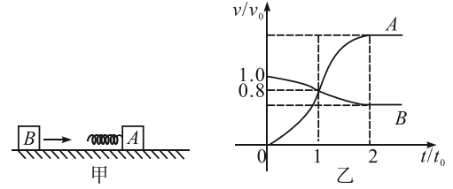
> > [!opts1]
> > - A. 物块B的质量为 $0.25m$
> > - B. 分离后物块A的速度大小为 $2v_0$
> > - C. 碰撞过程中弹簧的最大弹性势能为 $0.5mv_0^2$
> > - D. 弹簧压缩量的最大值为 $0.6v_0t_0$

###### 14
> [!ti] *高三物理三校联考第14题*
> 急动度是描述加速度变化快慢的物理量，定义式 $j=\Delta a/\Delta t$。为评估某品牌新能源汽车起步时的平稳性，一辆测试车从静止开始沿平直公路启动，车载系统在起步阶段“0～4 s”内将急动度设定为 $j=-2t+4$（$\mathrm{m\cdot s^{-3}}$）。已知 $t=0$ 时 $a_0=0$，下列关于汽车在起步阶段“0～4 s”内的说法正确的是（　　）
> > [!opts1]
> > - A. 汽车的加速度随时间均匀增加
> > - B. 汽车的加速度随时间均匀减小
> > - C. 汽车在 $t=2\,\mathrm s$ 时加速度达到最大值
> > - D. 汽车在 $t=2\,\mathrm s$ 时速度达到最大值

# 二、实验题

###### 15
> [!ti] *高三物理三校联考第15题*
> 物理实验一般都涉及实验目的、实验原理、实验仪器、实验方法、实验操作、数据分析等。例如：
>
> %% 图位：原卷第6页，游标卡尺、摆长图像和纸带。 %%
>
>
> （1）某同学用单摆测量重力加速度的大小，请读出游标卡尺的读数 ______ mm。他测量摆线的长度 $l$ 和对应的周期 $T$，得到了多组数据，作出了 $l-T^2$ 图像，如图所示。他认为根据图线可求得重力加速度 $g=4\pi^2 b/(a_2-a_1)$，则从理论上分析，他求得的重力加速度 $g$ ______ 真实值（选填“大于”“等于”或“小于”）。
>
> （2）用重锤实验验证机械能守恒定律。
>
> ① 已知重锤的质量为 $m$，使用的交流电的频率为 $f$。在电源接通之后让重锤从高处由静止开始下落，重锤上拖着的纸带通过打点计时器打出一系列的点，对纸带上的点进行测量并通过计算，就可以验证机械能守恒定律。
>
> ② 如图所示，选取纸带上打出的连续五个点 $A、B、C、D、E$，测出 $A$ 点距起始点 $O$ 的距离为 $s_0$，点 $A、C$ 间的距离为 $s_1$，点 $C、E$ 间的距离为 $s_2$，打点计时器在打 $O$ 点到 $C$ 点的这段时间内，重锤的重力势能的减少量为 ______，动能的增加量为 ______。
> 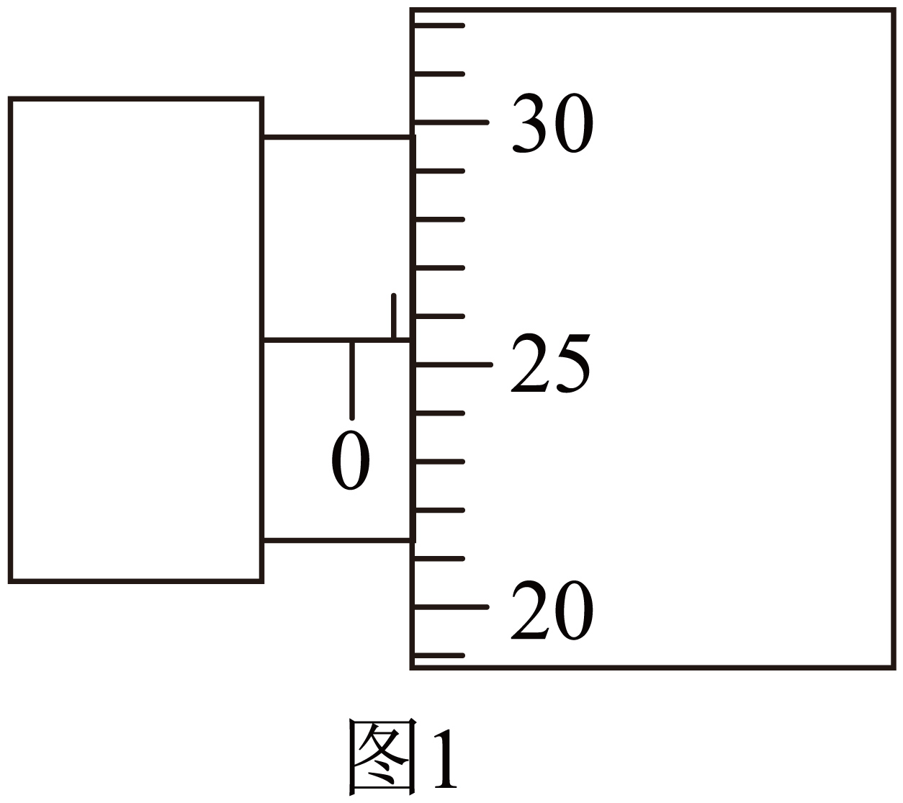

###### 16
> [!ti] *高三物理三校联考第16题*
> 如图1所示，用“碰撞实验器”可以验证动量守恒定律，即研究两个小球碰撞前后的动量关系。图1中的 $O$ 点为小球抛出点在记录纸上的垂直投影。实验时，先使A球多次从斜轨上某一位置静止释放，找到其平均落地点的位置 $P$。然后，把半径相同的B球静置于水平轨道的末端，再将A球从斜轨上该位置静止释放，与B球相碰后两球均落在水平地面上。多次重复上述过程，分别找到碰后A球和B球落点的平均位置 $M$ 和 $N$。用刻度尺测量出水平射程 $OM、OP、ON$。测得A球的质量为 $m_A$，B球的质量为 $m_B$。
>
> %% 图位：原卷第6—7页，碰撞装置及三幅落点图。 %%
>
>
> （1）实验中，通过测量小球做平抛运动的水平射程来代替小球碰撞前后的速度。
>
> ① 实验必须满足的条件有 ______。
>
> A. 两球的质量必须相等
> B. 轨道末端必须水平
> C. A球每次必须从轨道的同一位置由静止释放
>
> ② “通过测量小球做平抛运动的水平射程来代替小球碰撞前后的速度”可行的依据是 ______。
>
> A. 运动过程中，小球的机械能保持不变
> B. 平抛运动的下落高度一定，运动时间相同，水平射程与速度大小成正比
>
> （2）当满足表达式 ______ 时，即说明两球碰撞中动量守恒。如果再满足表达式 ______ 时，则说明两球的碰撞为弹性碰撞。（用所测物理量表示）
>
> （3）在上述实验中换用不同材质的小球，其他条件不变，可以改变小球的落点位置。下面图2三幅图中，可能正确的落点分布是 ______。
> 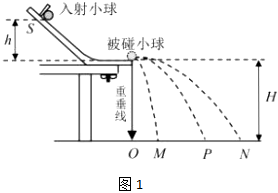

# 三、计算题

###### 17
> [!ti] *高三物理三校联考第17题*
> 如图所示，长 $L=1\,\mathrm m$ 的轻质绝缘细绳上端固定，下端连接一个可视为质点的带电小球，小球静止在水平向右的匀强电场中，绳与竖直方向的夹角 $\theta=37^\circ$。已知小球所带电荷量 $q=3.0\times10^{-7}\,\mathrm C$，匀强电场的场强 $E=2.0\times10^3\,\mathrm{N/C}$，取重力加速度 $g=10\,\mathrm{m/s^2}$，$\sin37^\circ=0.6$，$\cos37^\circ=0.8$。求：
>
> %% 图位：原卷第8页，电场中悬球。 %%
>
>
> （1）小球所受电场力 $F$ 的大小。
> （2）小球的质量 $m$。
> （3）将电场撤去，小球回到最低点时速度 $v$ 的大小。
> 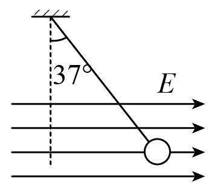

###### 18
> [!ti] *高三物理三校联考第18题*
> 如图所示，足够长的光滑水平面 $AB$ 与竖直面内的光滑半圆形导轨 $BC$ 在 $B$ 点相切，导轨半径为 $R$。一个质量为 $m$ 的物体将弹簧压缩至 $A$ 点后由静止释放，在弹力作用下物体获得某一向右速度后脱离弹簧，之后沿半圆形导轨运动，恰好能通过最高点 $C$。已知重力加速度为 $g$，求：
>
> %% 图位：原卷第8页，弹簧与半圆导轨。 %%
>
>
> （1）物块经过 $C$ 点时速度的大小 $v_C$。
> （2）物块在 $B$ 点进入圆轨道后的瞬间对轨道压力的大小 $F$。
> （3）弹簧压缩至 $A$ 点时的弹性势能 $E_p$。
> 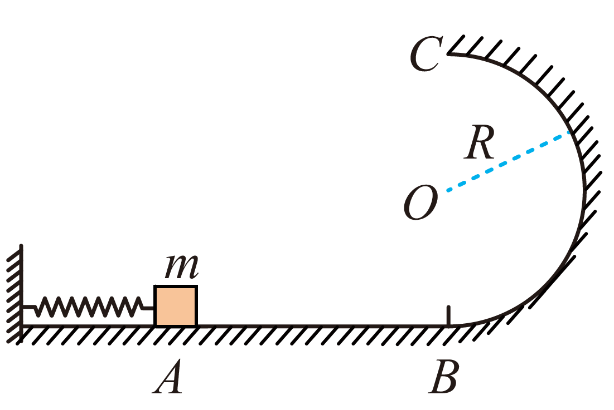

###### 19
> [!ti] *高三物理三校联考第19题*
> 研究传统弹簧式电梯反弹冲击的部分装置简化如图所示。轻弹簧下端与地面连接，上端与质量为 $m$ 的物体A拴接，平衡时弹簧的压缩量为 $x_0$。相同质量的物体B在物体A正上方 $16x_0$ 处由静止释放，两物体相碰后粘在一起并立即以相同的速度向下运动且碰撞时间极短。已知重力加速度为 $g$，弹簧弹性势能与形变量 $x$ 的关系为 $E_p=kx^2/2$（弹簧劲度系数 $k$ 未知），弹簧始终处于弹性限度内，不计空气阻力及弹簧伸缩过程中损失的机械能。求：
>
> %% 图位：原卷第9页，电梯弹簧模型。 %%
>
>
> （1）碰撞前瞬间物体B的速度大小。
> （2）物体A、B碰撞过程中损失的机械能 $\Delta E$ 和AB运动过程中最大压缩量 $x_m$。
> （3）请判断AB碰撞后的运动类型，并说明理由。
> 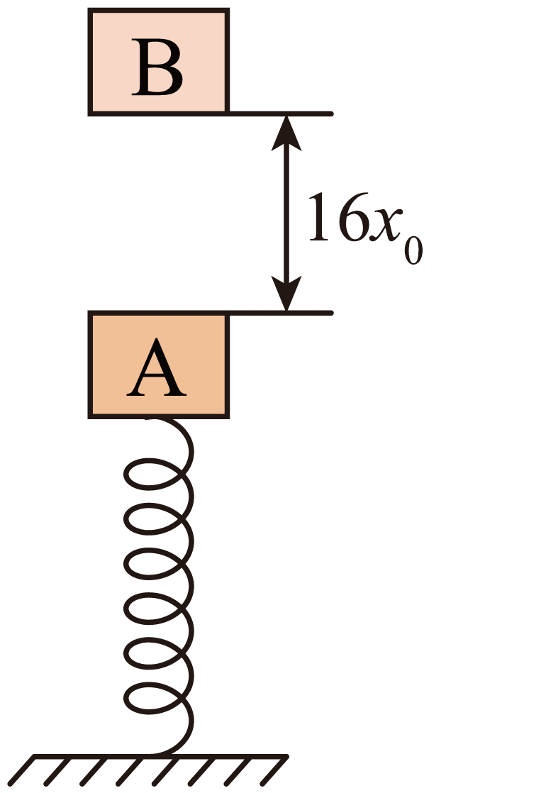

###### 20
> [!ti] *高三物理三校联考第20题*
> 利用物理模型对复杂现象进行分析，是重要的科学思维方法。已知太阳的质量为 $M$，半径为 $R$，万有引力常量为 $G$。
>
> %% 图位：原卷第10页，太阳与彗尾尘埃轨迹。 %%
>
>
> （1）太阳的外层大气不断向四周膨胀，形成由太阳径向向外的粒子流，通常被称为太阳风。关于太阳风的成因，一种观点认为：由于太阳外层温度高，粒子的动能较大，能够克服太阳的引力向外层空间运动。
>
> ① 已知质量为 $m$ 的粒子与太阳中心相距 $r$ 时具有的引力势能为 $E_p=-GMm/r$（以无穷远处势能为零）。忽略粒子间的相互作用。求在距离太阳中心 $2R$ 处、质量为 $m$ 的粒子，为了脱离太阳引力的束缚所需的最小速率 $v_{\min}$。
>
> ② 太阳风会造成太阳质量的损失。已知太阳风粒子的平均质量为 $m$，探测器在距离太阳 $r$ 处，探测到该处单位体积内太阳风粒子的数目为 $n$，太阳风粒子在探测器周围的平均速率为 $v$。求单位时间内太阳因太阳风而损失的质量 $\Delta m$。
>
> （2）彗星的彗尾主要由尘埃粒子和气体组成。一种观点认为：太阳光辐射的压力和太阳的引力，对彗尾尘埃粒子的运动起关键作用。假定太阳光的辐射功率 $P_0$ 恒定，尘埃粒子可视为密度相同、半径不都相等的实心球体，辐射到粒子上的太阳光被全部吸收，太阳光的能量 $E$、动量 $p$、光速 $c$ 的关系为 $p=E/c$。如图所示，当彗星运动到 $A$ 处，部分尘埃粒子被释放出来，不再沿彗星轨道运动。已知沿轨道切线方向释放的三个尘埃粒子，分别沿直线 $Ab$ 和曲线 $Aa、Ac$ 运动。关于造成这三个尘埃粒子轨迹分开的原因，有同学认为是它们被释放出来时的速度大小不同所致。请判断该同学的结论是否正确，并通过分析讨论来说明。
> 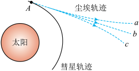

