# 北京市第一七一中学2025—2026学年度第一学期高二年级物理科目十月月考试题 #h0
时长：90分钟　总分值：100分

## 一、单项选择题（共10题，每题3分，共30分）

###### 1

> [!ti] *2014~2015学年北京海淀区北京市中关村中学高二上学期期中第2题*
> 下列关于电场强度的叙述正确的是（　　）
> > [!opts1]
> > - A. 电场中某点的场强与该点检验电荷所受的电场力成正比
> > - B. 电场中某点的场强与该点检验电荷的电荷量成反比
> > - C. 电场中某点的场强方向就是检验电荷在该点所受电场力的方向
> > - D. 电场中某点的场强在数值上等于单位电荷受到的电场力

###### 2

> [!ti] *例题第2题*
> 如图所示，电场中有 $A$、$B$ 两点，下列说法正确的是（　　）
> %% 图位：原卷第1页，第2题电场线图。 %%
> 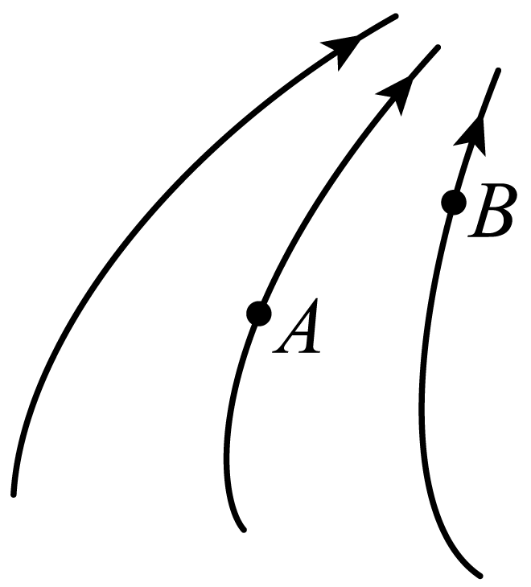
> > [!opts1]
> > - A. 电势 $\varphi_B>\varphi_A$（【待核：不等号被笔迹遮挡】）
> > - B. 电场强度 $E_A<E_B$
> > - C. 同一电荷在 $A$ 点受力较大
> > - D. 同一电荷在 $A$ 点具有的电势能较大

###### 3

> [!ti] *例题第3题*
> 关于电容器，下列说法正确的是（　　）
> > [!opts1]
> > - A. 电容器的带电量 $Q$ 为两极板所带电荷量的总和
> > - B. 两个相互靠近又彼此绝缘的导体就构成一个电容器
> > - C. 由 $C=\dfrac QU$ 可知，一只电容器的带电量越大，它的电容就越大
> > - D. 由 $C=\dfrac QU$ 可知，一只电容器两端电压越小，它的电容就越大

###### 4

> [!ti] *2024~2025学年北京东城区北京市第五中学高二上学期期中第7题3分*
> 导体棒原来不带电，现将一个电荷量为 $+q$ 的点电荷放在棒的中心轴线上，它距离导体棒的中点 $O$ 为 $L$，如图。静电力常量为 $k$，当导体棒达到静电平衡后，下列说法不正确的是（　　）
> %% 图位：原卷第1页，第4题导体棒与点电荷图。 %%
> 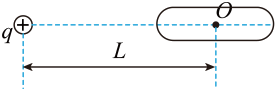
> > [!opts1]
> > - A. 棒上感应电荷只分布在其表面
> > - B. 棒左、右两端的电势相等
> > - C. 点电荷在 $O$ 点产生的电场强度为0
> > - D. 棒上感应电荷在 $O$ 点产生的电场强度大小为 $\dfrac{kq}{L^2}$

###### 5

> [!ti] *例题第5题*
> 某电场中电场线如图中实线，一电子仅在电场力作用下由 $a$ 运动到 $b$ 点，则（　　）
> %% 图位：原卷第2页，第5题电场线与电子轨迹图。 %%
> 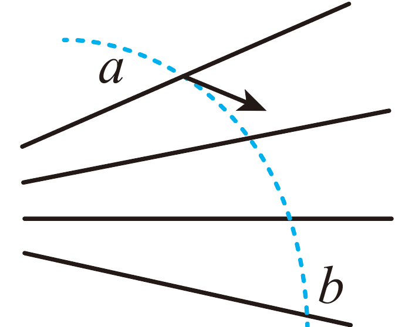
> > [!opts1]
> > - A. 电子在 $a$ 点的加速度小于它在 $b$ 点的加速度
> > - B. 电子在 $a$ 点的动能小于它在 $b$ 点的动能
> > - C. 电子在 $a$ 点的电势能小于它在 $b$ 点的电势能
> > - D. $a$ 点的电势低于 $b$ 点的电势

###### 6

> [!ti] *例题第6题*
> 下列关于教科书上的四幅插图，说法正确的是（　　）
> %% 图位：原卷第2页，第6题甲、乙、丙、丁四幅插图。 %%
> 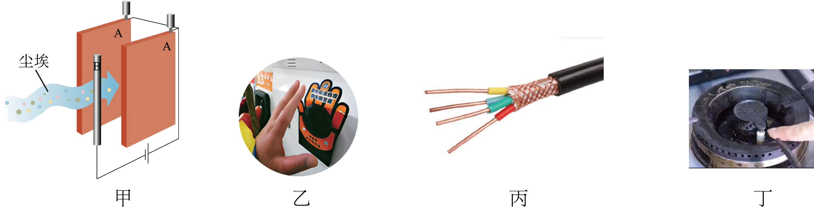
> > [!opts1]
> > - A. 图甲为静电除尘装置的示意图，应用了静电屏蔽的原理
> > - B. 图乙为给汽车加油前要触摸一下的静电释放器，是为了增加手上的静电
> > - C. 图丙中，导线外面包裹着金属外衣是为了增加导线的强度
> > - D. 图丁的燃气灶中安装了电子点火器，应用了尖端放电的原理

###### 7

> [!ti] *例题第7题*
> 具有质量的两物体之间存在万有引力的作用，类比电场可知在具有质量的物体周围存在着由该物体产生的“引力场”。仿照电场强度 $E$ 和电势 $\varphi$ 的定义，也可以定义它的物理量：“引力场强度”和“引力势”。下列说法正确的是（　　）
> > [!opts1]
> > - A. “引力势”和电势的国际单位均为伏特（V）
> > - B. 若某物体在 $A$ 点的引力势能大于在 $B$ 点的引力势能，则 $A$ 点“引力势”一定大于 $B$ 点“引力势”
> > - C. 地球周围空间不同位置的“引力场强度”相同
> > - D. 对于“地—月”空间的引力场，存在一个引力场强度为0的位置，且该位置“引力势”最低

###### 8

> [!ti] *2017~2018学年北京西城区北京市第八中学高二上学期期中第10题3分*
> 如图，在光滑绝缘水平面上，两个带等量正电的点电荷分别固定在 $A$、$B$ 两点，$O$ 为 $AB$ 连线的中点，$MN$ 为 $AB$ 的垂直平分线，在 $MN$ 之间的 $C$ 点由静止释放一个带负电的小球（可视为质点），若不计空气阻力，则（　　）
> %% 图位：原卷第2页，第8题点电荷及垂直平分线图。 %%
> 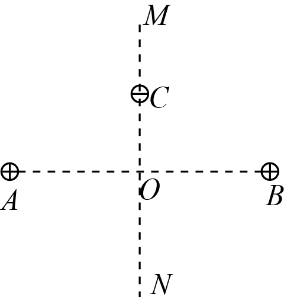
> > [!opts1]
> > - A. 小球从 $C$ 点沿直线 $MN$ 向 $N$ 端运动，先做匀加速运动，后做匀减速运动
> > - B. 小球从 $C$ 点运动至距离该点最远位置的过程中，其所经过各点的电势先降低后升高
> > - C. 小球从 $C$ 点运动至距离该点最远位置的过程中，其电势能先减小后增大
> > - D. 若在某个小球运动过程中，两个点电荷所带电荷量同时等量地缓慢增大，则小球往复运动过程中的振幅将不断增大

###### 9

> [!ti] *2025~2026学年北京海淀区北京理工大学附属中学高二上学期期中（等级考）第14题*
> 如图甲所示，直线加速器由多个横截面积相同的金属圆筒依次排列，其中心轴线在同一直线上。圆筒的长度依照一定的规律依次增加，序号为奇数的圆筒和交变电源的一个极相连，序号为偶数的圆筒和该电源的另一个极相连。交变电源两极间电势差的变化规律如图乙所示。某时刻位于序号为0的金属圆筒中心的粒子由静止开始加速，沿中心轴线进入圆筒1。粒子运动到圆筒与圆筒之间各个间隙中都恰好使静电力的方向跟运动方向相同而不断加速。已知电压的绝对值为 $U_0$（周期为 $T$），粒子的比荷为 $k$，粒子通过圆筒间隙的时间可以忽略不计。只考虑静电力的作用，则（　　）
> %% 图位：原卷第3页，第9题甲直线加速器图、乙交变电压图。 %%
> 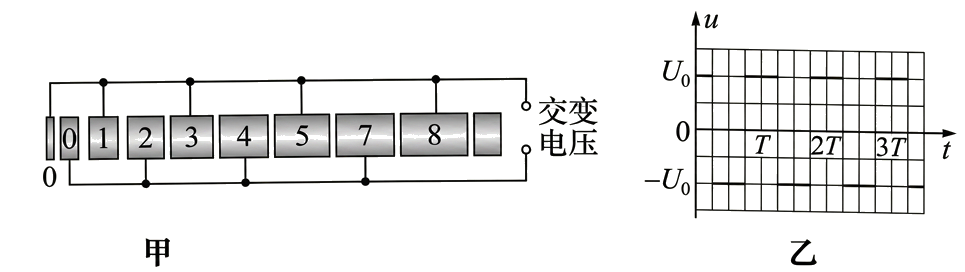
> > [!opts1]
> > - A. 粒子在金属圆筒内始终做匀加速直线运动
> > - B. 粒子在各个金属圆筒内运动的时间均为 $T$
> > - C. 粒子刚进入第8个圆筒时的速度大小为 $4\sqrt{kU_0}$
> > - D. 第8个圆筒的长度为 $4T\sqrt{kU_0}$

###### 10

> [!ti] *2025~2026学年12月北京石景山区北京市第九中学高三上学期月考第11题*
> 真空中存在沿 $y$ 轴正方向的匀强电场，带电粒子 $a$ 和 $b$ 先后从坐标原点 $O$ 沿 $x$ 轴正方向射入该电场，其轨迹如图所示。忽略粒子所受重力，下列条件中可以确定粒子 $a$ 比荷较大的是（　　）
> %% 图位：原卷第3页，第10题粒子运动轨迹图。 %%
> 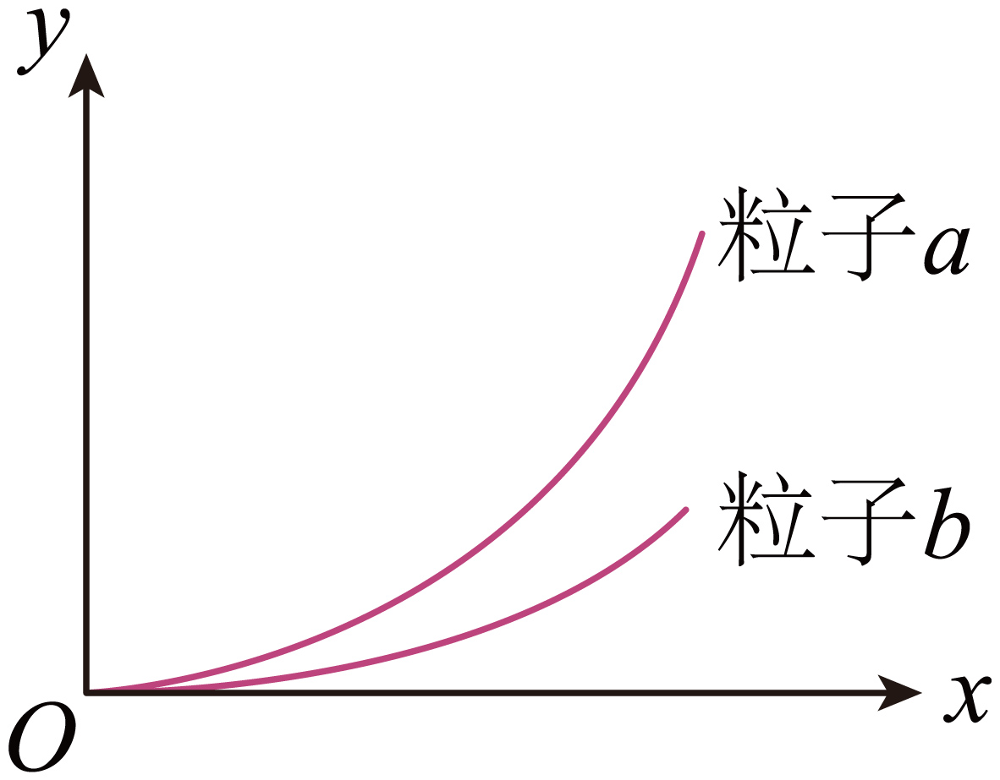
> > [!opts1]
> > - A. 粒子 $a$ 和 $b$ 在电场中的加速度相等
> > - B. 粒子 $a$ 和 $b$ 射入电场时的速度相等
> > - C. 粒子 $a$ 和 $b$ 射入电场时的动能相等
> > - D. 粒子 $a$ 和 $b$ 射入电场时的动量相等

## 二、多项选择（每题4分，共16分）

###### 11

> [!ti] *例题第11题*
> 如图所示，在带电体 $C$ 的右侧有两个原来不带电的、相互接触的金属导体 $A$ 和 $B$，$A$、$B$、$C$ 均放在绝缘支座上。由于静电感应，导体 $A$、$B$ 均带电。下列说法正确的是（　　）
> %% 图位：原卷第4页，第11题静电感应图。 %%
> 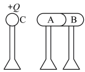
> > [!opts1]
> > - A. 如图所示状态中，导体 $A$ 带负电，$B$ 带正电
> > - B. 在图示状态下移走带电体 $C$，导体 $A$ 带负电，$B$ 带正电
> > - C. 无论是移走带电体 $C$ 还是将导体 $A$、$B$ 分开，导体 $A$、$B$ 上的总电荷量始终为零
> > - D. 在图示状态下将导体 $A$、$B$ 分开，分开后 $A$、$B$ 仍带电，该过程创造了电荷

###### 12

> [!ti] *2024~2025学年10月北京西城区北京市育才学校高二上学期月考第7题*
> 如图所示为研究影响平行板电容器电容大小因素的实验装置。设两极板的正对面积为 $S$，极板间的距离为 $d$，静电计指针偏角为 $\theta$，平行板电容器的电容为 $C$。实验中极板所带电荷量可视为不变，则下列关于实验的分析正确的是（　　）
> %% 图位：原卷第4页，第12题电容器与静电计装置图。 %%
> 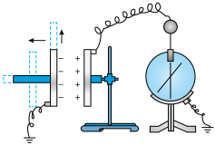
> > [!opts1]
> > - A. 保持 $d$ 不变，减小 $S$，则 $C$ 变小，$\theta$ 变大
> > - B. 保持 $d$ 不变，减小 $S$，则 $C$ 变大，$\theta$ 变大
> > - C. 保持 $S$ 不变，增大 $d$，则 $C$ 变小，$\theta$ 变大
> > - D. 保持 $S$ 不变，增大 $d$，则 $C$ 变大，$\theta$ 变大

###### 13

> [!ti] *2024~2025学年北京顺义区顺义区第一中学高二上学期期末第16题*
> 如图所示，两个等量异种点电荷分别位于 $M$、$N$ 两点，$P$、$Q$ 是 $MN$ 连线上的两点，且 $MP=QN$。下列说法正确的是（　　）
> %% 图位：原卷第4页，第13题等量异种点电荷图。 %%
> 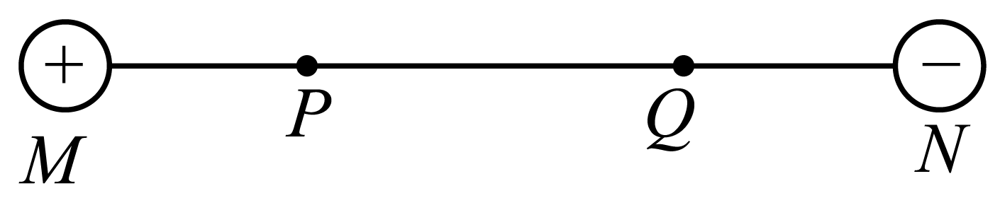
> > [!opts1]
> > - A. $P$ 点电场强度与 $Q$ 点电场强度相同
> > - B. $P$ 点电势比 $Q$ 点电势高
> > - C. 若两点电荷的电荷量均变为原来的2倍，$P$ 点电场强度大小也变为原来的2倍
> > - D. 若两点电荷的电荷量均变为原来的2倍，$P$、$Q$ 两点间电势差不变

###### 14

> [!ti] *例题第14题*
> 空间中一静电场的某物理量在 $x$ 轴上的分布情况如图所示，其中 $OA=OB$，则（　　）
> %% 图位：原卷第4页，第14题物理量随x变化图。 %%
> 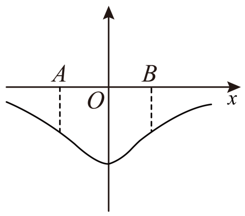
> > [!opts1]
> > - A. 若为 $E-x$ 图像，则 $\varphi_A<\varphi_B$
> > - B. 若为 $E-x$ 图像，则将一电子由 $A$ 沿 $x$ 轴移向 $B$，电场力先做负功再做正功
> > - C. 若为 $\varphi-x$ 图像，则 $E_A$、$E_B$ 相同
> > - D. 若为 $\varphi-x$ 图像，在 $A$ 自由释放一质子，仅在电场力作用下运动到 $B$，加速度先变小后增大

## 三、实验题（共14分）

###### 15

> [!ti] *例题第15题*
> 如图甲是观察电容器的充、放电现象的实验装置。电源输出电压恒为 $6\,\mathrm V$，$S$ 是单刀双掷开关，$G$ 为灵敏电流计，$C$ 为平行板电容器。
>
> %% 图位：原卷第5页，第15题甲电路图、乙放电曲线、丙三条放电曲线。 %%
>
> （1）当开关 $S$ 接________（选填“1”或“2”）时，平行板电容器放电；电容器充电时，流经灵敏电流计的电流方向与放电时________（选填“相同”或“相反”）。
>
> （2）将灵敏电流计换成电流传感器，并和计算机相连，电容器充电完毕后再放电，其放电电流随时间变化图像如图乙所示。已知图像与坐标轴所围的面积约为42个方格，可算出电容器的电容约为________$\mathrm F$（结果保留2位有效数字）。
>
> （3）换用不同阻值的电阻放电，在图丙中放电电流的 $I-t$ 图线的 $a$、$b$、$c$ 三条曲线中，对应电阻最小的一条是________（选填“a”、“b”或“c”）。
>
> （4）电容器充电后就储存了能量。某同学在研究电容器储存的能量 $E$ 与电容器的电容 $C$、电荷量 $Q$ 及电容器两极间电压 $U$ 之间的关系时，他从等效的思想出发，认为电容器储存的能量等于把电荷从一个极板搬运到另一个极板过程中克服电场力所做的功。为此他做出电容器两极间的电压 $u$ 随电荷量 $q$ 变化的图像如图所示。按照他的想法，下列说法正确的是（　　）
>
> %% 图位：原卷第5页，第15题（4）u-q图像。 %%
> ![[Pasted image 20261014161438.png|500]]
> > [!opts1]
> > - A. $u-q$ 图线的斜率越大，电容 $C$ 越大
> > - B. 搬运 $\Delta q$ 的电量，克服电场力所做的功近似等于 $\Delta q$ 上方小矩形的面积
> > - C. 对同一电容器，电容器储存的能量 $E$ 与两极间电压 $U$ 成正比
> > - D. 若电容器电荷量为 $Q$ 时储存的能量为 $E$，则电荷量为 $Q/2$ 时储存的能量为 $E/2$

## 四、简答题（共40分）

###### 16

> [!ti] *2024~2025学年10月北京西城区北京师范大学附属实验中学高二上学期月考第17题*
> （9分）如图所示，在真空中 $A$、$B$ 两个完全相同的带正电小球（可视为质点）分别用长为 $l$ 的绝缘线系住，另一端悬挂在 $P$ 点，电荷量 $q_A=q_B=q_0$，$OP$ 为 $A$、$B$ 连线中垂线。当 $A$、$B$ 静止时，$\angle PAO=60^\circ$。已知静电力常量为 $k$，求：
>
> %% 图位：原卷第6页，第16题两悬挂带电小球图。 %%
>
> （1）轻细线拉力的大小 $F_T$；
>
> （2）$P$ 点电场强度的大小 $E_P$ 和方向；
>
> （3）若把电荷量为 $q=2.0\times10^{-7}\,\mathrm C$（$q\ll q_0$）的正试探电荷从 $P$ 点移到 $O$ 点，克服电场力做了 $1.0\times10^{-7}\,\mathrm J$ 的功，求 $P$、$O$ 两点间的电势差 $U_{PO}$。
> 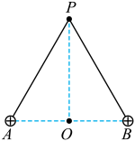

###### 17

> [!ti] *例题第17题*
> （9分）如图所示，两个带等量异种电荷的平行金属板水平放置，板间电场可视为匀强电场，一电子沿平行于板面的方向射入电场中，并从另一侧射出。已知板长为 $L$，两板间距为 $d$，板间电压为 $U$，电子的质量为 $m$，电荷量为 $e$，电子射入时的速度大小为 $v_0$，不计电子的重力，求：
>
> %% 图位：原卷第6页，第17题平行板间电子偏转图。 %%
>
> （1）电子在两极板间的加速度大小 $a$；
>
> （2）电子射出电场时沿垂直于板面方向偏移的距离 $y$；
>
> （3）电子在板间运动的过程中电场力对电子所做的功 $W$。
> 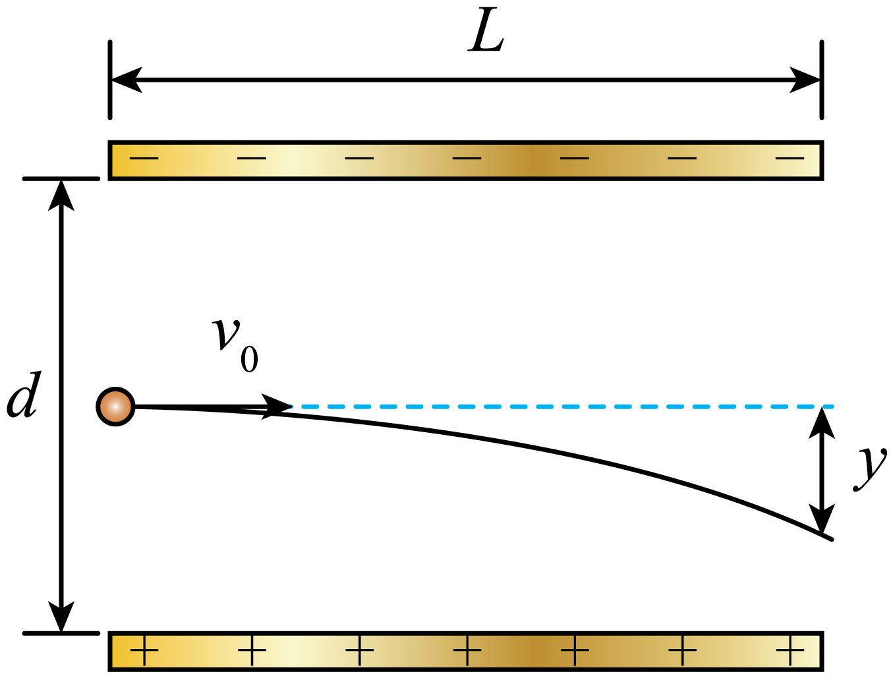

###### 18

> [!ti] *例题第18题*
> （10分）如图所示，匀强电场（范围足够大）的方向水平向左，用一长为 $L$ 的不可伸长的绝缘轻绳将一质量为 $m$、电荷量为 $-q$（$q>0$）的带电小球悬挂于 $O$ 点，平衡时小球静止于 $A$ 点，此时轻绳与竖直方向夹角 $\theta=37^\circ$，$B$ 点在 $O$ 点的正下方。现把小球拉到 $O$ 点正右方的 $C$ 处，此时轻绳恰好处于伸直状态，将小球由初速度零释放。不计空气阻力，带电小球可以视为质点，重力加速度为 $g$，$\sin37^\circ=0.6$，求：
>
> %% 图位：原卷第7页，第18题带电摆球图。 %%
>
> （1）匀强电场的电场强度大小；
>
> （2）轻绳的最大拉力大小；
>
> （3）小球运动到 $B$ 点时剪断轻绳，在以后的运动过程中，小球运动到 $P$ 点（图中未画出）时速度会有一个最小值，则小球从 $B$ 点运动到 $P$ 点的时间是多少？
> 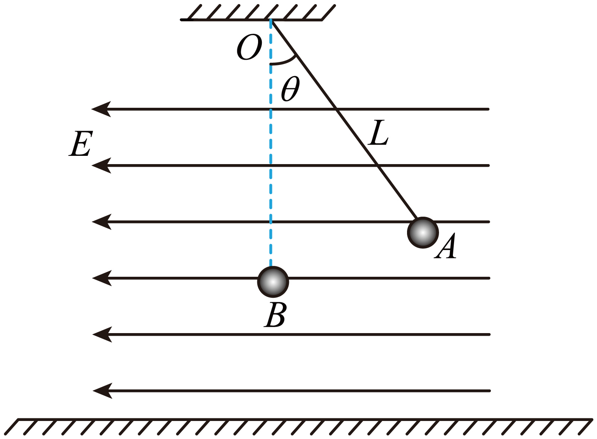

###### 19

> [!ti] *2026年北京海淀区北京大学附属中学高三三模第20题*
> （12分）用静电的方法来清除空气中的灰尘，需要首先设法使空气中的灰尘带上一定的电荷，然后利用电场对电荷的作用力，使灰尘运动到指定的区域进行收集。
>
> %% 图位：原卷第8页，第19题甲上下极板、乙圆筒电极及同心轨道图。 %%
>
> （1）为简化计算，可以认为每个灰尘颗粒的质量及其所带电荷量均相同，设每个灰尘所带电荷量为 $q$，其所受空气阻力与其速度大小成正比，表达式为 $F=kv$，式中 $k$ 为大于0的已知常量。由于灰尘颗粒的质量较小，为简化计算，灰尘颗粒在空气中受电场力作用后达到电场力与空气阻力相等的过程所用的时间及通过的位移均忽略不计，同时也不计灰尘颗粒之间的作用以及灰尘所受重力的影响。
>
> 有一种静电除尘的设计方案是这样的：需要除尘的空间是一个高为 $H$ 的绝缘圆筒形容器的内部区域，将一对与圆筒半径相等的圆形薄金属板水平放置于圆筒的上、下两端，恰好能将圆筒封闭，如图甲所示。在圆筒上、下两金属板间加恒定的电压 $U$（圆筒内空间的电场可视为匀强电场），便可以在一定时间内将圆筒区域内的带电灰尘颗粒完全吸附在金属板上，从而达到除尘的作用。求灰尘颗粒运动时达到的最大速率 $v_m$。
>
> （2）如图所示，真空中某静电除尘装置的金属圆筒 $A$ 接高压电源的正极，其轴线上的金属线 $B$ 接负极（$A$ 和 $B$ 的高度远大于 $A$ 的直径）。
>
> 已知筒内距离轴线 $r$ 处的电场强度大小 $E=k\dfrac{2\lambda}{r}$，式中 $k$ 为静电力常量，$\lambda$ 为金属线 $B$ 单位长度的电荷的电荷量。
>
> ① 如图所示，忽略重力，忽略微粒之间的相互作用力的三个带正电微粒，电荷量均为 $q$，质量均为 $m$，在圆筒内某横截面上分别绕轴线做半径不同的匀速圆周运动，其半径为 $r_1$、$r_2$ 和 $r_3$（$r_1<r_2<r_3$），它们的动能分别为 $E_{k1}$、$E_{k2}$、$E_{k3}$，电势能分别为 $E_{p1}$、$E_{p2}$、$E_{p3}$，总能量分别为 $E_1$、$E_2$、$E_3$。若 $r_3-r_2=r_2-r_1$，试分析比较三个粒子的总能量差值 $(E_3-E_2)$ 与 $(E_2-E_1)$ 的大小。
>
> ② 实际进行除尘工作时，筒内距离轴线 $r$ 处的电场强度大小仍然为 $E=k\dfrac{2\lambda}{r}$，但由于金属筒内充满空气，微粒会受到空气阻力，经过计算微粒所受重力可以忽略。空气阻力与其速度大小成正比，即 $f=Av$，$A$ 是一个确定的值并且符合 $f=Av$ 所要求的单位。已知在微粒运动过程中，当微粒速度改变时空气阻力也随即改变，并能随时迅速与所受电场力等大反向。现在分析一个带电量 $q$（$q$ 表示带电量的绝对值）、质量 $m$ 的微粒从轴线附近 $r_1$ 向直线的外侧运动，试求出微粒从 $r_1$ 处运动到 $r_2$ 处的时间。
> 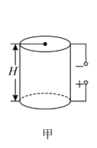

